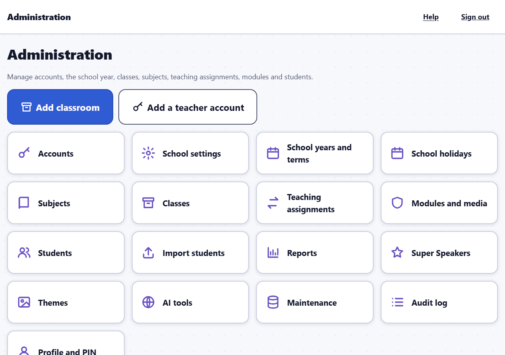
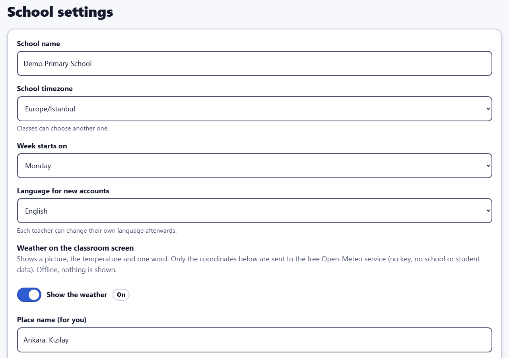
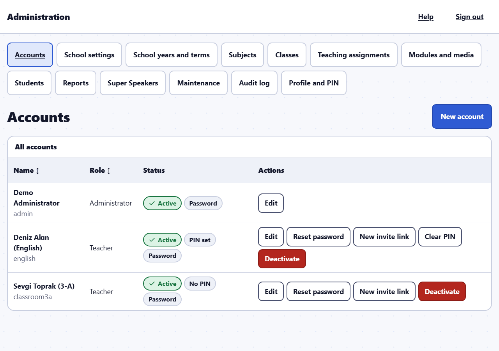
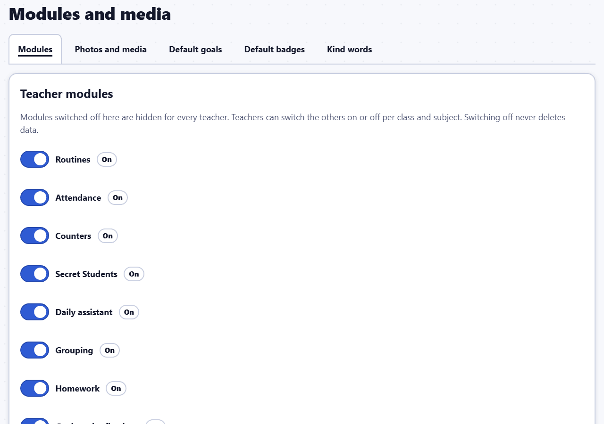
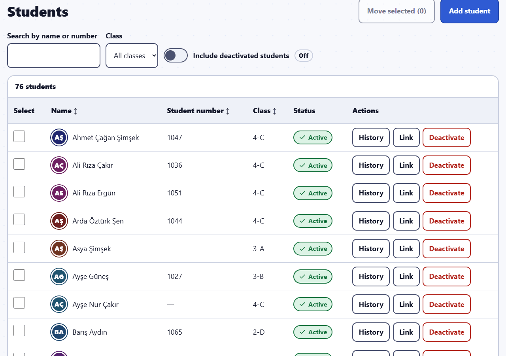
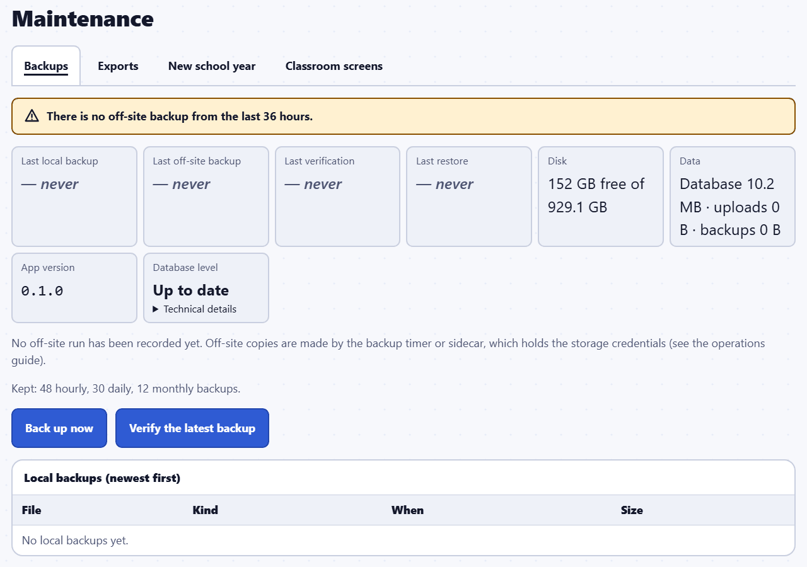

# Administrator guide

This guide is for the school's Class Compass administrators: the people who set up the school, create accounts, look after student records and keep the data safe. The server itself (installation, email settings, backups on disk, restore) is described for the IT person in `docs/OPERATIONS.md` in the Class Compass repository; this guide points there where needed.

The pictures come from the fictional demo school. Every name in them is invented.

In a hurry? See the [quick start for administrators](quick-start-admin.md).

## The administration area

After you sign in you land on **Administration**. **Add classroom** and **Add a teacher account** are the two most common jobs; the tiles and the menu bar open every section. **Help** (top bar) opens these guides.

Administrator accounts always sign in with a **password** (never with email links). Classroom mode and its PIN lock are for teacher accounts only, so an administrator account is never PIN-locked: do not sign in as an administrator on the classroom device.

## First setup

The very first administrator account is created on the server by the IT person (`admin:create`, see `docs/OPERATIONS.md`); there is no web registration and no default password. Then, in this order:

1. **School settings**: **School name**, **School timezone** (for example Europe/Istanbul), **Week starts on**, **Language for new accounts** and the weather (below).
2. **School years and terms**: **New school year** with its dates, then **Add term** for each term. Terms are calendar settings only.
3. **Subjects**: **New subject** with a name in English and/or Turkish. Teachers see the name in their own language when both are given.
4. **Classes**: **Add classroom** / **New class**: **Class name** (for example 3-A), **School year**, **Grade**, **Theme**, **Timezone** (empty = the school timezone), **Sounds** and **Animations**, and the class language.
5. **Accounts**: create the teacher accounts (below).
6. **Teaching assignments**: **Assign a teacher** to a class and a subject. *A teacher sees a class only when they teach a subject in it.*
7. **Students**: teachers usually import their class lists themselves (Teacher guide, "Importing a student list"); you can also **Add student** on **Students**.
8. **Modules and media**: decide what the school uses.

## Accounts and invites

**New account**: **Username** (3–64 letters, digits or . _ @ -), **Name**, **Email (optional)**, **Role** (Teacher or Administrator) and **Interface language** (the language the person sees after signing in; they can change it in their profile). Then choose the **First sign-in**:

- **Invite link (recommended)**: a single-use link valid for 7 days. The person chooses a password or email sign-in links (administrators always a password); teachers then set their classroom PIN. When the account has an email address and the school has set up email, the invite is emailed in the account's language; you can always **Copy link** or show the QR code.
- **Temporary password**: shown to you **once**. Give it to the person safely; they must change it at their first sign-in.

The list shows each account's status (**Active** / **Deactivated**), whether a PIN is set, **Must change password**, **Invite pending** and the sign-in method. Actions:

- **Reset password**: a new temporary password; the person is signed out everywhere. For an account that uses email links, this switches it back to a password.
- **Clear PIN**: when a teacher forgot their PIN. They are signed out on every device and set a new PIN.
- **New invite link** / **Revoke invite**.
- **Deactivate** / **Reactivate**: a deactivated person cannot sign in; their records stay. You cannot deactivate yourself, and at least one active administrator must remain.
- **Edit**: name, email, interface language. Changing the email revokes open invites and sign-in links.

## Email (SMTP)

Class Compass sends email for invites, email sign-in links and password resets. Email is configured by the IT person on the server, not in the browser: `SMTP_HOST`, `SMTP_PORT`, `SMTP_USER`, `SMTP_PASS` and `SMTP_FROM` in the server's settings file (see `docs/OPERATIONS.md`).

- **Port 465** uses implicit TLS; **port 587** (the default) must offer STARTTLS. Class Compass never sends email without encryption and checks the mail server's certificate, so a relay without TLS will not work.
- **School settings** shows whether email works: "Password reset by email is available" or "Password reset by email is off (no email server configured)".
- **Without email**, accounts that sign in with email links **cannot sign in**. **Maintenance** warns about them; give them a temporary password (**Reset password**) or a new invite link.

## School year and new-year rollover

**School years and terms**: edit dates and terms, and **Archive** a year. An archived year is read-only: nothing in it can change until it is unarchived; its reports stay available.

At the end of the year use **Maintenance** → **New school year**:

1. **From the year**, the **New year's name**, **First day** and **Last day** (YYYY-MM-DD).
2. Choose: **Create the classes again (grade + 1)**, **Keep the same teachers and subjects**, **Move the students up on the first day**, **Archive the old year (read-only)**.
3. **Preview**. Each class can be switched off (for example a final grade that graduates: it is not created again and nobody moves up from it) and new names can be changed. After any change, **Preview again**.
4. **Start the new year**: type the old year's name to confirm. Everything happens at once and is recorded in the audit log. History stays with the students.

Single classes can also be moved with **Classes** → **Promote class**.

## Classes and teaching assignments

**Classes**: **New class**, **Edit class** (name, grade, theme, timezone, sounds, animations, class language and student page language), **Archive** (read-only; can be unarchived) and **Promote class** (moves every current student into a class of another school year; create that class first).

**Teaching assignments**: **Assign a teacher** (teacher, class, subject). **End assignment** when a teacher stops teaching a class: they no longer see it, their lesson records stay, and their reports cover only the days they taught. **Show ended assignments** lists old ones.

## Modules and media

- **Teacher modules**: modules switched off here are hidden for every teacher. Teachers switch the others on or off per class and subject.
- **School-wide modules**: **Super Speakers** (off by default). See the [Super Speakers guide](super-speakers.md).
- **Photos, audio and documents**: **Student photos**, **Photo evidence** and **Audio evidence** stay **off until consent is confirmed**. Turn them on only after the school has confirmed consent and its KVKK position. **Document evidence** (text, links and documents) is on by default and can be switched off.
- **Default goal categories and goals**: **Archive** removes a default category or goal from every class (goals students already have are kept); **Restore** brings it back. Teachers can also hide a default for their own classes only.
- **Default badges**: archive a built-in badge for every class, or restore it. Badges already given are kept.
- **Kind words check**: **Blocked words** and **Allowed words** for the whole school (one per line; an allowed word wins), and how long a goal must be (**Words a goal needs at least**, default 3, and **Letters a goal needs at least**, default 12).

*Turning a module off hides it but keeps all of its data.*

## Weather

**School settings** → **Weather on the classroom screen**: **Show the weather**, a **Place name** (for you) and the **Latitude** and **Longitude**. Only these coordinates are sent to the free Open-Meteo service (no key, no school or student data). The server needs internet access to api.open-meteo.com; without it, the weather simply does not appear.

## Students

**Students** lists every student of the school: **Search by name or number**, filter by class, **Include deactivated students**.

- **Add student**.
- **Move students**: tick students and **Move selected**, choose the class and an optional **Date of the move** (empty = today; a future date keeps them in their class until then). Their history moves with them.
- **History**: which classes the student was in and why (added, imported, moved, promoted).
- **Deactivate**: the student disappears from class lists; all records stay and they can be reactivated. Their personal link stops working.
- **Delete permanently**: only for a deactivated student. Class Compass shows what will be deleted (records, files and photos, history entries naming the student). This cannot be undone, and backups made before today still contain the student until they expire. Class counter and assistant totals stay correct without the name, but the student's attendance, homework marks and Super Speakers points are removed, so reports and the points history no longer count them. Free text that teachers typed elsewhere and that names the student (for example a lesson reflection) is not changed. Only a note "a student was deleted" (without a name) stays in the audit log.
- **Link**: the student's personal link (copy, print) and the **Emergency** revoke or replace (see the Teacher guide, "Student links"). For a deactivated student the link does not work and only revoke is offered.

## Reports and audit log

**Reports**: the **School-wide usage** report (counts per class, subject and teacher, no student data) and every class and subject report. Teachers' own lesson reflection notes are not shown to administrators. Every table has a **CSV** download and every download is recorded.

**Audit log**: who changed what and when. Passwords, PINs and secret selections are never shown there.

## Exports

**Maintenance** → **Exports**:

- **Full school export**: a ZIP file with one spreadsheet (CSV) per table, optionally the uploaded files (**Include uploaded files**), and a manifest. Type `EXPORT` to prepare it. It contains every student's data **and the teachers' private notes**: keep it safe and share it only as the school's data protection rules allow. Never included: passwords, PINs, sign-in data, student link codes, pairing codes and Secret Students who were never revealed.
- **One student's data (KVKK request)**: choose the student and **Prepare export**. Everything recorded about that student, with their files. Private teacher notes stay with their author; the export says how many exist.

An export can be downloaded **once**, within one hour, only by you; then it is deleted. Preparing and downloading are recorded in the audit log.

## Backups and restore

**Maintenance** → **Backups** shows the **Last local backup**, **Last off-site backup**, **Last verification** and **Last restore**, disk usage, the data size, the app version and the database level, and the list of local backups. Warnings appear here when the last backup failed, when there is no recent off-site copy, when database updates are waiting for a restart, or when email-link accounts cannot sign in.

**Back up now** and **Verify the latest backup** ask for your PIN and are recorded. At the moment the PIN form in **Profile** is offered on teacher accounts only, so an administrator account without a PIN cannot use these two buttons; the scheduled backups on the server do not depend on them.

Backups are made automatically on the server (hourly local copies and a nightly off-site copy, as set up by the IT person). **Restoring a backup is done on the server, not in the browser**: the app must be stopped first. The step-by-step procedure, the off-site copies and the restore drill are in `docs/OPERATIONS.md` ("Backups", "Restore").

## Maintenance page in short

- **Backups**: status, warnings, **Back up now**, **Verify the latest backup**, the backup list.
- **Exports**: full school export and one student's data.
- **New school year**: the rollover.

## Getting help

**Help** in the top bar opens these guides. Teachers have the [Teacher guide](teacher.md); the [Super Speakers guide](super-speakers.md) covers the school-wide points board.
