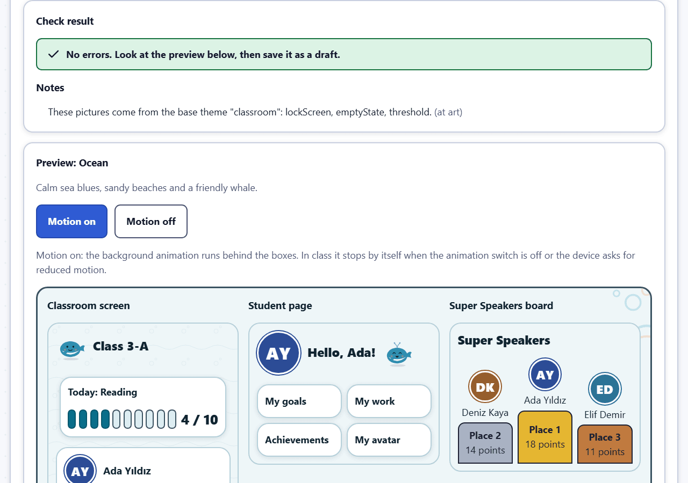

# Administrator guide

This guide is for the school's Class Compass administrators: the people who set up the school, create accounts, look after student records and keep the data safe. The server itself (installation, email settings, backups on disk, restore) is described for the IT person in `docs/OPERATIONS.md` in the Class Compass repository; this guide points there where needed.

The pictures come from the fictional demo school. Every name in them is invented.

In a hurry? See the [quick start for administrators](quick-start-admin.md).

## The administration area

After you sign in you land on **Administration**. **Add classroom** and **Add a teacher account** are the two most common jobs; the tiles open every section, and on the other pages the menu bar does (on a phone or tablet it is one **Section** list). **Help** (top bar) opens these guides. On a phone, tables show each row as a card with its buttons at the bottom.

Administrator accounts always sign in with a **password** (never with email links). Classroom mode and its PIN lock are for teacher accounts only, so an administrator account is never PIN-locked: do not sign in as an administrator on the classroom device. An administrator still sets a PIN in **Profile and PIN**: **Maintenance** asks for it before **Back up now** and **Verify the latest backup**. **Profile and PIN** also holds your **Language**, **Text size** and **Spacing** (Compact, Normal or Large: how much room tables and cards take on the administration pages; buttons keep their size).

## First setup

The very first administrator account is created on the server by the IT person (`admin:create`, see `docs/OPERATIONS.md`); there is no web registration and no default password. Then, in this order:

1. **School settings**: **School name**, **School timezone** (chosen from a list; Europe/Istanbul is first), **Week starts on**, **Language for new accounts** and the weather (below).
2. **School years and terms**: **New school year** with its dates, then **Add term** for each term. Terms are calendar settings only.
3. **Subjects**: **New subject** with a name in English and/or Turkish. Teachers see the name in their own language when both are given.
4. **Classes**: **Add classroom** / **New class**: **Class name** (for example 3-A), **School year**, **Grade** (a number, for example 3), **Theme** (**Show a larger preview of the theme** opens a bigger picture), **Timezone** (empty = the school timezone), **Sounds** and **Animations**, and the class language.
5. **Accounts**: create the teacher accounts (below).
6. **Teaching assignments**: **Assign a teacher** to a class and a subject. *A teacher sees a class only when they teach a subject in it.*
7. **Students**: fill the classes from the e-Okul lists on **Import students** (below), so teachers find their classes with the students already in. Teachers can also import lists into their own classes (Teacher guide, "Importing a student list"), and you can **Add student** on **Students**.
8. **Modules and media**: decide what the school uses.

## Accounts and invites

**New account**: **Username** (3–64 letters, digits or . _ @ -), **Name**, **Email (optional)**, **Role** (Teacher or Administrator) and **Interface language** (the language the person sees after signing in; they can change it in their profile). Then choose the **First sign-in**:

- **Invite link (recommended)**: a single-use link valid for 7 days. The person chooses a password or email sign-in links (administrators always a password); teachers then set their classroom PIN. When the account has an email address and the school has set up email, the invite is emailed in the account's language; you can always **Copy link** or show the QR code.
- **Temporary password**: shown to you **once**. Give it to the person safely; they must change it at their first sign-in.

The list shows each account's status (**Active**, **Invite pending** until the invite is used, or **Deactivated**), whether a PIN is set, **Must change password** and how the person signs in (**Sign-in: password** or **Sign-in: email links**). Actions:

- **Reset password**: a new temporary password; the person is signed out everywhere. For an account that uses email links, this switches it back to a password.
- **Clear PIN**: when someone forgot their PIN. They are signed out on every device and set a new PIN.
- **New invite link** / **Revoke invite**.
- **Deactivate** / **Reactivate**: a deactivated person cannot sign in; their records stay. You cannot deactivate yourself, and at least one active administrator must remain.
- **Edit**: name, email, interface language. Changing the email revokes open invites and sign-in links.

## Email (SMTP)

Class Compass sends email for invites, email sign-in links and password resets. Email is configured by the IT person on the server, not in the browser: `SMTP_HOST`, `SMTP_PORT`, `SMTP_USER`, `SMTP_PASS` and `SMTP_FROM` in the server's settings file (see `docs/OPERATIONS.md`).

- **Port 465** uses implicit TLS; **port 587** (the default) must offer STARTTLS. Class Compass never sends email without encryption and checks the mail server's certificate, so a relay without TLS will not work.
- **School settings** shows whether email works: "Password reset by email is available" or "Password reset by email is off (no email server configured)".
- **Without email**, accounts that sign in with email links **cannot sign in**. **Maintenance** warns about them; give them a temporary password (**Reset password**) or a new invite link.

## School year and new-year rollover

**School years and terms**: edit dates and terms, and **Archive** a year. An archived year is read-only: nothing in it can change until it is unarchived; its reports stay available.

At the end of the year use **Maintenance** → **New school year**:

1. **From the year**, the **New year's name**, **First day** and **Last day**. They are filled in with the old year moved on by one year; change them as needed (the dates have a calendar). Under the buttons a line says what is still missing.
2. Choose: **Create the classes again (grade + 1)**, **Keep the same teachers and subjects**, **Move the students up on the first day**, **Archive the old year (read-only)**.
3. **Preview**. Each class can be switched off (for example a final grade that graduates: it is not created again and nobody moves up from it) and new names can be changed. After any change, **Preview again**.
4. **Start the new year**: type the old year's name to confirm. Everything happens at once and is recorded in the audit log. History stays with the students.

Single classes can also be moved with **Classes** → **Promote class**.

## Classes and teaching assignments

**Classes**: **New class**, **Edit class** (name, grade, theme, timezone, sounds, animations, class language and student page language), **Archive** (read-only; can be unarchived) and **Promote class** (moves every current student into a class of another school year; create that class first).

**Teaching assignments**: **Assign a teacher** (teacher, class, subject). **End assignment** when a teacher stops teaching a class: they no longer see it, their lesson records stay, and their reports cover only the days they taught. **Show ended assignments** lists old ones.

## Modules and media

The page has five tabs: **Modules**, **Photos and media**, **Default goals**, **Default achievements** and **Kind words**.

- **Teacher modules**: modules switched off here are hidden for every teacher. Teachers switch the others on or off per class and subject.
- **School-wide modules**: **Super Speakers** (off by default). See the [Super Speakers guide](super-speakers.md).
- **Photos, audio and documents**: **Student photos**, **Photo evidence** and **Audio evidence** stay **off until consent is confirmed**. Turn them on only after the school has confirmed consent and its KVKK position. **Document evidence** (text, links and documents) is on by default and can be switched off.
- **Default goals**: **Archive** (at the right of each row) removes a default category or goal from every class (goals students already have are kept); **Restore** brings it back. Teachers can also hide a default for their own classes only. The same tab holds the **Default sentence starters** that students can tap to begin writing (see the Teacher guide, "Sentence starters"): **Archive** removes a starter from every class at the school.
- **Default achievements**: archive a built-in achievement for every class, or restore it. Achievements with the same name show their tier (for example "· Bronze"). Achievements already given are kept.
- **Kind words**: **Blocked words** and **Allowed words** for the whole school (one per line; an allowed word wins), and how long a goal must be (**Words a goal needs at least**, default 3, and **Letters a goal needs at least**, default 12).

*Turning a module off hides it but keeps all of its data.*

## Themes

A theme sets the colours, letters, shapes, mascot, pictures, sounds and celebrations of the classroom screen, the student pages and the Super Speakers board. **Themes** lists the **Built-in themes** (with **Preview**) and the themes your school imported. Teachers choose a theme for their classes in Class settings; you choose one in **Classes** and for the Super Speakers board.

A new theme comes as a **theme package**: one JSON file, for example made with an AI assistant from the theming guide or by a colleague. A package holds only colours, sizes and drawings, never programs, and Class Compass checks every part of it.

1. Under **Import a theme**, choose the **Theme file (.json)** or paste its text into **Theme package (JSON)**, and press **Check package**.
2. **Check result** lists the errors (for example text that is too pale to read on its background: fix them in the file, or in the text box, and check again) and **Notes**. Nothing is saved yet.
3. Look at the preview: **Classroom screen**, **Student page**, **Super Speakers board**, **Celebration** (**Play the celebration**), the mascot and pictures, **Sounds** and **Contrast** (every colour pair with its ratio).
4. **Save as draft**. A draft can only be previewed. When you are happy, press **Enable** in the list: teachers can then choose the theme. **Replace the saved theme "…"** updates a theme that already exists with the same key.

Some themes also bring a **scene** (a picture behind the whole classroom screen, such as a snowy village), **frames** (snow on the edges of the boxes and cards, a striped band around Today and the timer, little corner decorations), a gentle **background animation** (falling snow or leaves, without sound) and **sets** (a frame around the achievements, the avatar families shown first in the avatar picker). The preview shows them under **Scene, frames, background animation and sets**. Use **Motion on** and **Motion off** to see the classroom picture moving and standing still: in class the animation stops by itself when the class's **Animations** switch is off or the device asks for less motion, and a still picture is shown instead. Writing on the screen always stays on plain cards, so it is as easy to read as before. Avatars the children already chose never change with the theme. Look at a new theme on the classroom display itself before you enable it for all classes.

The three built-in themes have their own scene, frames and sound too: **Explorer** a map table under hills with torn-paper edges and a marimba, **Animal friends** a meadow with a leaf garland, gently falling leaves and a music box, **Colourful classroom** a sunny classroom wall with a pencil and stars and soft chimes. The scene and the background animation are shown on the classroom screen only; the teacher and admin pages stay plain. A theme package can also choose the **instrument** of its sounds (plain tones, bells, marimba, chimes or a music box): the preview says **Instrument: …** and its sound buttons play in it. Loudness, the class volume and the sound switches work as before.

In the list: **Disable** hides a theme from new choices (classes that use it keep their choice and show it again when you enable it), **Export** downloads its package to share or change, and **Delete** removes it after a confirmation; classes and the board that used it move to the default theme. Up to 30 imported themes. Every change is in the audit log.

The full technical description (every colour, the limits, the drawing rules, a worked example) is `docs/THEMING.md` in the repository; the AI tools can read it too ([AI tools](ai-tools.md)).

## AI tools

**AI tools** (administration menu) lets teachers connect an AI assistant such as Claude to Class Compass. It is off by default, and student names stay inside the school until you, with the school's KVKK contact, decide otherwise. Everything about it is in the [AI tools guide](ai-tools.md). The page starts with a **Setup checklist**: switch AI tools on, what the student data switch means, allow the return hosts of Claude (`claude.ai`) and ChatGPT (`chatgpt.com`) in one click, the Cloudflare Access note and whether a first tool call worked; each line says **Done**, **To do**, **Note** or **Check yourself**. Teachers then follow **Profile → AI tools → Connect an AI app** ([setup checklist](ai-tools.md#for-administrators-switch-it-on)).

## Assistant connections

**AI tools** → **Assistant connections** is where you connect the school's own account with an AI provider, for the assistant inside Class Compass. Nothing is connected until you add a connection.

**Add connection** asks for:

- **Kind of connection**: Anthropic (Claude), OpenAI, Google Gemini, OpenRouter, or an **OpenAI-compatible server** (for example Mistral, Groq, or a model running on the school's own server such as Ollama). For an OpenAI-compatible server you give its **Address (base URL)**; tick **This address is on this server or the school's network** only when it really is local (a local address or plain http is refused without the tick; cloud metadata addresses are always refused).
- **Name**: what teachers see.
- **API key**: pasted once and stored sealed. Nobody can see it again, administrators included. To change it, edit the connection and paste a new one. For OpenRouter you can leave it empty and use **Connect OpenRouter** after saving: you sign in at OpenRouter and come back to Class Compass, which then stores the key it receives.
- **Models, one per line**: the exact model names of the provider.
- **Monthly budget (tokens)** for everyone together and **Messages a day per teacher**. Empty means no limit.
- The **data processor confirmation** (KVKK): tick it only when the school has agreed to use this provider. Messages sent to the assistant go to the provider; while **Student data to AI tools** is off it only ever sees pseudonyms.

**Test** (the button named after a model) sends two tiny requests with no school data: one asks for a word, the other asks the model to use a test tool. The result says in words whether text works and whether tools work; the assistant needs both. The list shows each model as "tested with tools", "text only, tools did not work" or "not tested", the usage this month (messages and tokens, never what was written) and the status.

**School default** → **Connection and model the assistant uses** chooses the connection and model the assistant uses. **Teachers may add their own connection** (off by default) lets teachers add a personal Anthropic, OpenAI, Gemini or OpenRouter connection on their Profile, used only by them; they cannot add server addresses. Switching it off again stops their use.

**Edit** changes the name, models, limits, key or **Connection in use**; **Delete** erases the key at once (usage numbers stay). Every change is in the audit log, never with the key.

### Sign in with ChatGPT

A ChatGPT account cannot be connected yet: OpenAI must first approve Class Compass for "Sign in with ChatGPT". Until then the option is shown as **Not available yet**. To apply, the school (or whoever runs the server) asks OpenAI for access through the OpenAI developer platform (platform.openai.com, the help and contact pages), describing a school app that lets teachers use their ChatGPT account. When OpenAI gives a client id and the sign-in addresses, the server's operator sets `AI_CHATGPT_SIGNIN=true` and the other `AI_CHATGPT_*` values in the server settings and restarts it; after that **Sign in with ChatGPT** can be added like the other kinds. Until then, an OpenAI API key works with **OpenAI**.

## Weather

**School settings** → **Weather on the classroom screen**: **Show the weather**, a **Place name** (for you) and the **Latitude** and **Longitude**. Only these coordinates are sent to the free Open-Meteo service (no key, no school or student data). The server needs internet access to api.open-meteo.com; without it, the weather simply does not appear.

## Import students

**Import students** fills the classes of the school year before teachers start. The table **Classes of the school year** shows every class of an open school year with its number of students; a class without students says **Empty**, and the line above the table says how many classes are still empty.

1. Press **Import into …** next to a class (or choose it in **Import into class**).
2. Choose the e-Okul file (Excel, CSV, Word, PDF or a photo of a typed list) and press **Read file**, or paste the list and press **Preview**. Everything is read on this server; photos go through text recognition on the server too.
3. Check the preview exactly as a teacher does (Teacher guide, "Importing a student list"): the columns, the flagged rows and the students who may already exist. Then confirm.
4. The class count goes up. Do the next class.

**A list with several classes** (for example one e-Okul export of the whole school with a class column): turn on **This list has several classes** before you read it. **Classes in this list** then shows every class of the file in one preview: how it is written in the list (3/A, 3-A, 3 A and "3. Sınıf / A Şubesi" count as the same class), how many rows it has, and which class it was recognised as. A class the school does not have is marked **No class with this name**: choose a class for it under **Import into**, or leave **Skip these rows**. When two open school years both have a class with that name, it is marked **Several classes have this name: choose one**, and **Import into** offers those classes first with their school year. A child listed under two classes of the file is marked **also listed under another class**: in the class preview, the first copy needs your choice and later copies are skipped. A list can have up to 5000 rows (each class at most 2000); a longer list is refused, so save it as smaller files (for example one per grade). Press **Make previews for N classes**; then **Check each class** lists one preview per class. Check and confirm each class as above; each one has its own report, its own line in the history and its own **Undo import**. With the switch off, a file is read into one class as before and rows of other classes are marked **Listed in another class** and skipped.

**Web-page .xls files**: some school systems save a list as a web page with a .xls name. It is read like a workbook (only the text of its table; nothing in the page is opened or run), and the preview says so. Other files that are not real workbooks are still refused.

The history below lists **All imports in the school** with who made each one. **Undo import** removes what an import added, as for teachers. Teachers do not see the imports an administrator made and cannot undo them; they simply find the students in their class. Every import and undo is in the audit log under your name.

## Students

**Students** lists every student of the school: **Search by name or number**, filter by class, **Include deactivated students**.

- **Add student**.
- **Move students**: tick students and **Move selected**, choose the class and an optional **Date of the move** (empty = today; a future date keeps them in their class until then). Their history moves with them.
- **History**: which classes the student was in and why (added, imported, moved, promoted).
- **Deactivate**: the student disappears from class lists; all records stay and they can be reactivated. Their personal link stops working.
- **Delete permanently**: only for a deactivated student. Class Compass shows what will be deleted (records, files and photos, history entries naming the student). This cannot be undone, and backups made before today still contain the student until they expire. Class counter and assistant totals stay correct without the name, but the student's attendance, homework marks and Super Speakers points are removed, so reports and the points history no longer count them. Free text that teachers typed elsewhere and that names the student (for example a lesson reflection) is not changed. Only a note "a student was deleted" (without a name) stays in the audit log.
- **Link**: the student's personal link (copy, print) and the **Emergency** revoke or replace (see the Teacher guide, "Student links"). For a deactivated student the link does not work: no QR code or address is shown, **Reactivate the student** is offered, and the emergency action only revokes.

## Reports and audit log

**Reports**: the **School-wide usage** report (counts per class, subject and teacher, no student data) and every class and subject report. Teachers' own lesson reflection notes are not shown to administrators. Every table has a **CSV** download and every download is recorded.

**Audit log**: who changed what and when, in words (for example "Invite link made", record type "Account"). Filter by **Record type** and **Action** from the lists. Passwords, PINs and secret selections are never shown there.

## Exports

**Maintenance** → **Exports**:

- **Full school export**: a ZIP file with one spreadsheet (CSV) per table, optionally the uploaded files (**Include uploaded files**), and a manifest. Type `EXPORT` to prepare it. It contains every student's data **and the teachers' private notes**: keep it safe and share it only as the school's data protection rules allow. Never included: passwords, PINs, sign-in data, student link codes, pairing codes and Secret Students who were never revealed.
- **One student's data (KVKK request)**: choose the student and **Prepare export**. Everything recorded about that student, with their files. Private teacher notes stay with their author; the export says how many exist.

An export can be downloaded **once**, within one hour, only by you; then it is deleted. Preparing and downloading are recorded in the audit log.

## Backups and restore

**Maintenance** → **Backups** shows the **Last local backup**, **Last off-site backup**, **Last verification** and **Last restore**, disk usage, the data size, the app version and the database level (**Up to date**, or how many updates wait for a restart; **Technical details** shows the internal name for the IT person), and the list of local backups. Warnings appear here when the last backup failed, when there is no recent off-site copy, when database updates are waiting for a restart, or when email-link accounts cannot sign in.

**Back up now** and **Verify the latest backup** ask for your PIN and are recorded. Set the PIN once in **Profile and PIN** (your current password, then 4–8 digits); without one, the button explains this and links there. The scheduled backups on the server do not depend on these buttons.

Backups are made automatically on the server (hourly local copies and a nightly off-site copy, as set up by the IT person). **Restoring a backup is done on the server, not in the browser**: the app must be stopped first. The step-by-step procedure, the off-site copies and the restore drill are in `docs/OPERATIONS.md` ("Backups", "Restore").

## Maintenance page in short

- **Backups**: status, warnings, **Back up now**, **Verify the latest backup**, the backup list.
- **Exports**: full school export and one student's data.
- **New school year**: the rollover.
- **Classroom screens**: the last screen each teacher's classroom board was opened on (below).

## Classroom screens

**Maintenance** → **Classroom screens** lists, for each teacher, the last screen their classroom board was opened on: when, the window and screen size, the pixel ratio, the browser and system (for example "Chrome 142 · Windows"), whether the screen is touch, whether the board was in full screen (teachers can turn full screen during lessons off for themselves; "Not recorded" for screens seen before this was recorded), the teacher's text size and board settings, and up to five recent sizes (so different classrooms show up). It helps the school plan the classroom displays without visiting every room.

**What is recorded and why.** Each time the classroom board opens (and at most once a minute when the window is resized or the board enters or leaves full screen) the board sends only these screen facts. Nothing about students, no full browser identification string, no address, nothing typed. Only the newest value and the last five sizes are kept per teacher, and only administrators can see them. They are part of the full school export (as account settings). The feature is a separate module that can be removed later; its data then goes with one database command (`docs/DECISIONS.md`, D-165).

## Getting help

**Help** in the top bar opens these guides. Teachers have the [Teacher guide](teacher.md); the [Super Speakers guide](super-speakers.md) covers the school-wide points board.
