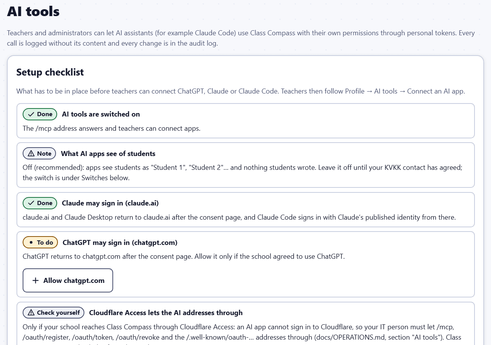
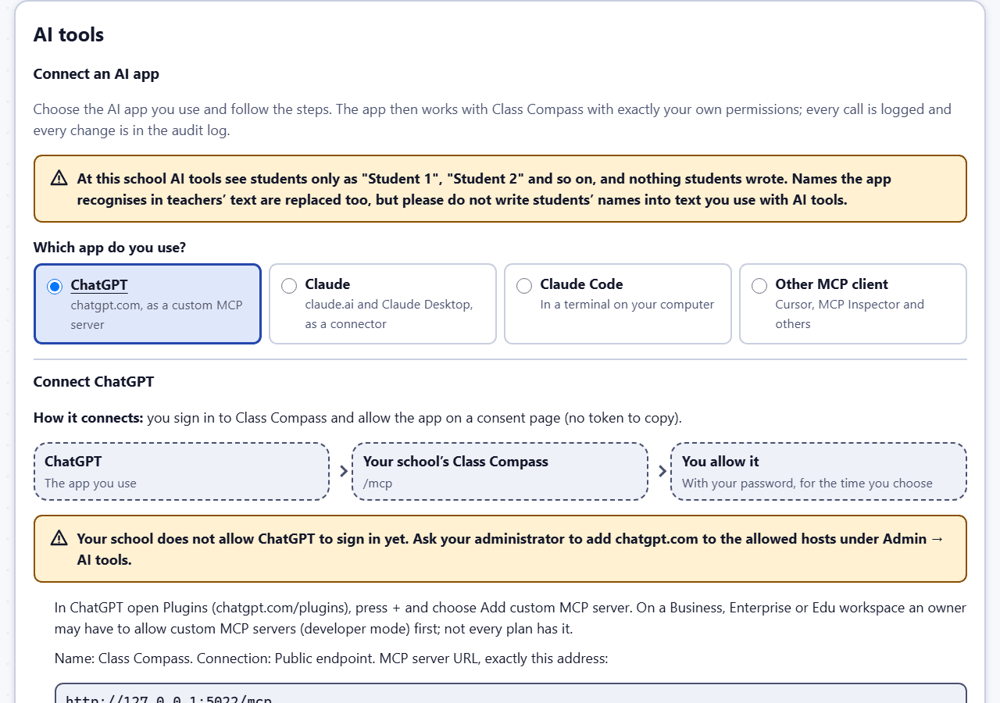
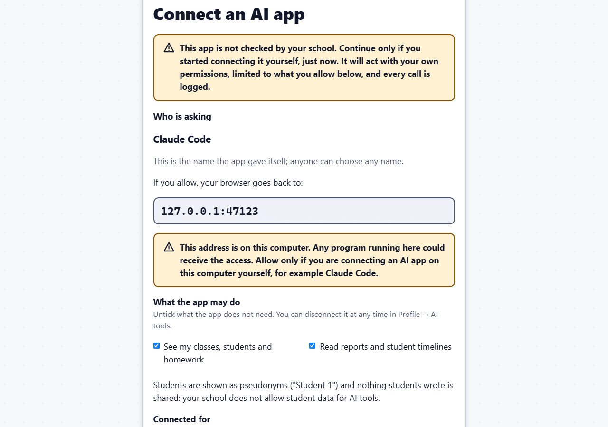

# AI tools: connecting an AI assistant

Class Compass can let an AI assistant, such as **ChatGPT**, **Claude** or **Claude Code**, work with your classes for you: read a report and write a short weekly summary, suggest goal presets, plan the week's lesson topics or design a theme. The assistant connects through the **Model Context Protocol (MCP)**, an open standard for AI tools, at the address `/mcp` of your school's Class Compass.

The assistant can do exactly what you can do in Class Compass, and only the parts you choose. Every call it makes is logged (what was called and when, never what was in it), and every change it makes is in the audit log under your name, marked "through an AI tool".

AI tools are **off** until an administrator switches them on, and **student names stay inside the school** until the administrator, with the school's KVKK contact, decides otherwise.

## What leaves the school

With **pseudonyms** (the default, and the only choice while the school's "Student data to AI tools" switch is off):

- Students appear as **"Student 1", "Student 2"** and so on, and their ids as `student-1`, `student-2`. The numbers stay the same for one token, so the assistant can follow a student across questions. It can use `student-3` in its own requests (only for your own students).
- Student names and student numbers inside text you or other teachers wrote (a lesson reflection, feedback, a homework title) are replaced as far as the app can recognise them, also in Turkish spellings (İ/I, ş, ğ…), in capitals or lower case and with an apostrophe ("Elif'in"). A student's full name becomes their pseudonym; a first name or surname on its own becomes `[name]`, and a student number `[student no.]`.
- **Anything a student wrote** (goals, reflections, notes to themselves, evidence text and links) is **withheld**.
- What does leave: the school's name, teachers' names, class and subject names, dates, counts with their totals, attendance and homework statuses per pseudonym, your own text with names replaced, goal categories and presets, settings.

> **Please do not write students' names or numbers into text you will use with AI tools** (feedback, reflections, homework titles). The app cannot recognise everything: misspelt names and nicknames, a former name, the name of a student who has left and been deleted, a name in lower case with an ending but no apostrophe ("elifin"), the names Can, Su, Ay, Will and May written in lower case, and short numbers (one to three digits) without "no" go out as they were written. Staff names and your school's name are not changed.

With **names** (only when the administrator allows student data, and only for tokens made with "Names"):

- Student names and what students wrote also leave. Student writing is marked as `untrustedText`, so the assistant treats it as data and never as an instruction.

**Never, in either case:** files, photos and voice recordings; private teacher notes and homework notes; Secret Student choices before the reveal; grouping levels; student link addresses and codes; passwords, PINs and sign-in data; exports, backups and deleting students.

> Where the data goes depends on the AI tool you use: with Claude Code it goes to Anthropic under your own account. Use only the tools your school has agreed to, and only fictional data while you are trying things out.

## For administrators: switch it on



Open **AI tools** in the administration menu. The page starts with a **Setup checklist**; each line says **Done**, **To do**, **Note** or **Check yourself** (a word next to the icon, not only a colour):

1. **AI tools are switched on**, with a **Switch AI tools on** button while they are off.
2. **What AI apps see of students**: a reminder of the student data switch below (off: pseudonyms only; leave it off until your KVKK contact has agreed).
3. **Claude may sign in (claude.ai)** and 4. **ChatGPT may sign in (chatgpt.com)**: the return host each app's documentation names. **Allow claude.ai** / **Allow chatgpt.com** adds it to the allowed hosts in one click (it is in the audit log like any change of the list). Allow only the apps your school agreed to use. `claude.ai` is allowed from the start; it also covers Claude Code's sign-in.
5. **Cloudflare Access lets the AI addresses through**: Class Compass cannot see this from the inside, so it always says **Check yourself**; see [Cloudflare Access](#cloudflare-access) below.
6. **A first tool call worked**: ticks as soon as any app has used a tool at the school, with the time of the last one.

Below the checklist:

- **AI tools are on**: switches the `/mcp` address on. While it is off, no token works and no new token can be made.
- **Longest a token may last**: 7 to 90 days (90 by default). Teachers choose a shorter time for each token.
- **Student data to AI tools**: off by default. Switch it on **only after your school's KVKK contact has agreed** and the parent privacy note says so. The dialog lists what would leave the school; type `STUDENT DATA` to confirm. Switching it off takes effect at once for every token.
- **What leaves the school** repeats the list above for the current setting.
- **Tokens at this school** lists every token (never its secret) with its account, permissions, privacy and last use. **Revoke** stops one at once. Changes on this page are in the audit log.
- **Connected apps at this school** lists every app a teacher or administrator connected through the consent page (ChatGPT, claude.ai, Claude Desktop, Claude Code), with **Disconnect**.
- **Registered AI apps** lists the apps that registered themselves with Class Compass. Anyone can register an app; it can do nothing until a person allows it on the consent page. **Revoke** ends all connections of that app. Registrations nobody uses disappear after 30 days.
- **Allowed hosts for AI apps**: the hosts an app may send people back to after the consent page. `claude.ai` (for claude.ai and Claude Desktop) is on the list from the start; ChatGPT needs `chatgpt.com` (the checklist adds it in one click); addresses on the person's own computer (Claude Code) are always allowed. Write one host per line. Add a host only for an AI tool your school has agreed to use.

Switching AI tools off disconnects every connected app.

## Cloudflare Access

If your school reaches Class Compass through Cloudflare Access, the IT person must let `/mcp`, the sign-in addresses for AI apps (`/oauth/register`, `/oauth/token`, `/oauth/revoke`) and their discovery addresses (`/.well-known/oauth-…`) through (see `docs/OPERATIONS.md`, "AI tools"): an AI tool cannot sign in to Cloudflare. ChatGPT and Claude call these addresses from their own servers; Claude Code calls them from the teacher's computer, so a teacher there needs either that address let through or an Access service token (the Claude Code page shows the command with its two headers).

## Connect an AI app



Open **Profile** (teachers from the menu, administrators from the administration menu) and find **AI tools**. On a classroom computer the PIN is asked first. **Connect an AI app** comes first:

1. **Which app do you use?** Choose **ChatGPT**, **Claude** (claude.ai and Claude Desktop), **Claude Code** or **Other MCP client**.
2. The page says **how it connects** (signing in on the consent page, or a personal token), shows a small picture of the connection and gives numbered steps with your school's exact address and **copy** buttons. The address comes from the school's server settings, so copy it rather than typing it.
3. Follow the steps in the app (below for each app), then ask the app something about your classes, for example "Use Class Compass: list my classes."
4. Press **Check connection**. It shows the last tool the app used, when, and through which connection or token, for example "Last tool call from ChatGPT: list_my_classes, 11 Nov 2026, 09:30 (connected app "ChatGPT")". Nothing new is recorded for this: it reads the existing call log, which never holds what was asked or answered.

When AI tools are off, the page says so and lists what your administrator does. When the school has not allowed an app's return host yet (for example `chatgpt.com`), the page asks you to pass that on to your administrator; a personal token (Claude Code, other clients) works without it.

Your personal tokens and connected apps are under **Advanced: personal tokens and connected apps**. It opens by itself while you have a working token or connected app.

## ChatGPT

ChatGPT connects as a **custom MCP server** (OpenAI calls it an app or plugin) and signs in on the consent page; you do not paste a token. The school's administrator must have allowed `chatgpt.com` first. Use only fictional data while you are trying it out, and only if your school has agreed to use ChatGPT.

1. In ChatGPT open **Plugins** (`chatgpt.com/plugins`), press **+** and choose **Add custom MCP server**. On a Business, Enterprise or Edu workspace an owner may have to allow custom MCP servers (developer mode) first; not every plan offers it.
2. **Name**: Class Compass. **Connection**: Public endpoint. **MCP server URL**: the address Profile → AI tools shows, for example `https://school.example.org/mcp`.
3. **Authentication**: OAuth. Leave the client ID and secret empty: ChatGPT registers itself with Class Compass.
4. Read the warning, confirm and create it. ChatGPT opens your school's Class Compass: sign in (on a classroom computer the PIN first), read the consent page and press **Allow** with your password. ChatGPT returns to `chatgpt.com`.
5. In a chat, turn Class Compass on and ask, for example: "Use Class Compass: list my classes." Then press **Check connection** on the Profile.

## Make a personal token

Open **Profile → AI tools** and then **Advanced: personal tokens and connected apps** (on a classroom computer the PIN is asked first). The Claude Code and "Other MCP client" steps of **Connect an AI app** also have a **Make a token** button that opens the same form.

1. Press **New token**.
2. **Name**: where you will use it, for example "Claude Code on my laptop".
3. **Permissions**: choose only what the assistant needs. Read permissions are chosen to start with. Teachers can choose: see my classes, students and homework; read reports and student timelines; read goals; write goals, presets, sentence starters and feedback; set and mark homework; classroom actions in a running lesson; change class settings. Administrators can choose: read school structure and school-wide reports; change school settings; save theme drafts.
4. **Valid for**: a number of days, at most what the school allows.
5. **Students are shown as**: only when the school allows names. Pseudonyms are the safe default.
6. Type your **current password** (accounts that sign in with an email link sign in again first) and press **Make token**.

The token (it starts with `ccmcp_`) is **shown only once**. Copy it, or copy the ready-made Claude Code command, and keep it like a password. Class Compass keeps only a fingerprint of it.

The list shows your tokens with their permissions, until when they are valid and when they were last used. **Revoke** stops a token at once; make a new one when you need it again.

## Claude Code

On your own computer, with Claude Code installed, run the command from the dialog. It looks like this (your school's address and your token instead of the examples):

```
claude mcp add --transport http class-compass https://school.example.org/mcp --header "Authorization: Bearer ccmcp_…"
```

Then ask Claude, for example: "Use class-compass: give me a short summary of last week in 3-A English." Claude starts with **list_my_classes** and asks before it changes anything when you tell it to.

**Behind Cloudflare Access.** If your school's address is behind Cloudflare Access and your IT person gave you an Access service token, add its two headers to the token command (the Claude Code steps on the Profile show it with placeholders):

```
claude mcp add --transport http class-compass https://school.example.org/mcp --header "Authorization: Bearer <your token>" --header "CF-Access-Client-Id: <id>" --header "CF-Access-Client-Secret: <secret>"
```

Use a personal token for this: signing in also needs the `/oauth/…` addresses, which the service token may not reach.

Useful tools: **class_overview**, **class_report** (ask for a few sections when a report is large), **student_summary**, **goal_library**, **create_goal_preset**, **create_sentence_starter**, **get_topic_plan** and **set_topic_plan**, **create_homework**; for themes **theme_schema**, **validate_theme**, **preview_theme**, **export_theme** and, for administrators, **import_theme_draft** (it saves a draft; enabling a theme stays your decision on **Themes**). Ready-made requests (prompts): weekly summary, goal presets, topic plan, design a theme.

**Making a theme with an assistant.** The assistant can read the theming guide and complete example themes (one for each built-in theme), copy any theme with **export_theme**, check its work with **validate_theme** and see every colour contrast with **preview_theme**. None of this contains school data. An administrator's assistant can save the result as a draft; you look at the preview and switch the theme on yourself on **Themes**.

## claude.ai and Claude Desktop

claude.ai and Claude Desktop connect as a **custom connector**. You do not paste a token: Claude sends you to a Class Compass page where you allow it (the "consent page", below). Use only fictional data while you are trying it out, and only if your school has agreed to use Claude.

1. In claude.ai open **Customize → Connectors** (the same in Claude Desktop), press **+** and choose **Add custom connector**. On Team and Enterprise plans an Owner adds it under **Organization settings → Connectors**, and you then press **Connect** on it.
2. **Name**: for example "Class Compass". **Remote MCP server URL**: your school's address followed by `/mcp`, exactly as Profile → AI tools shows it, for example `https://school.example.org/mcp`. Keep the sign-in settings Claude detects ("Use Claude's published identity" or "Register automatically") and leave the client ID and secret empty.
3. Press **Add**, then **Connect**. A browser window opens your school's Class Compass. Sign in if you are asked; on a classroom computer the PIN is asked first.
4. Read the consent page, choose the permissions and press **Allow** with your password (see below). The browser goes back to claude.ai and the connector shows as connected.
5. In a chat, turn the connector on in the tools menu and ask, for example: "Use Class Compass: give me a short summary of last week in 3-A English."

Connectors belong to your Claude account, so a connector added in claude.ai also appears in Claude Desktop. When the connection ends (after the time you chose, or when you disconnect it), Claude asks you to connect again.

## Claude Code with a sign-in instead of a token

Claude Code can sign in through the same consent page, so you do not have to copy a token:

```
claude mcp add --transport http class-compass https://school.example.org/mcp
```

Then start Claude Code, type `/mcp`, choose **class-compass** and **Authenticate**. Your browser opens the consent page; its return address is on your own computer (for example `localhost:43215`), which the page points out. After **Allow** the browser says you can go back to the terminal, and Claude Code is connected. A personal token (above) keeps working too; use whichever you prefer.

## The consent page



The page that opens when an AI app wants to connect is your decision, so read it:

- **"This app is not checked by your school"**: anyone can make an app with any name. Continue only if you started connecting it yourself, just now. If the page appears out of the blue (for example from a link in an email), press **Do not allow**.
- **Who is asking**: the name the app gave itself. For apps whose details come from their own address the page names that address too.
- **If you allow, your browser goes back to**: the host that receives the access. For claude.ai and Claude Desktop it is `claude.ai`, for ChatGPT `chatgpt.com`; for Claude Code it is an address on your own computer (`localhost` or `127.0.0.1` with a number), and the page warns that any program on that computer could receive it.
- **What the app may do**: the permissions the app asked for, limited to what your account can do. Untick what it does not need. Permissions of administrators are never offered to teachers.
- **Students are shown as**: pseudonyms, unless your administrator allows student data; then you choose, as for a token.
- **Connected for**: how long the app may stay connected (at most what the school allows). The app gets a key that works for an hour at a time and is renewed until then.
- **Allow** needs your password again (accounts that sign in with an email link sign in again first). **Do not allow** sends the app away without access.

## Disconnect an app

**Profile → AI tools → Advanced → Connected apps** lists the apps you connected: the app, where it returns to, its permissions, how students are shown, when it was last used and until when it is connected. **Disconnect** stops it at once. You can also disconnect it in the app, but disconnecting here is the one that counts for Class Compass.

## Good to know

- A token works only at the `/mcp` address, never in the app itself, and a signed-in browser cannot use `/mcp`.
- Each token may make about 120 calls a minute; very large answers are shortened with a note asking for a narrower question.
- When an account is deactivated, or its password is reset or changed, all its tokens and connected apps are ended for good (reactivating the account does not bring them back): make new ones afterwards. When the administrator shortens the longest time a token may last, existing tokens and connections are shortened too. When the administrator switches AI tools off, every connected app is disconnected (tokens just stop working until AI tools are on again).
- The assistant sees only your own classes and students, exactly like you do.
