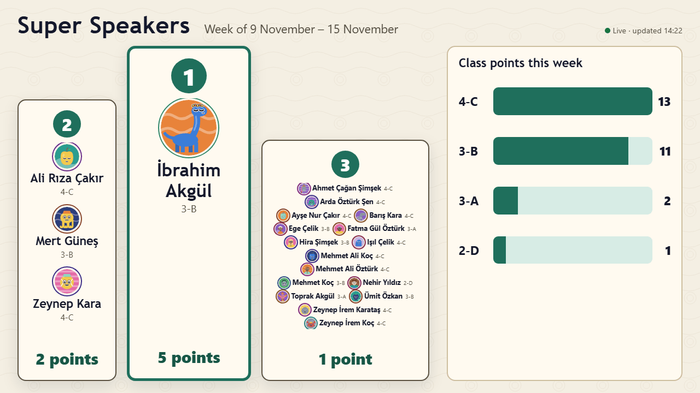

# Super Speakers: setting up the board screen

The **board** shows this week's Super Speakers on a big screen, for example in the hall: the top three students (with every tied student), their classes and avatars, and the points of every class taking part. It updates by itself a moment after a teacher gives a point.

## What you need

- A computer, mini PC or smart TV with a modern browser (Chrome, Edge or Firefox), connected to the screen and to the school network or internet.
- A **board link** from the administrator (Administration → Super Speakers → **Links** → **Board links** → **Create board link**). A board link can only show the board; it cannot give points or open anything else.

## Set it up

1. Open the board link in the browser on that computer.
2. Switch the browser to full screen (usually **F11**).
3. Turn off the computer's screen saver and sleep, so the board stays on all day.
4. If the administrator switched on **Board sound and celebration**, click once on the board: browsers play sound only after a click.

The board fits 1920×1080 and 1280×720 screens without scrolling. The mouse pointer hides by itself.

## What the board shows

- The title and **Week of …**. Every week starts fresh at the time the administrator set (normally Monday 00:00); earlier weeks are kept in the history.
- **Top three of the week**: places 1 to 3, with points. Students with the same points share a place: two or three are shown almost as big as a single student, more in a list with smaller names. While nobody has points, the board says **We are waiting for our super speakers**.
- **Class points this week**: every class taking part, including classes with 0 points.
- A connection sign: **Live**, or **Reconnecting…** when the network drops. The board keeps trying by itself and catches up when the connection is back; you do not need to reload it.

## If something is wrong

- **This board link no longer works**: the administrator made a new link or switched it off, or Super Speakers moved to its own web address. Ask for the board link and open it again.
- A short notice instead of points: Super Speakers is switched off at the moment.
- **Connecting to the board…** for a long time: check the network of that computer.
