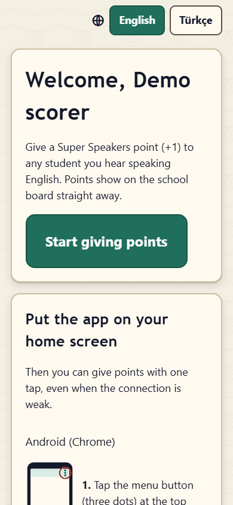
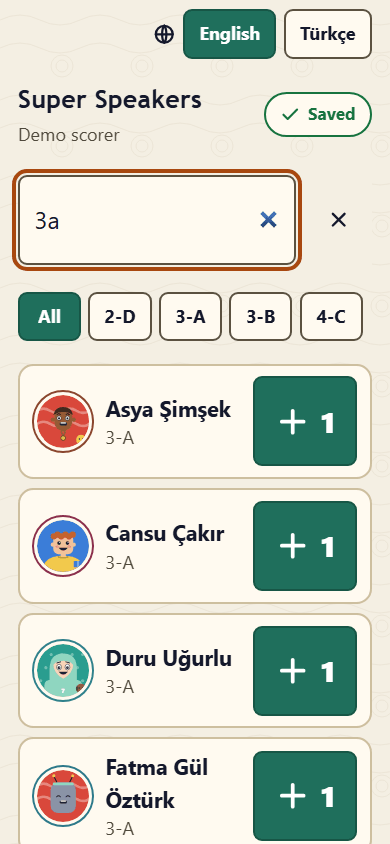

# Super Speakers: one-page guide for scorers

You have a **scorer link**: with it you give **Super Speakers points** to students you hear speaking English, anywhere in the school. Points show on the school board straight away.

> Your link is personal. Do not share it: anyone with it can give points in your name.

## 1. Open your link

Open the link your administrator sent you (or scan its QR code) on your phone. The first time you see **Welcome**; press **Start giving points**. You can switch between **English** and **Türkçe** at the top.

## 2. Put the app on your home screen (recommended)

Then you can give points with one tap, even when the connection is weak. Press **Put the app on your home screen** at the bottom (on the welcome page it is already open):

- **Android (Chrome)**: tap the menu button (three dots) at the top right, choose **Install app** or **Add to Home screen**, then open Super Speakers from your home screen. It signs in by itself.
- **iPhone and iPad (Safari)**: tap the **Share** button at the bottom of Safari, choose **Add to Home Screen**, then **Add**. The app on an iPhone needs a **pairing code** the first time: in Safari, on your link page, tap **Show pairing code**; open the app from the home screen and type the six digits under **Connect the app**. A code works once, for 10 minutes; **Make a new code** if it ran out.

## 3. Find a student and give +1

- Type in **Find a student**: part of a name ("isik" finds "Işık"), a class ("3a") or a student number. The class buttons narrow the list; **Recent** shows students you gave points to.
- Tap the big **+1** on the student's card. A second tap within a moment asks you to **Tap again to add another point**, so a double tap does not give two points by mistake.

## 4. Undo

- Right after a point, the bar at the bottom shows **Undo**.
- **My points today** lists your points of today, each with **Undo**, for as long as the undo window lasts (10 minutes unless your administrator changed it). Later, ask an administrator to remove a wrong point.

## 5. Offline

No signal? Keep tapping. The points wait on your phone (the badge shows how many) and are sent when the connection is back. They count on the day you tapped them. If a point could not be saved (for example a student who is not taking part), it appears under **Needs attention** with **Try again** and **Dismiss**.

## Good to know

- Only students of the classes taking part can get points. There are no minus points.
- **Sign out on this phone** ends the session on this phone. Your link keeps working.
- "This scorer link no longer works": the administrator made a new link or switched it off. Ask for your new link.
- **Help** at the bottom of the app opens this guide.
