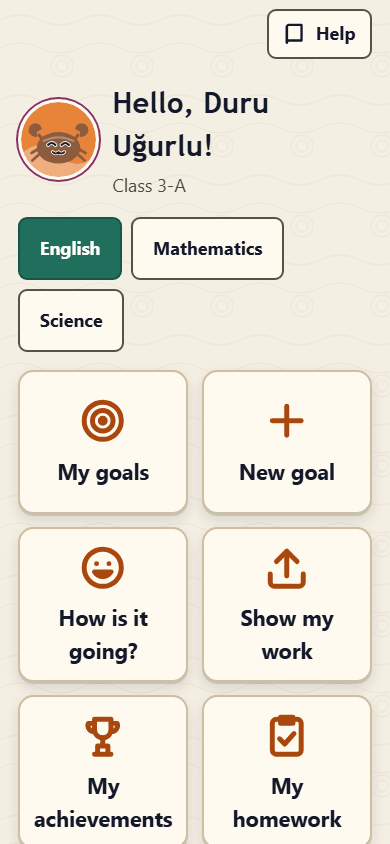
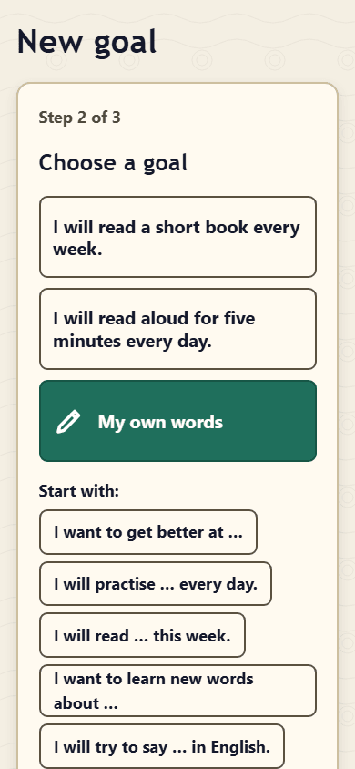
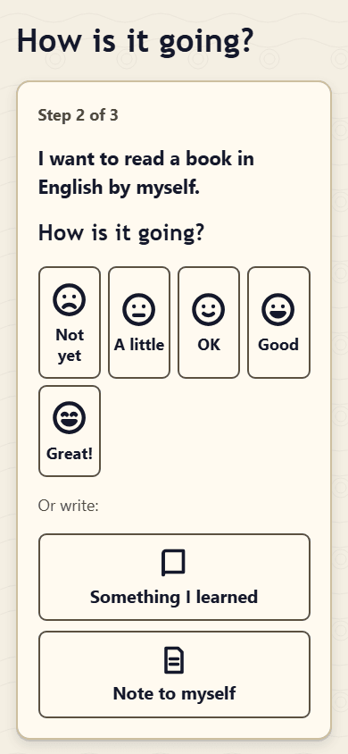
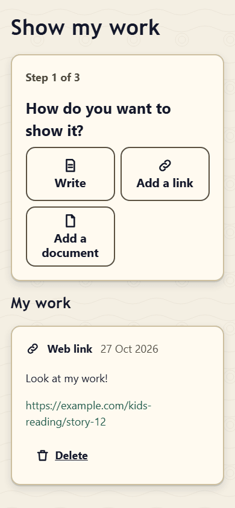
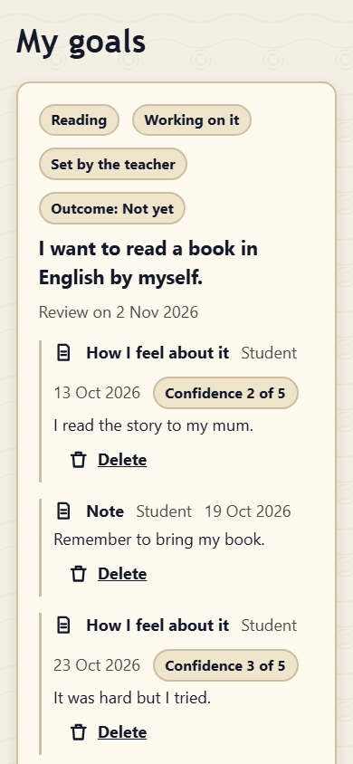
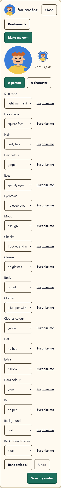
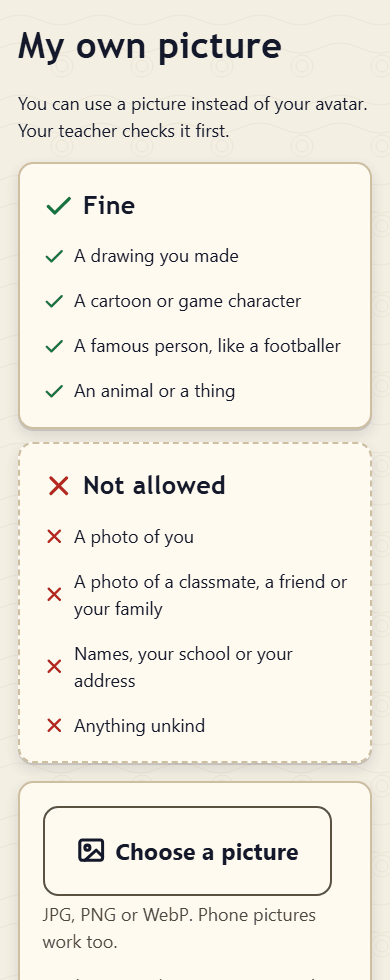
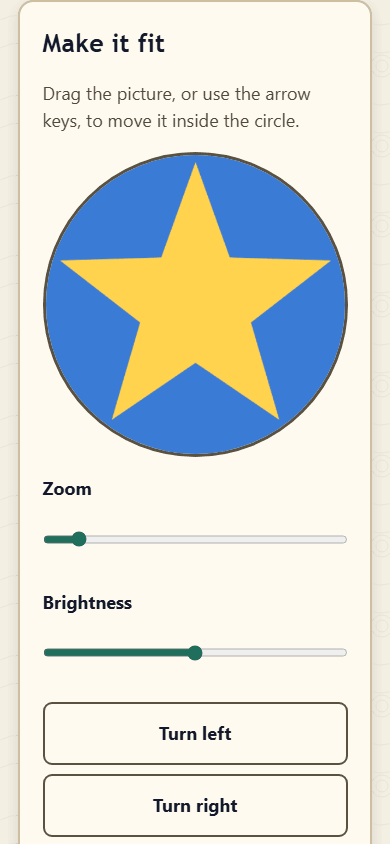
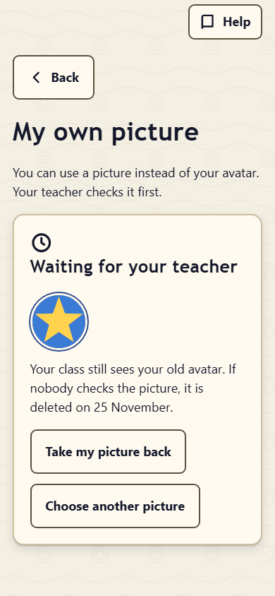

# Your own page in Class Compass: a guide for students and parents

Hello! Your teacher gave you a **card with a QR code**. It opens **your own page** in Class Compass. On your page you can set goals, say how you are doing, show what you have done, and read what your teacher wrote to you.

*For parents: this guide is written for children. The part for you is [For parents: privacy](#for-parents-privacy).*

## Opening your page

1. Scan the QR code on your card with a phone or tablet camera, or type the link your teacher gave you.
2. Your page opens. It says **Hello** and your name.
3. Next time, the same card opens the same page again.

**Keep your card private.** Your link is only for you. Anyone who has it can see your page and add things to it. If you lose your card, or someone else has seen it, tell your teacher. They can stop the old link and give you a new card.

On a shared computer or tablet, press **Leave this page on this device** at the bottom of the home screen when you are done.

**Help** is at the top of your page. If your class uses two languages, you can switch between **English** and **Türkçe** there too.

## The home screen

Your page starts with your avatar, **Hello** and your name, and your class. Under **What do you want to do?** there are big tiles:

- **My goals**
- **New goal**
- **How is it going?**
- **Show my work**
- **My achievements**
- **My homework**
- **My avatar**

Tap a tile to open it. You only see the tiles your class uses. If you have more than one subject, first tap the subject's button under your name (for example **English**); your page remembers it on this phone or tablet.

Most tiles open a few short steps. **Step 1 of 3** at the top tells you where you are. **Next** goes on, **Back** goes back one step (the back button of your phone works too), and when you save you come back to where you started.

## New goal

A goal is something you want to get better at, for example "I will read one English book every week."

1. **What do you want to get better at?** Tap a tile.
2. **Choose a goal**: tap a ready goal, or **My own words** and write your goal.
3. **How will you practise?** Tap an idea, or write **My idea** and press **Add this idea**. You can add more than one.
4. Press **Save my goal**.

Your teacher can add goals for you too. They are marked **Set by the teacher**.

## Sentence starters

Where you write, you may see **Start with:** and a few sentence beginnings, for example "I want to get better at … ." Tap one: it goes into the box, where ___ marks the place for your own words. Type them in place of the ___.

If you already wrote something, the page asks **Put this in place of your words?** Choose **Yes, change it** or **No, keep my words**.

A starter alone is not enough: if you see **Finish your sentence: write your own words where the ___ is.**, add your words and try again.

## How is it going?

1. Choose the goal.
2. Tap a face to say how it is going, from 1 to 5: **Not yet**, **A little**, **OK**, **Good** or **Great!** This is not a mark. It just helps you and your teacher see how you feel. **Tell us why** in a few words if you want.
3. Or write something else: **Something I learned**, or a **Note to myself** (something you want to remember).
4. Press **Save**.

## Show my work

1. **How do you want to show it?**
   - **Write**: a few sentences.
   - **Add a link**: a web address that starts with https://.
   - **Add a document**: for example a PDF or a Word file.
   - **Add a picture**, **Take a picture**, **Record my voice** (up to 5 minutes) and **Add a voice file**, but only if your school allows pictures and voice recordings. If you do not see these buttons, your school has not switched them on.
2. **Which goal is it for?** Tap a goal, or **For all my learning**.
3. Write about your work, or choose the file, and add **A few words** if you like. Press **Save my work**.

You see **Saved!** and the list of **My work**. You can delete your own work there: the page asks **Delete this? You cannot get it back.** Choose **Yes, delete** or **No, keep it**.

## My goals

**My goals** shows your goals and **What was written about this goal**: your words, your work and what your teacher wrote (**From my teacher**).

- **Tell how it is going** opens **How is it going?** for that goal.
- When you have done it, press **I did it!** Well done!
- **Change my words** lets you change what you wrote: your goal or what you wrote about it. Change the words and press **Save my words** (or **Cancel**). Only your own words can be changed.
- **Delete goal** asks first, like above.

## Kind words

Class Compass checks what you type before it is saved. When you press **Save**, you may see a message like **Let’s keep our words kind. Please change that word.** or **Please write a little more.** Change your text and try again. Nothing is saved until the text is fine.

## My homework

**My homework** shows your newest homework and its status. Each status has its own little picture: a tick for **Completed**, a clock for **Not checked yet** (your teacher has not looked at it yet). **Show older homework** shows the rest.

## My achievements

Achievements celebrate your effort: setting goals, showing your work, writing about your learning, doing homework, helping as the class assistant and more. Some come automatically; your teacher gives others.

- **My achievements** shows your newest achievements with their level (Bronze, Silver or Gold), what they are for, when you earned them and who gave them. **Show all my achievements** shows every one.
- **Next achievements** shows achievements you can still earn, with their level and how far you are (for example **3 of 5**).
- Your teacher may also show your own **level**. Only you see your level on your page, and nobody is ranked. Your teachers can see your achievements, and your teacher may choose to celebrate an achievement on the classroom screen with your name and avatar.

When you get a new achievement, your page celebrates it once, and its tile says **New!**.

## My avatar

Your avatar is the little picture of you that your class sees on the classroom screen. It is a drawing, never a photo.

1. Open **My avatar** and press **Change my avatar**.
2. Choose **Ready-made**, or **Make my own**: **A person** or **A character** (for example a dinosaur, a unicorn or a dragon). Tap a family picture to see its characters, then tap the pictures and colours you like for the face, hair, clothes and more; the one you chose has a tick. **Surprise me** picks one part for you, **Randomise all** changes everything, **Undo** goes back.
3. Press **Save my avatar**.

Some parts say **earn "…" to unlock**: earn that achievement first. If you see **Your teacher has paused avatar changes for now**, you can change it later.

### Use my own picture

If your school and your teacher allow it, **My avatar** has a button **Use my own picture**. You can use a picture instead of your avatar, and your teacher checks it first.

- **Fine**: a drawing you made, a cartoon or game character, a famous person (like a footballer), an animal or a thing.
- **Not allowed**: a photo of you, a photo of a classmate, a friend or your family, names, your school or your address, anything unkind.

1. Press **Choose a picture** and pick one (JPG, PNG or WebP).
2. Make it fit: drag it, or use the arrow keys, to move it inside the circle. Use **Zoom** and **Brightness**, **Turn left**, **Turn right**, **Mirror** or **Start again**. **How it will look** shows the large and the small card.
3. Press **Send to my teacher**.

Until your teacher says yes, your class sees your avatar (**Waiting for your teacher**). You can **Take my picture back**. A picture nobody checks is deleted after 14 days. If your teacher says **Not this one**, the picture is deleted at once and you see why; press **Choose another picture** to try again. **Stop using my picture** deletes it and brings your avatar back. While your own picture is in use you can still change your avatar: it is kept for later and comes back when you stop using your picture.

## What your teacher can see

Your teachers of that subject can see everything on your page for that subject: your goals, what you wrote about them, your work and how it is going. They can add goals, work and feedback. They can also **hide** something from your page (for example if it was added by mistake). Your teacher may also keep short private notes for themselves; those are never shown on your page. When you add something, your teacher may get a notification about it in their teacher area.

Your classmates cannot see your page. On the classroom screen they see your avatar and your name, and, if your teacher switches them on, your counts on your student card and achievement celebrations. When your teacher taps your name on the classroom screen, the class sees a small card with good things only: your newest achievements, your Super Speakers points this week, your days as the class assistant and your counts.

## For parents: privacy

What Class Compass does with your child's page, in plain words:

- **Where the data is kept.** On the school's own Class Compass server. The page shows only your child's learning items: goals, reflections, evidence, feedback, homework status, achievements and avatar. There are no grades and no contact details on it.
- **The link is a key.** Anyone who has the link or card can open the page and add to it, until the school stops the link. Keep the card at home, do not post it online, and tell the teacher at once if it is lost. The teacher or the administrator can then stop the old link immediately and make a new card. When a student leaves the school and is deactivated, the link stops working.
- **Who sees what.** The child's teachers in that subject and the school's Class Compass administrators. Other students and other parents do not. Teachers may write private notes for themselves; these are not shown to the student, and the school's full data export (made by administrators) includes them.
- **Notifications for teachers.** When your child adds something to the page, their teachers may see a short line about it in their own teacher area. A teacher can choose a daily email that says how many new things are waiting, and optionally the children's names; it never contains what your child wrote.
- **Pictures and voice.** Photos and voice recordings are off until the school has confirmed consent (KVKK). When pictures are allowed, location and camera details are removed from them on the server. Documents (PDF, Word…) are kept as they are, so a document may still contain, for example, the name of the person who created it.
- **What others may see.** The class sees your child's name and avatar on the classroom screen. If the teacher switches them on, the class also sees counts on the student cards and short achievement celebrations with names and avatars. When the teacher taps a child's name on the classroom screen, the class sees a small card with positive things only (recent achievements, Super Speakers points this week, days as the class assistant, counts); never attendance, homework, goals, notes or comparisons. If the school uses Super Speakers, the top students' full names, classes and avatars are shown on a school screen, and the people scoring points can search the students of the classes taking part by name, class and student number.
- **AI tools.** The school can let teachers use an AI assistant (for example Claude Code) with Class Compass; it is off unless the school's administrator switches it on. By default the assistant is not given your child's name or anything your child wrote: students appear as "Student 1", "Student 2" and so on, and names and student numbers in teachers' notes are replaced as far as the app can recognise them (a misspelt name or a nickname is not recognised, so teachers are asked not to write names into text they use with AI tools). Only if the school decides so, after its KVKK contact has agreed, can names and your child's texts be shared with the AI service a teacher uses; the school then tells you. Photos, voice recordings, files and private teacher notes are never shared.
- **Kind words check.** When a word is refused, the text is not stored; only the number of attempts is counted. A teacher can choose to see that number.
- **Your rights.** You can ask the school for a copy of the data about your child or for its deletion (KVKK). The school's administrator can prepare an export of one student's data and can delete a student's records permanently once the student is deactivated; backups made before that keep the data until they expire.
- **The page is not public.** It is not shown to search engines, and the page does not send its address to other websites.

If you have questions, please contact the class teacher or the school administration.
