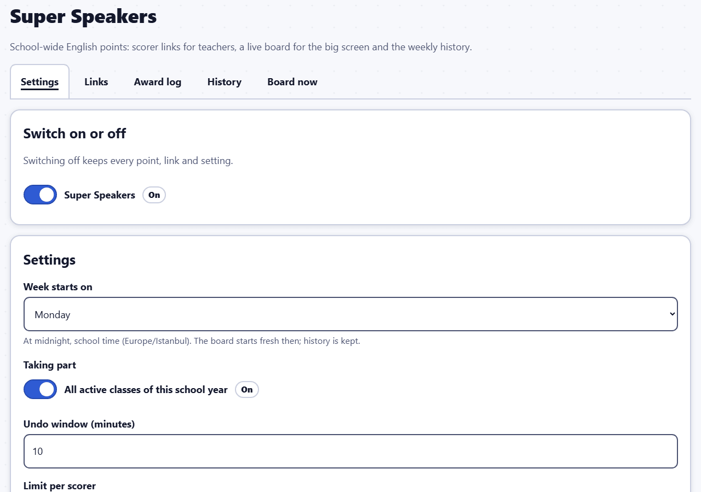
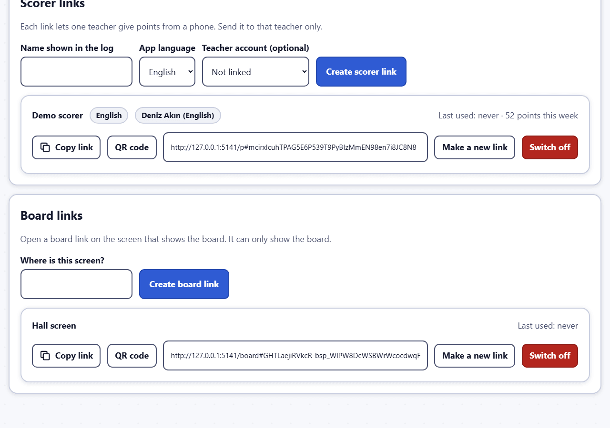

# Super Speakers: guide for administrators

**Super Speakers** is a school-wide English points board. Teachers who hear a student speaking English give them a point (+1) from their phone; a big screen in the hall shows this week's top three students and every class's points, live. Each week starts fresh on the board; every point is kept in the history.

It is a **school-wide module**: it is off by default, only an administrator switches it on, and it does not belong to one class. Switching it off keeps every point, link and setting.

The pictures come from the fictional demo school. Every name in them is invented.

Related one-page guides: [for scorers](scorer.md) and [for the board screen](board-screen.md).

## Switch it on

Open **Super Speakers** in the administration menu. Under **Switch on or off**, turn it on. (The same switch is on **Modules and media** → **School-wide modules**.) While it is off, scorer links cannot give points and boards show a short notice.

## Settings

The **Settings** tab:

- **Week starts on**: at midnight, school time. The board starts fresh then; the history is kept.
- **Taking part**: **All active classes of this school year**, or switch that off and choose the classes. Students of other classes cannot get points.
- **Undo window (minutes)**: how long a scorer can undo their own point (10 by default).
- **Limit per scorer**: **At most (points)** in **In (minutes)**; the line below reads it as a sentence. It stops runaway tapping (60 points in 10 minutes by default).
- **Board title (English)** and **Board title (Turkish)**, and the **Board messages** shown while nobody has points and on an empty podium place. Leave a field empty for the built-in message.
- **Board language** and **Board theme**.
- **Show students' own pictures on the board and the scorer**: only pictures a teacher approved; off by default, and while it is off the board and the scorer show the avatar.
- **Board sound and celebration**: plays the theme's celebration when the top three change. Off by default. Browsers may only play sound after someone has clicked the board once.
- **Achievements go to this subject**: points earn the Super Speakers achievements (first point, 5, 10 and 25 points) in this subject. By default (**Automatic: the English subject**), the subject named "English". If no subject is found, no Super Speakers achievements are given until you choose one.

## Scorer links and board links

The **Links** tab.

**Scorer links**: each link lets **one teacher** give points from a phone. Send it to that teacher only.

1. **Name shown in the log** (for example "Ms Deniz"), the **App language** (the teacher can switch it on the phone) and, optionally, a **Teacher account** to link it to.
2. **Create scorer link**. Then **Copy** the link or show its **QR code** for the teacher to scan.

**Board links**: a board link can only show the board.

1. **Where is this screen?** (for example "Hall screen").
2. **Create board link**, then open the link on the computer connected to the big screen (see the [board screen guide](board-screen.md)).

For each link the list shows when it was last used and, for scorers, the points this week. **Make a new link** replaces a link: the old one stops working at once and phones or screens using it are signed out; points already given are kept. **Switch off** stops a link (for example when a teacher leaves); you can make a new one later.

> Treat scorer links like keys: anyone who has one can give points in that teacher's name.

## Award log

The **Award log** tab lists the points, newest first, each with its **Status** (**Counts**, or how it was removed) and its action, with filters for the period, class and scorer, and **Show removed points**. **Remove** takes back a wrong point: give a reason. The point then no longer counts on the board or in reports; the removal and its reason are recorded. Achievements already earned stay. Removing a point never deletes it; only permanently deleting a student (administration area) deletes that student's points.

A scorer can undo only their own points, and only within the undo window. After that, an administrator removes them here.

## History

The **History** tab shows a chosen period: **Weekly winners** (the top three of each whole week, as the board showed them, with shared places for equal points), **Points per class and week**, **Points per scorer** and **Points per student**, each with a CSV download. Removed points are not counted.

Super Speakers points also appear in the class report and the student timeline of the achievement subject (Teacher guide, "Reports and CSV").

## Board now

The **Board now** tab shows the board as it is at the moment, without needing a board screen.

## Its own web address (optional)

The server administrator can give Super Speakers a web address of its own (for example `speakers.` in front of the school's address; OPERATIONS.md, "Super Speakers on its own hostname"). That address shows only the scorer app and the board, so board screens and phones can open it even when the main address asks for an extra sign-in. Nothing else of the app opens there.

Before it is switched on:

- Ask every scorer to open the app once with a connection and check that no points are waiting on their phone (no badge). Points that are still waiting are not lost: the app sends them first the next time it is opened with a connection, and only then goes to the new address. Checking beforehand avoids the wait.
- Have the new links ready to send (they appear under **Links** as soon as the new address is switched on).

When it is switched on:

- **Links** shows the new addresses, and new QR codes use them. The secret part of each link stays the same.
- Old links and printed QR codes are forwarded to the new address only on devices that can still open the main address. If the main address asks for an extra sign-in (the reason for the new address), a board screen or a phone that is not signed in stops at that sign-in and never reaches Super Speakers. So **send the new links and reprint the QR codes when the new address is switched on**, not later.
- **Board screens**: open the new board link on each screen (copy it from **Links**). A screen that only reloads shows "This board link no longer works".
- **Scorers**: they open their new scorer link. If they put the app on their home screen, they remove the old Super Speakers icon and add it again from the new page; on an iPhone they pair again with a new code.
- Points, history, settings and the links' secret part are not changed.

## Good to know

- Points are positive only (+1). There are no minus points.
- The board shows full names, classes and avatars of the top three (all tied students), and the class totals including classes with 0 points.
- A point given offline on a phone is sent when the connection is back and counts on the day it was tapped (up to 4 days back).
- Students never see a ranking on their own page; they see their own Super Speakers achievements.
