# Teacher guide

This guide is for class teachers and subject teachers who use Class Compass in their lessons. It follows a normal day: signing in, teaching a lesson on the classroom screen, and the work you do afterwards in the teacher area.

The pictures come from the fictional demo school ("Demo Primary School"). Every name in them is invented.

> **Modules.** Most features belong to a *module* (Attendance, Counters, Secret Students, Daily assistant, Grouping, Homework, Goals and reflections, Achievements, Routines). Your administrator decides which modules the school uses, and you switch them on or off for each of your classes in **Class settings**. If you cannot find something described here, the module is probably switched off. Switching a module off never deletes its history.

New to Class Compass? Start with the [quick start for teachers](quick-start-teacher.md).

## Signing in

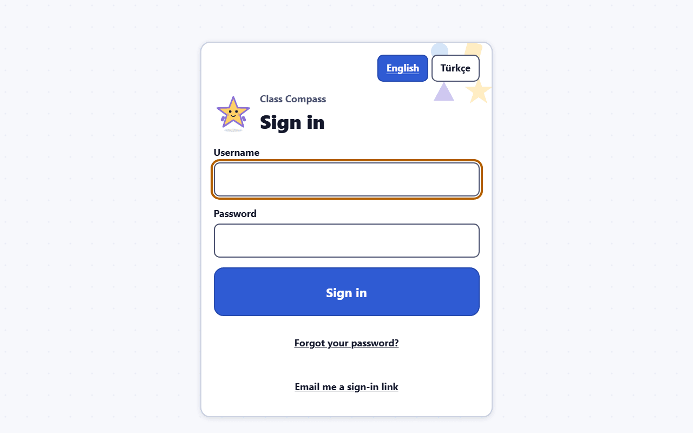

Your administrator creates your account. Usually you receive an **invite link** (by email, or as a link or QR code). Open it within 7 days. The invite page shows **Your username** in a box on its own: note it down, you type it every time you sign in with a password. Then choose how you want to sign in:

- **With a password**: you type your username and a password you choose (at least 10 characters).
- **With email sign-in links**: you have no password. Each time, press **Email me a sign-in link** on the sign-in page and type your email address. A link and a 6-digit code arrive within a minute. Open the link and press **Sign in**, or type the code on the device where you asked for the email. Both work once, for 15 minutes. The page repeats the address you typed, so you can spot a typo; **Use a different email** lets you type it again. This choice is only offered when the school has set up email.

If your administrator gave you a **temporary password** instead, you must choose your own password the first time you sign in.

Forgot your password? If the school has set up email, use **Forgot your password?** on the sign-in page; the reset link works for one hour. Otherwise ask your administrator to reset it. If a sign-in or reset link has expired, its page offers **Email me a new sign-in link** or **Ask for a new reset link**, and **Back to sign-in**. You can switch between password and email links later in **Profile and PIN** → **How you sign in**.

> The sign-in page has an **English | Türkçe** switch at the top; this device remembers your choice. Without a choice it follows the browser's language or the school's language for new accounts. After you sign in, Class Compass uses your own interface language (Profile and PIN → **Language**).

## PIN and classroom lock

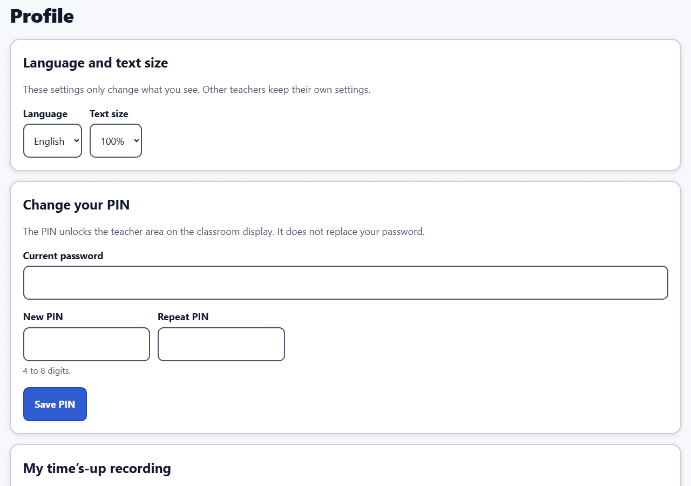

The classroom screen is usually projected for the whole class. So that nobody can see your teacher area there, Class Compass locks it with a **PIN**:

1. Open **Profile and PIN** from the teacher menu.
2. Under **Set your PIN**, type your current password (accounts with email links need a fresh email sign-in instead), then a PIN of **4 to 8 digits** twice, and press **Save PIN**.

The PIN does not replace your password. You cannot open the classroom screen without one.

How the lock works:

- Opening the classroom screen puts this device into **classroom mode**. From then on, **Teacher area** asks for your PIN.
- After you unlock, you always land on the **Teacher menu** first, never directly on a page with student information.
- The teacher area locks again after **3 minutes without a touch or key press**, and you can lock it at once with **Lock** on the bar that says **Visible on the classroom display**.
- After several wrong PINs there is a short pause; the lock screen warns you before more wrong PINs sign you out of the device.
- **Leave classroom mode on this device** (teacher menu) ends classroom mode, for example on your own laptop after school.

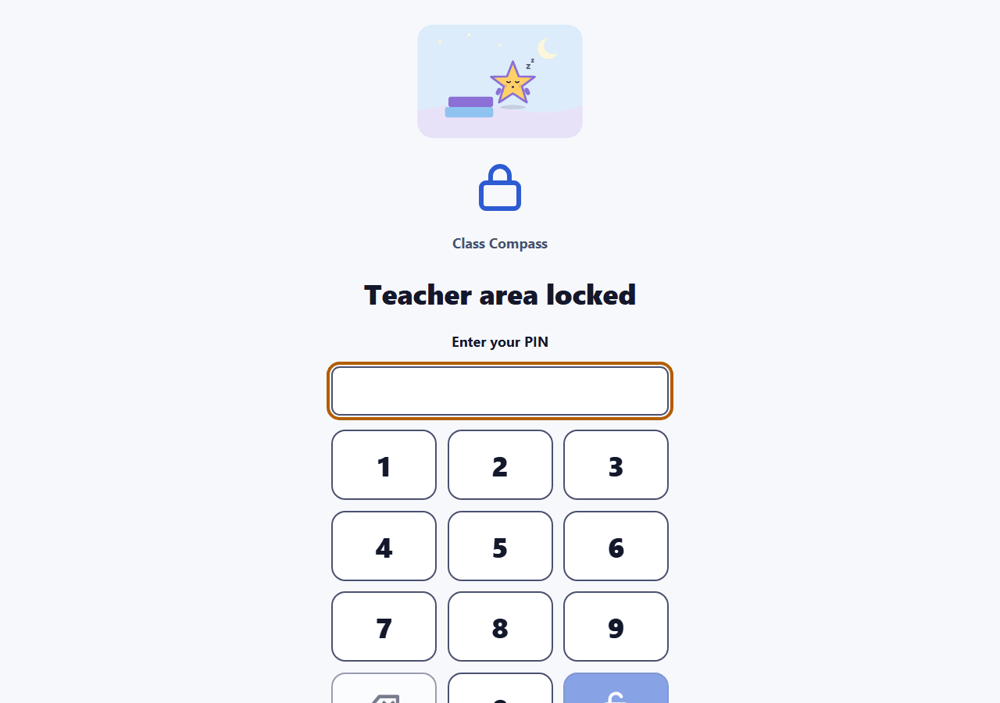

Forgot your PIN? Set a new one in **Profile and PIN** with your password, or ask your administrator to clear it (you are then signed out everywhere and set a new PIN).

In **Profile and PIN** you also choose your **Language**, **Text size** and **Spacing** (they change only what you see; **Spacing** — Compact, Normal or Large — sets how much room tables and cards take in the teacher area, buttons keep their size; the classroom screen sizes its student cards by itself), whether lessons open in full screen (**Lessons** → **Full screen during lessons**, see [Full screen](#full-screen)), and you can record **My time's-up recording** (see [Sounds and celebrations](#sounds-and-celebrations)).

## The teacher menu

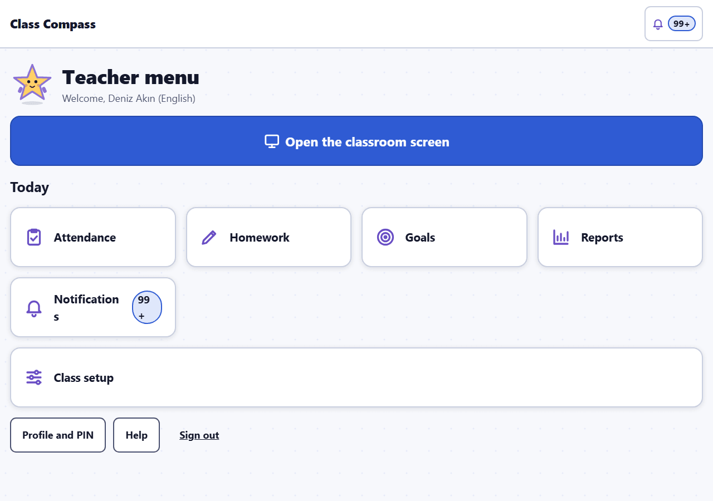

The teacher menu is the start page of the teacher area. It has three parts:

- **Open the classroom screen** (or **Back to the classroom**) takes you to the lesson screen.
- **Today**: the pages you use every day: **Attendance**, **Homework**, **Goals**, **Reports**, **Notifications** (the bell, with the number of new notifications; see [Notifications](#notifications)) and **Assistant** (see [Assistant](#assistant)).
- **Class setup**: one tile for everything you set up once and change now and then. It opens a page with three tabs:
  - **Classes and students**: **Class settings**, **Students**, **Import a student list**, **Student links**, **Avatars**.
  - **Lesson tools**: **Lesson topics**, **Routines**, **Counters**, **Daily Assistant**, **Secret Students**, **Grouping**.
  - **Achievements and kind words**: **Achievements**, **Kind words check**.

Under them, **Profile and PIN**, **Help** (these guides), **Leave classroom mode on this device** (only in classroom mode) and **Sign out**.

Pages of a module that is switched off in all your classes are left out of the menu. If you open such a page from an old bookmark, it says that the module is switched off and offers **Open Class settings**; nothing was deleted. On the other pages of the teacher area, the row of links at the top (with the bell) opens the pages; on a phone or tablet it is one **Page** list.

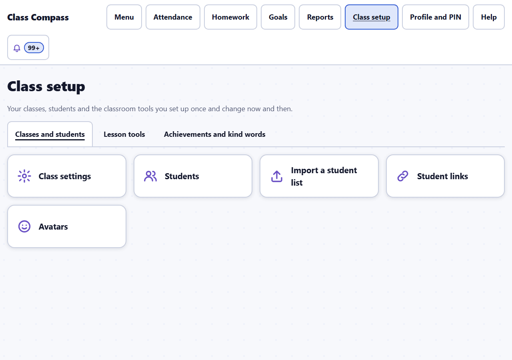

## Starting and ending a lesson

### Start a lesson

1. **Open the classroom screen**.
2. If you teach more than one class or subject, tap the class at the top, for example **3-A · English**. The active class and subject are always shown at the top, so nothing is recorded in the wrong class.
3. Press **Start lesson**. The steps depend on the modules that are on:
   - **Attendance**: everyone is present unless you change it. Tap a student to switch between absent, late, excused and present.
   - **Today's assistant**: who helps today, with their duties. Tick what the assistant has already done (for example "Help organise the classroom"); the ticks are saved when the lesson begins.
   - **Today's topic**: the focus of the lesson (Listening, Reading, Vocabulary, Grammar, Writing, Speaking, Phonics or your own topics). The weekly plan from **Lesson topics** suggests it; you can change it.
   - **Today's goal** (only when **Lesson goals** is on for the class, see [Lesson goals](#lesson-goals)): one short sentence the class can read, for example "We can ask and answer about the weather." Leave it empty for no goal today.
   - **Routine**: choose the routine for this lesson.
4. Press **Begin lesson**. If you switched on **Full screen during lessons** (see [Full screen](#full-screen)), the board fills the whole screen, so the browser's bars do not take space from the class.

On a school holiday (the administrator's holiday calendar) the classroom screen says so with a calm note. You can still start a lesson, for example a make-up lesson; reports leave holidays out of the school days.

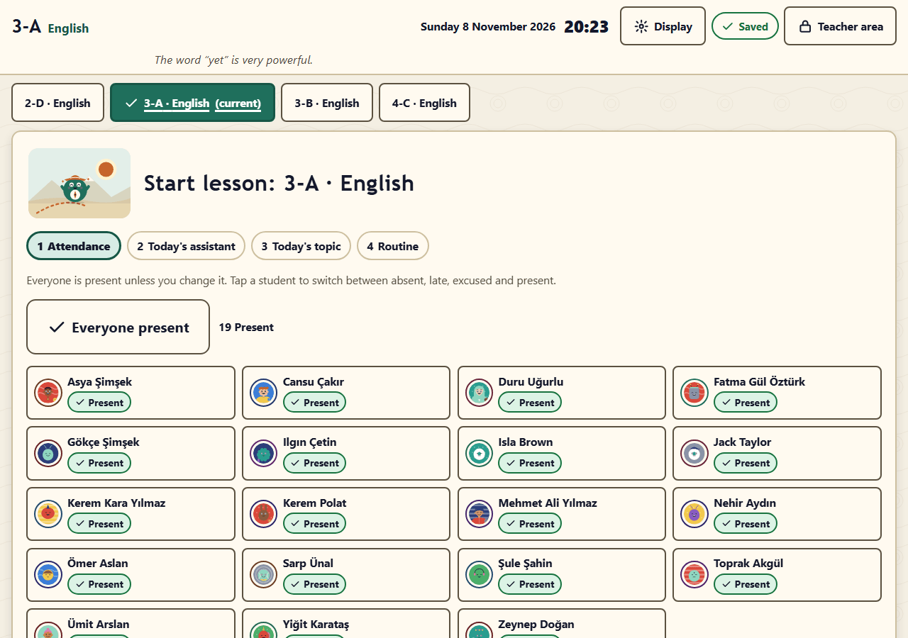

### Full screen

While a lesson runs, the top bar has a **Full screen** button; in full screen it becomes a small **Leave full screen** button. That button stays on the top bar (and in the teacher area) as long as the page is in full screen, also after the lesson ends, so you can always leave by touch. **Esc** on the keyboard always leaves full screen too. Dialogs, the PIN lock, celebrations and messages all keep working in full screen. **Save and end lesson** leaves full screen; **Back to the lesson** keeps it.

To have **Begin lesson** enter full screen and **Save and end lesson** leave it, switch on **Full screen during lessons** in **Profile and PIN** → **Lessons** (it is off at first). It is your own setting and follows you to every classroom computer; the **Full screen** button on the board works either way. Browsers without full screen (for example on an iPhone) show no button and nothing changes.

A lesson keeps running when you refresh the page or switch to another class and back. A class with a running lesson is marked **Lesson in progress**. If the Wi-Fi drops, your taps are kept on the device and sent later; the save status shows **Offline – N changes waiting**. Anything the server could not save appears under **Needs attention** with **Try again** and **Dismiss**.

### Without a connection

If you have opened the classroom on a computer before (in the last 7 days), it also opens there with no connection, after a reload or after closing and reopening the browser. It shows your classes, the students' names and avatars and the lesson as this computer saved them last, with the note **No connection. This screen shows what this device saved last; changes wait here and are sent when the connection returns.**

- **Start a lesson offline.** Press **Start lesson** and go through the steps as usual. The start cannot reach the server yet, so you see **Lesson start saved** with your class: the start is kept on this computer and sent as soon as the connection returns, and the lesson begins then. Until then the board waits: attendance, points and the timer can be used once the lesson has begun. While you are still offline, **Do not start** takes the start back.
- **End a lesson offline.** **End lesson** and **Save and end lesson** work as usual; you then see **Lesson end saved** with your class instead of the board, also after a reload. The end is sent as soon as the connection returns, and the summary appears then. While you are still offline, **Back to the lesson** takes the end back.
- **During a lesson** taps, attendance and the timer keep working when the Wi-Fi drops (see above); everything is sent in order when the connection returns.
- **What needs a connection:** the teacher area (reports, setup, notes, Profile and PIN), signing in, the student page, and uploaded avatar pictures (shown only if this computer loaded them in the last hour; otherwise the drawn avatar appears). The PIN cannot be checked offline, so the teacher area stays locked, and once the connection returns, **Teacher area** asks for your PIN again.
- **Privacy.** Only what the classroom screen shows is kept, and only on this computer. **Sign out** deletes it, and so does another teacher signing in on this computer; after 7 days without a connection it is not used any more.
- **Updates.** When a new version of Class Compass is installed, this computer switches to it at a quiet moment (no lesson on screen), never in the middle of a lesson. A page of the teacher area is never reloaded by itself (nothing you typed is lost): it uses the new version the next time you open or refresh it.

### End a lesson

Press **End lesson**. Depending on the modules, you go through:

- **Secret Students**: reveal the secret students and record their result (see [Secret Student](#secret-student)).
- **Thank the assistant**: tick the duties the assistant did today, then thank them.
- **Well done!**: the automatic achievements earned this lesson, only if the class chose this in Achievements.
- **Our goal**: only when the lesson has a goal. **Did we reach our goal?** **Yes, we did!**, **Partly** or **Not yet**. Answering is optional; tap the chosen answer again to clear it.
- **Reflection**: **How did the lesson go?** (Tough, Okay, Good, Great) and an optional note for yourself.

Press **Save and end lesson**. The summary **Lesson saved** shows the time, the routine stages reached and attendance, and with Lesson goals on, **Our goal**: today's goal with the class's answer (or "Not answered"). **Back to the lesson** cancels the end and returns to the running lesson.

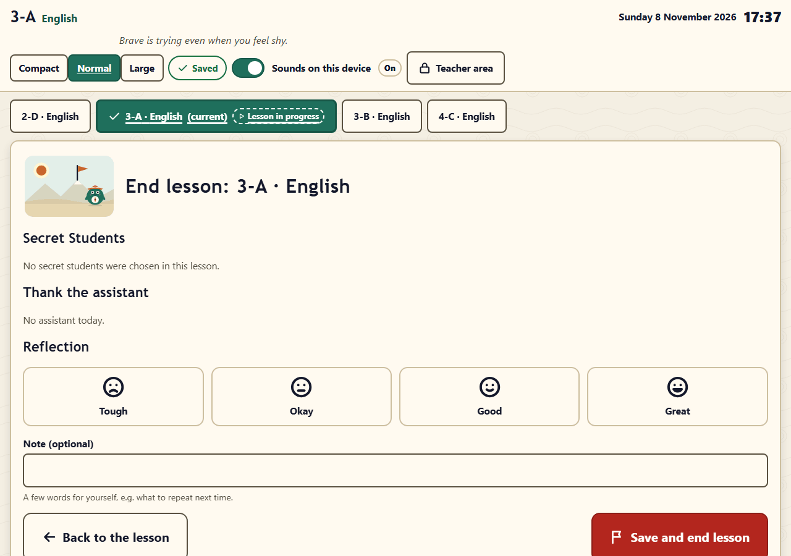

## The classroom screen

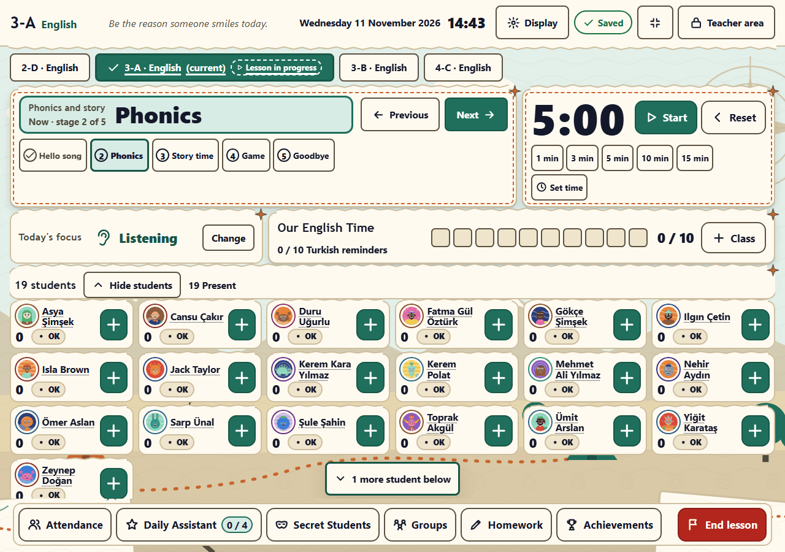

**The top bar** shows the class and subject, the **quote of the day** (if switched on), the day, date and time, and the weather (if the administrator switched it on and the server can reach the weather service). On the right:

- The save state.
- **Display** opens the settings of this screen:
  - **Class language**: only when the class uses two languages, to switch the screen between them.
  - **Sounds on this device**.
  - **Customise layout** (see [Customise layout](#customise-layout)).
  - **Sound check** (see [Sounds and celebrations](#sounds-and-celebrations)).
- **Teacher area** (asks for your PIN).

Under the top bar the lesson board is built from boxes, from top to bottom:

1. **A wide row** with the **routine**, every stage visible, next to a big **timer**.
2. **Today's focus** (the lesson topic, with a pencil button **Change**) and the **counter bar**. Today's focus keeps to one line: with two or three topics it shows the ones that fit and **+1** or **+2** for the others (all of them are on the routine's **Learning goal** stage and in **Change**), so the student cards keep their room.
3. **The student cards**, across the whole width. **Hide students** / **Show students** above them folds the cards away (for example while you show something on the board). There is no size to choose: the cards take the largest size at which every card fits their box, bigger for a small class and smaller for a large one, never below a readable size, with the **+** button always big enough to tap and a name never broken inside a word. Your **Text size** in **Profile and PIN** still makes everything bigger or smaller. When not every card fits (on a classroom display in its window, more than about 24 students under the routine, the timer and the counter, fewer when the cards show marks or your class tabs take two lines; in full screen about 28), the cards scroll inside their box, and a **… more students below** button at the end of the line with **Hide students** says how many are hidden and scrolls to them. A card can also show small marks next to the count: a trophy with the number of achievements the student got in this lesson, and the group number while groups are shown (the groups icon and the number). They show only something positive, never a zero, and disappear when the module is switched off for the class.
4. **Lesson tools**: a row of big buttons at the bottom: **Attendance**, **Daily Assistant**, **Secret Students**, **Groups**, **Homework** and **Achievements**. A button opens its panel full screen; the board under it waits until you close the panel with **Close** (or the Escape key). Messages and **Undo** for what you do in a panel appear inside the panel. A small number on a button counts something for the class, for example the secret students chosen; it never shows anything private. **End lesson** always stays at the end of the row. On a phone the row is one short line: the buttons that fit, **More** with the number of the others, and **End lesson**. On a narrow phone **More** may show only the number (for example **+5**). **More** opens all the buttons over a few lines; **Fewer** folds them again.

A box whose module is switched off for this class is simply not there, and its neighbours take the space. Short messages (for example **Lesson started: 3-A · English**) appear for a moment at the bottom left. Messages with **Undo** stay a little longer.

**With a keyboard** (for example on a laptop connected to the projector): Tab moves from box to box and to the buttons inside them, Enter or the space bar presses a button, and Escape closes a full-screen panel.

### Customise layout

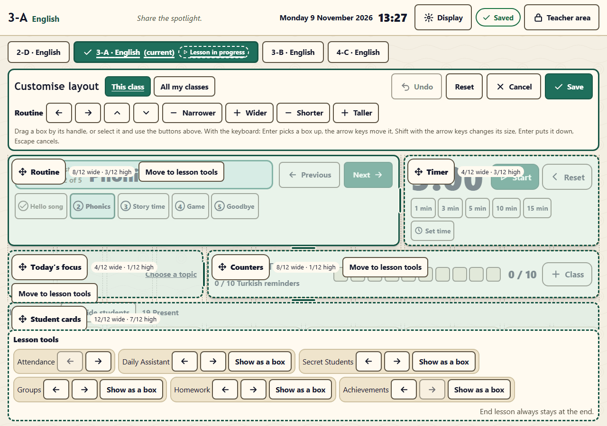

You can move and resize the boxes of the board yourself, for example to make the timer bigger or to put the counters in the lesson tools row:

1. **Display** → **Customise layout**. It asks for your PIN, because the layout belongs to you.
2. Drag a box by its handle to another place, or onto the **Lesson tools** row to make it a button there; drag the line between two boxes to change their width or height. Or select a box and use the buttons above it (**Move … left**, **Wider**, **Taller**, **Move to lesson tools**, **Show as a box**…). With the keyboard: Enter picks a box up, the arrow keys move it, Shift with the arrow keys changes its size, Enter puts it down, Escape cancels.
3. **Undo** takes back the last change. Under **Save for**, choose **This class** or **All my classes**, then **Save**. **Reset** goes back to the default layout; **Cancel** leaves without saving.

The teacher area locks again as soon as you save or cancel. Customise layout needs a wide screen; on a narrow window the button says **Needs a wider screen.** A layout saved for one class wins over the one for all your classes.

### A student's card on the classroom screen

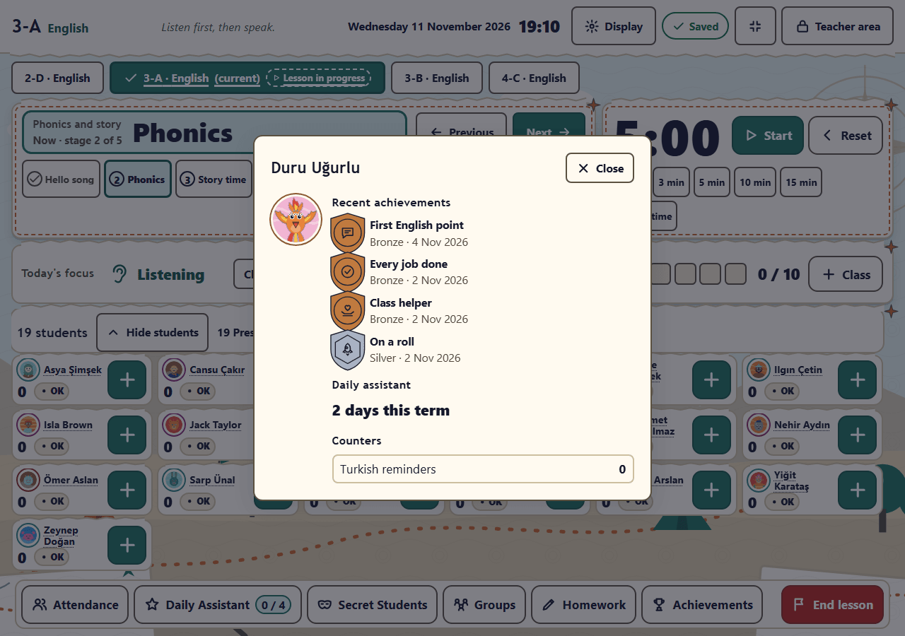

Tap a student's **name** on their card to open a small card for the class to see: **Recent achievements**, **Super Speakers this week** (their own points), **Daily assistant** (days this term) and **Counters** (only while the reminder boxes are on). It shows only positive things: never attendance, homework, goals, notes, levels or comparisons with other students, and it has no link to statistics. The **+** on the student card still counts a reminder, as before. Statistics are only in the teacher area (see [Student statistics](#student-statistics)).

### Lesson goals

**Lesson goals** is off in every class until you switch it on for a class and subject in **Class settings** → **Modules**. Then:

- **Start lesson** has a **Today's goal** step with one optional sentence.
- The board shows **Today's goal** next to **Today's focus**, above the student cards, with a pencil button **Change** (type a new sentence, **Save goal**, or **Remove goal**). A long goal is shown a little smaller, so the student cards keep their room. Without a goal only a small **Set a goal** button stays. Like any box, you can move it or put it in the **Lesson tools** row with **Customise layout**.
- On the routine's **Learning goal** stage the routine box shows the goal too, on its own line under the stage (today's focus moves up beside the stage name), so the class can read it while you talk about it.
- **End lesson** asks **Did we reach our goal?** (only when the lesson had a goal), and the **Lesson saved** summary shows the goal with the answer.
- **Reports** has a **Lesson goals** section: each lesson's goal with the answer, and how many goals were reached, partly reached or not yet reached out of the goals that were answered. A goal nobody answered shows "not recorded".

The goal is shown to the class, so write it for the children. Switching the module off hides the step, the box and the report section; the goals already saved are kept.

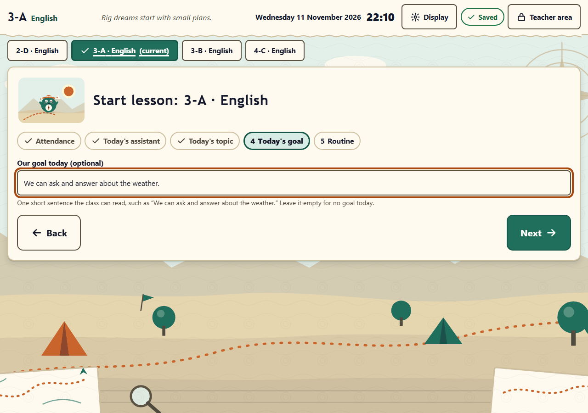

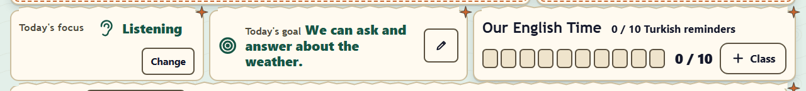

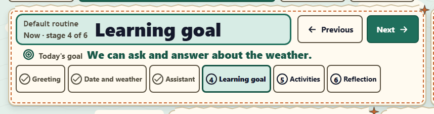

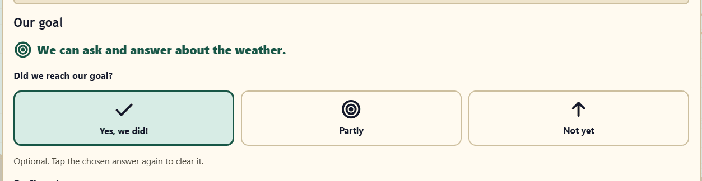

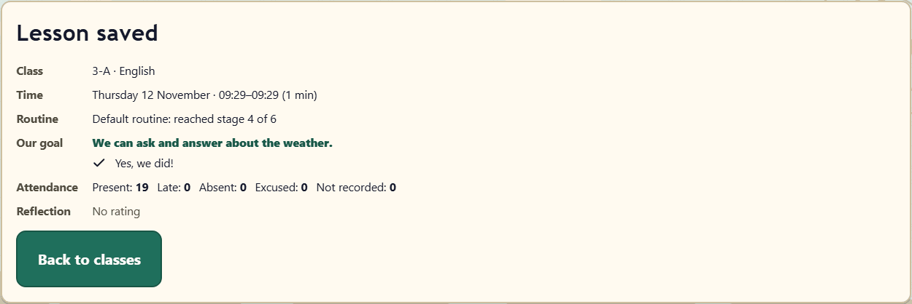

### Routine and timer

- **Routine**: the current stage (**Now · stage 2 of 6**), with every stage of the routine in view. Use **Next stage** and **Previous stage**, or tap a stage. Stage names are always shown in whole words: a longer name (often in Turkish) takes two lines inside its button. A routine with many stages, too many to name on one line, shows the other stages by their number only (their names are still read out by a screen reader); the current stage is always named, in its button and in big type above.
- **Timer**: choose 1, 3, 5, 10 or 15 minutes, or **Set time** to type a time on the number keys (1 3 0 is 1:30). **Start**, **Pause** and **Reset**. When the time is up, Class Compass plays what the class chose in **Class settings** → **When the timer ends**.

### Attendance during the lesson

**Attendance** (in the lesson tools row) opens the list for today. A change normally applies to the **whole day** and is shared with the other teachers of the class. Tick **Only for this lesson** when a student arrives late or leaves during the day. **Everyone else present** fills the rest. Older days and lesson exceptions are on the **Attendance** page of the teacher area.

### Counters

A counter counts something for the whole class (the **class bar**) and/or for each student, for example English reminders. Tap **+** on the class bar to add one. When the bar is full, the chosen response appears once, calmly, and never names a student. If the response is "Class reset", **Start the bar again** sets the bar back to 0 after you confirm (the taps stay recorded). For 10 minutes the counter then shows **Undo the reset**, which brings the bar back as it was, until the next tap on that counter. Filling the bar plays a short sound when the class sounds are on.

Each student card shows the student's count with a **+** button. To hide them for a class, switch off **Reminder boxes on student cards** in Class settings → Counters. Every tap shows a short message with **Undo**. Counters are counts, never scores. Create and edit counters, their labels, limit, levels and responses on the **Counters** page; **Weekly history** shows counts per student and week.

### Groups and the group screen

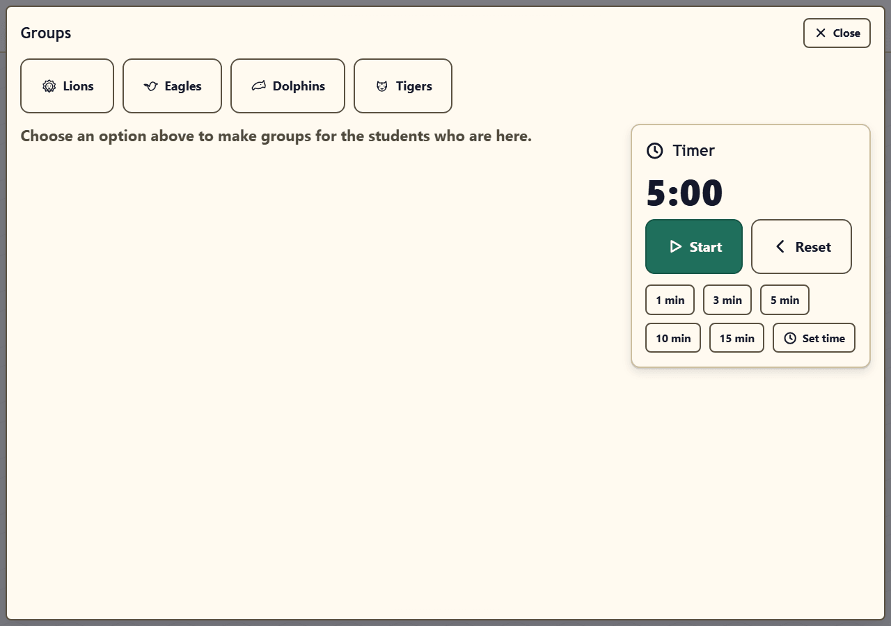

Press **Groups** in the lesson tools row (when Groups is a box on your board: **Choose groups**, or **Open groups** when groups are already shown). The full-screen group screen shows the group options; the four default options are Lions, Eagles, Dolphins and Tigers, each giving Group 1 to Group 5.

- Tap an option to make groups for the students who are here. Absent students are left out for this lesson only.
- **Shuffle** makes new groups; **Undo shuffle** brings the previous ones back.
- To move a student, drag the name onto another group, or tap the name and then **Move here** on the new group. On a tablet, press and hold the name before you drag it. **Not in a group** under the groups takes a student out of the groups for this lesson. With a keyboard, go to a name, press the right arrow to reach its drag handle, press Enter, Tab to the group and press Enter again.
- **Save to option** keeps these groups in the option for next time.
- A student you tapped to move is highlighted, and **Cancel** next to the message puts them back.
- The timer is on the group screen too.

Levels, pair rules ("should / should not work together") and their notes are **never** shown on the classroom screen. You manage them on the **Grouping** page (tabs **Arrangements**, **Levels**, **Pair rules**). In Class settings you can show student names in capital letters on the group screen.

**Levels** tab: type each student's level and press **Save**. Numbers, codes such as A1 and B1, and the usual words (Beginner … Advanced, Başlangıç … İleri) are put in their real order; other words come after them in alphabetical order. **Order used** shows the order level groups will use.

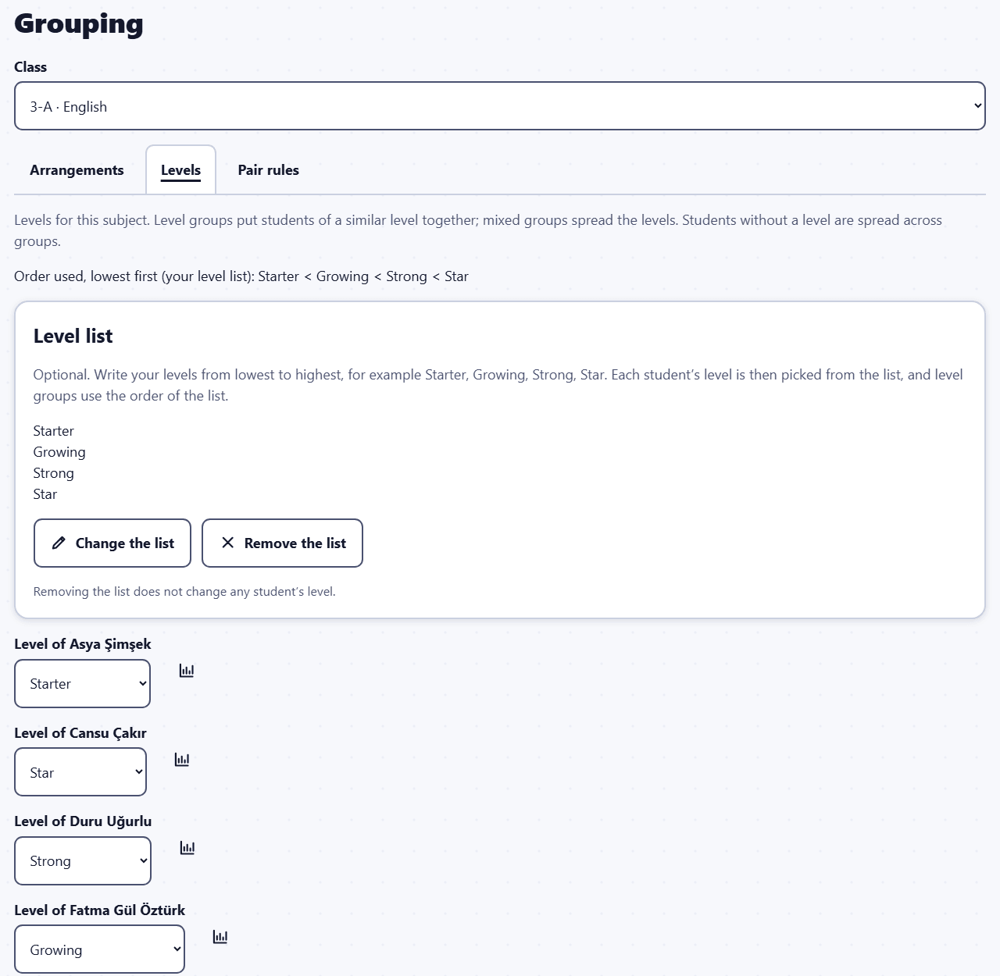

**Level list** (optional) lets you choose your own words and their order, for example Starter, Growing, Strong, Star:

- **Make a list from the levels used now** starts with the levels your students already have, in the order used now. **Start an empty list** starts from nothing.
- Write one level per line, lowest first. Use the up and down arrows to change the order, **Add a level** for another line, and the cross to remove one. Press **Save the list**.
- While the list exists, each student's level is chosen from it (or **No level**). A level that is not in the list stays and is shown as "(not in the list)"; level groups put such levels after the list. Under **Levels not in the list** you can change all students with that level to a level from the list.
- The list belongs to the class and subject, so every teacher of that class and subject sees the same list. Changing the list does not change the groups you already have: press **Make new groups** (or **Shuffle** on the group screen) to use it. **Remove the list** goes back to typing levels; no student's level changes.

**Edit groups** (Arrangements tab) shows the groups side by side. Drag a name onto another group or onto **Not in a group**, or tap a name and then **Move here** on the group. Nothing is saved until you press **Save**. **Group name and roles** under each group holds its English and Turkish name and the optional roles.

### Daily assistant

**Daily Assistant** (in the lesson tools row) shows today's assistant and their responsibilities with tick boxes; the ticks from the start screen are already there. If the assistant is marked absent, the next student takes over automatically. **Hide** / **Show the assistant** hides the panel for this lesson; the default is set on the **Daily Assistant** page (**Settings**: school days, responsibilities, **Show the assistant panel in lessons**). On the **Week** tab you **Plan this week**, **Announce** the plan, swap two days or **Set assistant** for a day; **History** shows the turns.

### Secret Student

1. During the lesson open **Secret Students** and press **Choose secret students**. Class Compass picks students who are present (2 by default; 1 to 10 on the **Secret Students** page). Nobody, not even you, sees who until the end of the lesson. **Choose again** puts them back and picks new ones.
2. At **End lesson**, press **Reveal the secret students**. A short countdown with a drum roll plays (**Show at once** skips it).
3. Under **For your records**, record a result for each: **Goal met**, **Still practising** or **Not assessed**, with an optional note.
4. **Celebrate {name}** plays the celebration for that student.

A chosen student who is absent is replaced; a student who was away keeps their turn for a later round.

### Achievements: giving an achievement in class

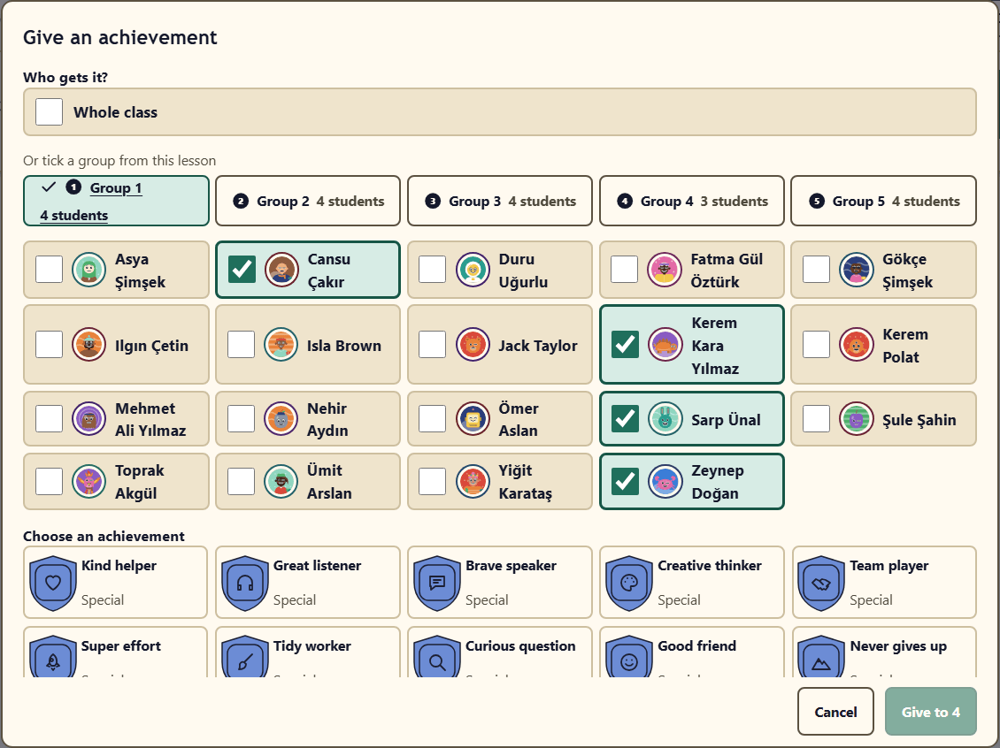

1. Open **Achievements** and press **Give an achievement**.
2. **Who gets it?**: tick students or **Whole class**. While groups are shown in the lesson, **Or tick a group from this lesson** lists them: one tap ticks everyone in that group who is here, a second tap unticks them. Students you ticked by hand stay ticked.
3. **Choose an achievement**. Tick **Celebrate on the display** for a short celebration with the achievement, the names and the avatars.
4. Press **Give to N**.

Right after you give an achievement, a message at the bottom of the screen offers **Undo** for a few seconds. After that you can still undo an achievement given in this lesson for 10 minutes (**Achievements given this lesson** → **Undo**). Later, remove an achievement given by mistake in the teacher area (see [Achievements and avatars](#achievements-and-avatars)). Automatic achievements are never announced on the display; a class can collect them in the End Lesson step **Well done!**.

### Homework in class

If **Allow checking on the classroom screen** is on (Homework → Settings; off by default), **Homework** shows the homework due this week with a **Check** button for each. **Close** is next to the title of the checking list. Private notes are never shown on the classroom screen.

### Sounds and celebrations

- **Class settings** → **Classroom display**: **Theme**, **Sounds** with **Volume** and **Try**, **Animations**, **Quote of the day** and **When the timer ends**: **Say "Time's up!"** (spoken in English by the computer; the chime plays if it has no English voice), **My own recording**, **Chime** or **Silent**.
- **My own recording**: in **Profile and PIN** → **My time's-up recording**, record up to 5 seconds or choose a sound file.
- **Sounds on this device** (classroom top bar → **Display**) mutes this device only.
- Browsers play sound only after someone has tapped the screen or pressed a key. Until then the top bar shows **Sound is off · Turn sound on**; tap it (any tap works) and a short test sound plays. If you still hear nothing, open **Display** → **Sound check**: it says what is wrong (sounds off for the class or this device, volume 0, the browser waiting for a tap), shows the **Last sound**, has **Test sound**, and **Copy diagnostics** copies the details for whoever looks after Class Compass. Also check the computer's own volume and speakers.
- Celebrations play only after you do something on the screen (a revealed Secret Student, **Celebrate on the display**), never by themselves. A device that asks for reduced motion gets a calm version without movement.

## Homework checking

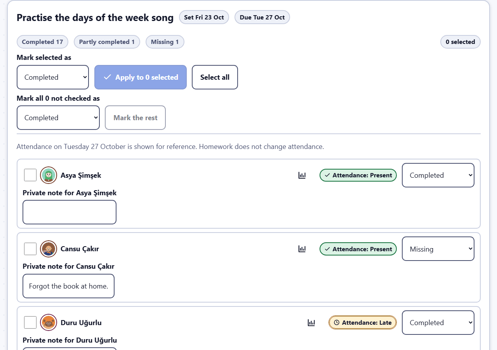

On the **Homework** page, choose the class and subject.

- **Assignments**: **Add homework** with a title, details, **Assigned on**, **Due on** and an optional **Private note** (only you see it). Browse by **Day**, **Week** or **Month**, by due date or assigned date.
- **Check {title}** opens the checking list: select students (or **Select all**), choose **Mark selected as** and press **Apply to N selected**. **Mark all N not checked as** + **Mark the rest** finishes the list. You can undo a batch, and add a private note per student. Attendance on that day is shown for reference only.
- **Outstanding** lists work marked missing or partly completed.
- **Settings**: the statuses (new homework uses the list; existing homework keeps its statuses) and **Allow checking on the classroom screen**.

A student without a mark is **Not checked**, never "Missing".

## Goals, evidence and feedback

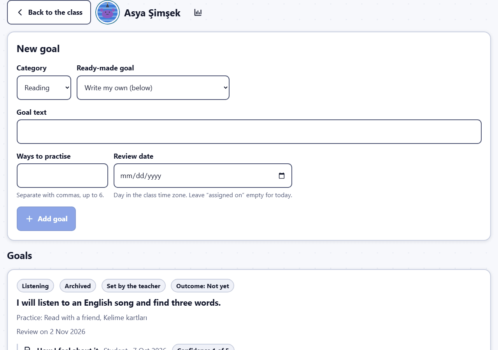

On the **Goals** page, choose the class and subject. The **Students** tab lists every student with active goals, achieved goals, evidence, their latest confidence and last activity. Tap a name to open the student:

- **New goal**: pick a **Category** and a **Ready-made goal**, or **Write my own (below)** and type it in **Goal text**; add **Ways to practise** (up to 6, separated by commas) and a **Review date**.
- On each goal: **Progress update**, **Record outcome** (your four outcome labels) and the student's own reflections and self-assessments ("How sure do you feel?", 1 to 5). The student's self-assessment and your assessment are always kept apart.
- **Evidence**: you can add evidence too (it is marked "Teacher" on the student's page and the student cannot change it): **Write**, **Add a link**, **Add a document**, and, only if your administrator allowed them, **Add a picture**, **Take a picture**, **Record my voice**, **Add a voice file**, **Record a video** and **Add a video** (up to 3 minutes: MP4, MOV or WebM, and the size the form names, 90 MB unless the server is set otherwise or the student's space is nearly full; **Record a video** uses the camera in the page with a timer that stops at 3:00, and on a phone or tablet **Use the camera app instead** opens the camera app, which makes big files and may store a location; a bar shows how far an upload is). Videos play on the page for you, the student and administrators only. **Delete evidence** removes your own evidence and its file.
- **Add evidence** on a goal opens the evidence form for that goal (for example a worksheet the student did in class, as a document). The list under **Evidence** shows which goal each item is for. Photos of students still follow the school's consent rules: add a picture only when your administrator allowed photo evidence.
- **Feedback for the student**: choose a goal or **All goals in this subject**, write and **Save feedback**. The student reads it on their page.
- **Show topic** filters goals and evidence by category.
- **Hide from student page** hides a student's goal, entry or evidence from their page (for example after a mistake). The words are kept as the student wrote them, and the change is recorded.

The **Categories and preset goals** tab holds the school's default categories and goals and your own. **Archive** hides a default for your classes only (other teachers are not affected); **Restore** brings it back. Items marked "Archived by the school" were archived by the administrator. **Rename** gives any category a new name, one box per language of your classes in that subject. For a default category the new name is yours only: your classes, their student pages, lesson topics and reports show it, goals stay in the category, and other teachers keep the school name (marked **Your name**; **Use the school name** goes back). **Outcome labels** sets the four labels you use when you assess a goal.

### Sentence starters

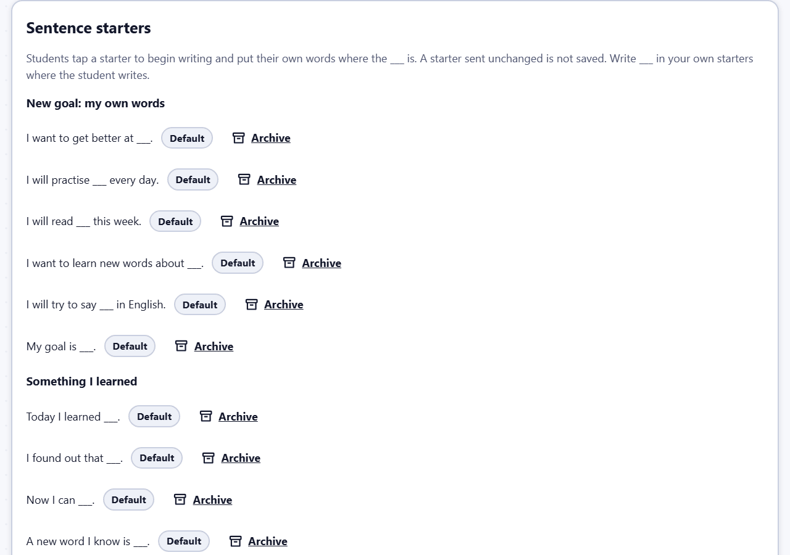

On their page, students can tap a **sentence starter** to begin writing, for example "I want to get better at ___." The starter goes into the box with the ___ selected, and the student types their own words in its place. A starter sent unchanged is not saved: the student is asked to finish the sentence.

The **Sentence starters** list is on the **Categories and preset goals** tab. Class Compass has built-in starters in English and Turkish for each place where students write (**Where students see it**: **New goal: my own words**, **New goal: practice ideas**, **How is it going?**, **Something I learned**, **Note to myself**, **Show my work: words** and **Show my work: a few words about a picture, file or link**).

- **New sentence starter**: choose where students see it, optionally **Only for goals in this category**, write the starter in English and/or Turkish with ___ where the student writes, and press **Add sentence starter**. Class Compass checks that the starter reads as a kind, real sentence once a word is put in place of ___.
- **Archive** hides a built-in starter for your classes only; **Restore** brings it back. Starters archived by the administrator are gone for the whole school.

When a student types an unkind word or nonsense, Class Compass asks them kindly to change it and does not save the text. See [Kind words check](#kind-words-check).

## Private notes

On a student's goals page, **Private notes** are for you only. They are never shown to the student, on the classroom screen or to other teachers. Be aware: the school's **full data export**, which only administrators can make, includes them. The export of one student's data does not.

## Student links and printing cards

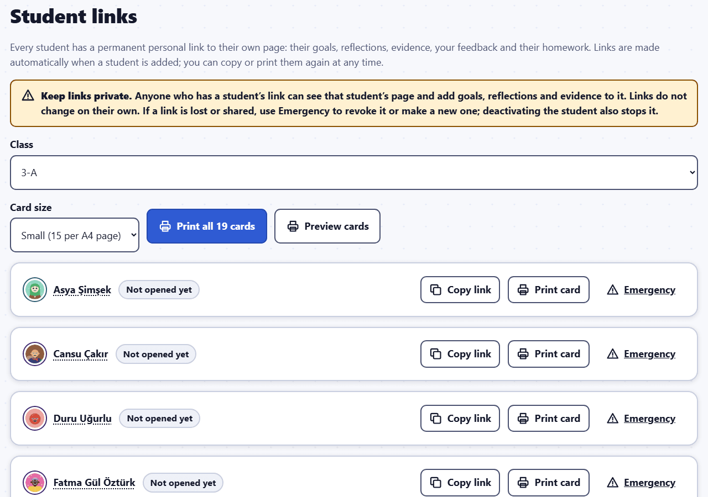

Every student has one **permanent personal link** to their own page (goals, reflections, evidence, your feedback, homework, achievements and avatar). Links are made automatically when a student is added.

On the **Student links** page, choose the class. For each student you can **Copy link**, show the QR code, or **Print card**. When the browser cannot copy by itself (for example on a school network without https), the link opens in a small window, already selected, so you can copy it by hand. **Print all cards** prints the whole class on A4: **Small (15 per A4 page)** or **Large (8 per A4 page)**; **Preview cards** shows them first. The QR codes are black on white in every theme.

> **Keep links private.** Anyone who has a student's link can see that student's page and add goals, reflections and evidence to it. Links do not change on their own.

**Emergency** (when a link or card has been lost, shared or seen by someone who should not have it):

1. Press **Emergency** next to the student.
2. Choose **Revoke the link (no new link)** or **Make a new link**.
3. Write a **Reason**, type the student's full name to confirm, and press **Revoke link** or **Make new link**.

The old link and all printed cards stop working at once. The list then shows "Link revoked on …" or "A new link was made on …" so you can collect old cards. This is recorded in the audit log. Deactivating a student also stops their link.

## Achievements and avatars

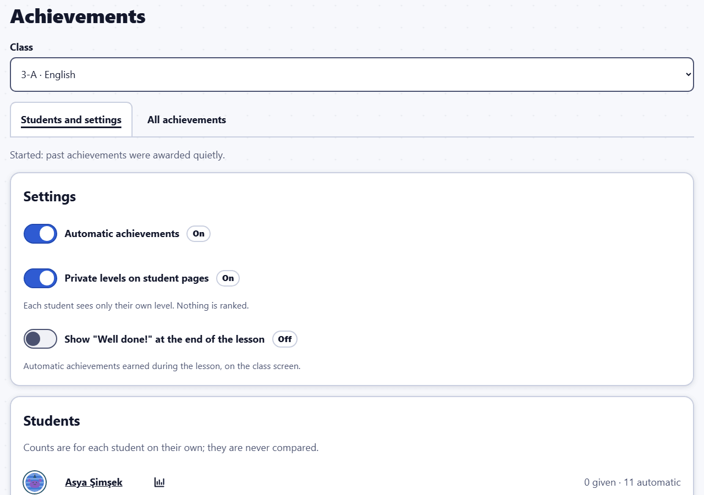

On the **Achievements** page, choose the class and subject.

**Students and settings**

- The first time, Class Compass asks **How should achievements start?**: **Award past achievements quietly** (achievements for work done before today, without celebrations) or **Start fresh from today**. You can give achievements by hand at any time before you choose.
- **Automatic achievements**, **Private levels on student pages** (each student sees only their own level; nothing is ranked) and **Show "Well done!" at the end of the lesson**.
- Give an achievement to a student, or **Remove** an achievement given by mistake with a reason (kept in the history). Automatic achievements follow what the student did and cannot be removed by hand.

**All achievements**: every achievement, grouped by kind (goals, evidence, homework…; tap a group to open it), each with its level (Bronze, Silver, Gold) next to the name. **Make your own achievement**: a name, what it is for, a picture, a level and **How it is given** (**Given by the teacher**, or **Automatic** with a rule such as "adds evidence, 5 times"). **Hide for my classes** hides a built-in achievement for your classes; **Show again** brings it back.

Achievements reward effort: none depends on attendance, speed or comparing students, and a student's page shows only their own achievements and level. Achievements appear on the classroom screen only when you celebrate one or the class shows **Well done!**.

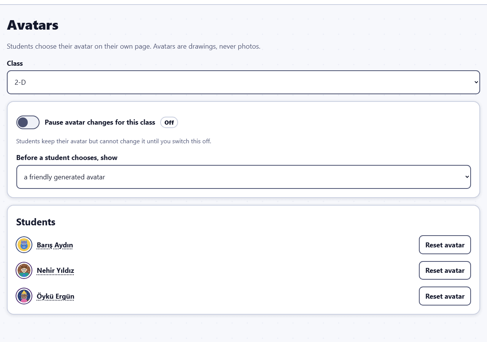

**Avatars**: students choose their avatar on their own page; avatars are drawings, never photos. On the **Avatars** page you can:

- **Pause avatar changes for this class** (students keep their avatar but cannot change it);
- choose what to show **Before a student chooses**: **a friendly generated avatar** or **the initials**;
- **Reset avatar** for one student (you confirm by typing; the student sees the generated avatar until they choose again);
- turn on **Students may send their own picture** (off by default; only while the administrator has turned own pictures on for the school). Pausing avatar changes also stops new pictures.

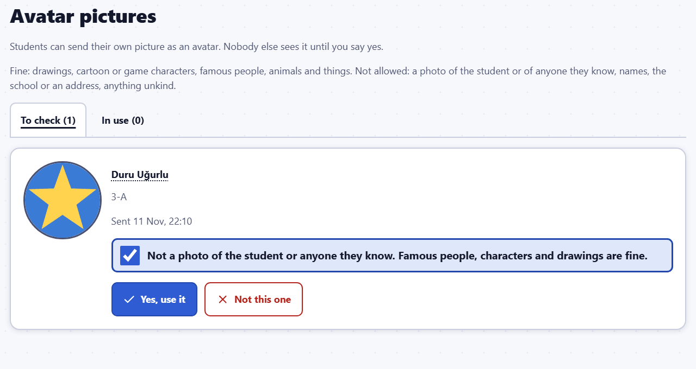

**Avatar pictures** (on the teacher menu, with the number to check): pictures your students sent as their avatar. Nobody else sees a picture until you say yes.

- **To check**: oldest first, with how long until it is deleted (a picture nobody checks is deleted after 14 days). Before **Yes, use it**, tick **Not a photo of the student or anyone they know. Famous people, characters and drawings are fine.** **Not this one** asks why (**A real person you know**, **Not kind or not suitable**, **Shows a name or place**, **Hard to see**): the student sees the reason and the picture is deleted at once.
- **In use**: the pictures students use now. **Remove** deletes one at once; the student gets their avatar back.

Approved pictures are kept in the school's backups like other uploads; copies in earlier backups go when those backups expire. Your notifications can tell you when a picture waits (**Own pictures to check**, can be turned off).

### Kind words check

The **Kind words check** page explains how student texts are checked. You can add **Words I block for my classes** (one per line). **Tell me when students try unkind words** (off by default) shows only how many times each student tried; the words themselves are never stored.

## Class settings

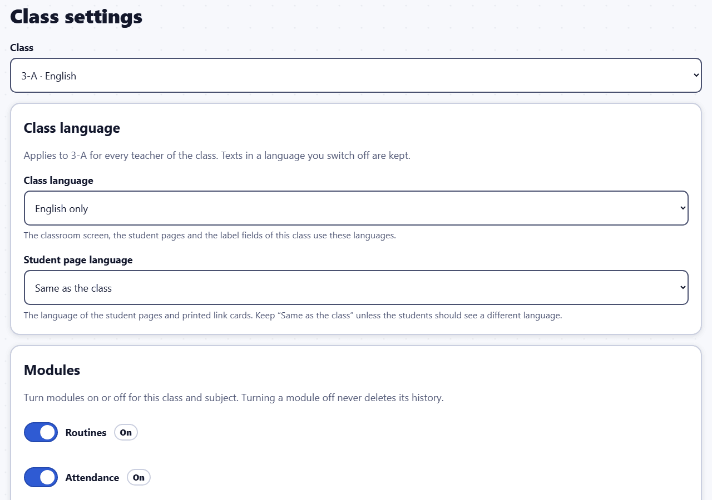

Choose the class and subject at the top.

- **Class language**: **English only**, **Turkish only**, **English, with Turkish as second language** or **Turkish, with English as second language**. It applies to the classroom screen, the student pages and the label fields of this class, for every teacher of the class. Texts in a language you switch off are kept. Every name field (routines and stages, counters, homework statuses, goals, groups, assistant duties, lesson topics) shows one box per class language, the main language first; **Needs translation** marks a box that is still empty while the other language has text (the class sees the other language until you fill it). The **Categories and preset goals** tab of **Goals** (new categories, ready-made goals and your own sentence starters) shows the languages of all your classes in that subject, because what you add there appears in each of them. The ready-made texts of a new class (assistant duties, the English reminder counter, group names) are written in its languages; when you switch a second language on, the ones you never changed get it too. **Student page language** can differ from the class (for example an English classroom with Turkish student pages); keep **Same as the class** otherwise.
- **Modules**: switch modules on or off for this class and subject. "Turned off by your administrator" means you cannot switch it on. Some modules show their own settings under the switch (Counters: reminder boxes; Grouping: capital letters on the group screen; Secret Students: how many are chosen; Homework and Goals settings). **Lesson goals** is the one module that starts off in every class; switch it on where you want a goal for each lesson.
- **Classroom display**: theme, sounds and volume, animations, quote of the day and what happens when the timer ends (see [Sounds and celebrations](#sounds-and-celebrations)).

## Reports and CSV

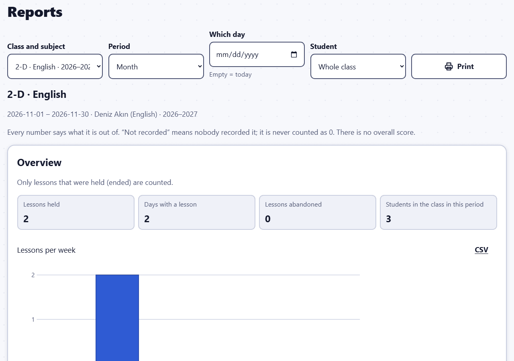

On the **Reports** page, choose the **Class and subject**, the **Period** (**Day**, **Week**, **Month**, **Term**, **School year** or **Custom**) and, optionally, one **Student** (then you also see their **Timeline**). Sections follow the modules: overview, attendance, counters, homework, goals and skills, reflections, assistant, Secret Students, grouping, achievements, Super Speakers, topics and lesson goals. Each section can be folded with its title; **Open all sections** and **Close all sections** do it for every section.

### Report views

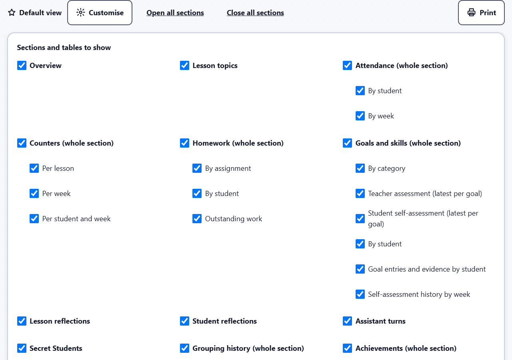

A **View** is a choice of sections, so a report shows only what you need:

- Built-in views: **Everything**, **Attendance & homework**, **Goals & reflections**, **Classroom tools**, **Achievements & Super Speakers** and **Student overview** (one row per student in each area).
- **Customise** opens the list of sections and their tables; tick what to show. The view then says "(changed, not saved)". **Save as new view…** keeps the choice under a name (up to 30 views); **Save changes to “…”** updates a view of your own; **Undo changes** goes back; **Delete view** deletes only the saved choice, never report data. A view saves only the choice of sections, not the class, student or period.
- **Make default**: the view marked ★ opens first on the Reports page, on every device you sign in on.

The address of the page always holds the class, student, view and period, so a bookmark or a link from another page (for example **Open full report** in a student's statistics, or **Open** on a notification) opens the same report again.

- Every number says what it is out of. "Not recorded" means nobody recorded it and is never counted as 0. There is no overall score.
- **CSV** under each table downloads it for a spreadsheet; **Print** prints the report on A4.
- You see only your own classes and subjects, also from earlier years; an ended assignment covers only the days you taught it.

## Student statistics

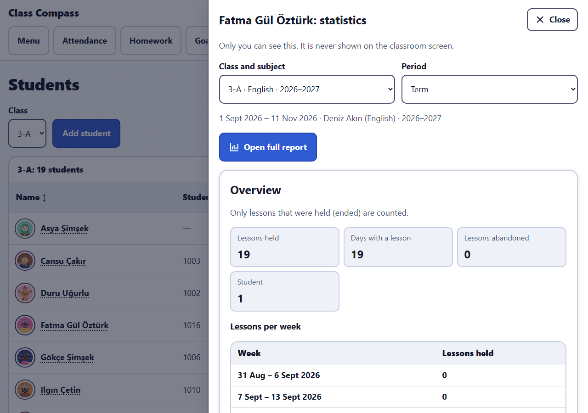

In the teacher area, a student's **name** opens their statistics almost everywhere: on **Students**, **Attendance**, **Student links**, **Avatars**, **Homework**, **Daily Assistant**, **Secret Students**, the **Kind words check** and in every report table. Where the name already does something (on **Goals** and **Achievements** it opens the student), a small **Statistics for …** button next to it opens them instead.

The statistics panel shows the class and subject (choose another one if the student is in several of your classes), a period, the **Student overview** report in short sections and the **Latest events**. **Open full report** opens the Reports page for that student. Only you see this panel; it is never shown on the classroom screen, where a name opens only the small positive card (see [A student's card on the classroom screen](#a-students-card-on-the-classroom-screen)).

## Notifications

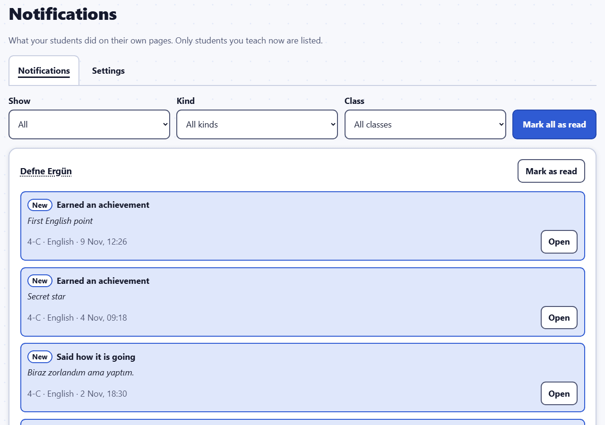

The **bell** on the teacher menu and in the row of links shows how many new things your students did on their own pages: new or changed goals, goals reached, reflections, notes, self-assessments, work they showed (writing, links, pictures, documents, voice, videos), achievements earned, avatars changed, a student link opened on a new device, text stopped by the kind words check (a count only) and Super Speakers points (one line a day). Only students you teach now are listed, and only for modules that are on.

On the **Notifications** page:

- Lines are grouped by student. Filter with **Show** (**All** or **New only**), **Kind** and **Class**. A short piece of the student's text is shown where there is one; text that was hidden, deleted or stopped never appears.
- **Open** takes you to the right page with the class and the student chosen (their goals, their achievements, the report…). **Mark as read** marks one student's lines; **Mark all as read** (or **Mark these as read** with a filter on) marks the rest.
- The **Settings** tab: **What to show under the bell** (tick the kinds you want) and the **Daily email**: **Send me a daily email** after the hour you choose. The email says only how many new things are waiting; **Name the students in the email** adds each student's name with a count. It never contains what students wrote. The email needs an email address on your account and a school that sends email; the tab tells you when one is missing.

## Assistant

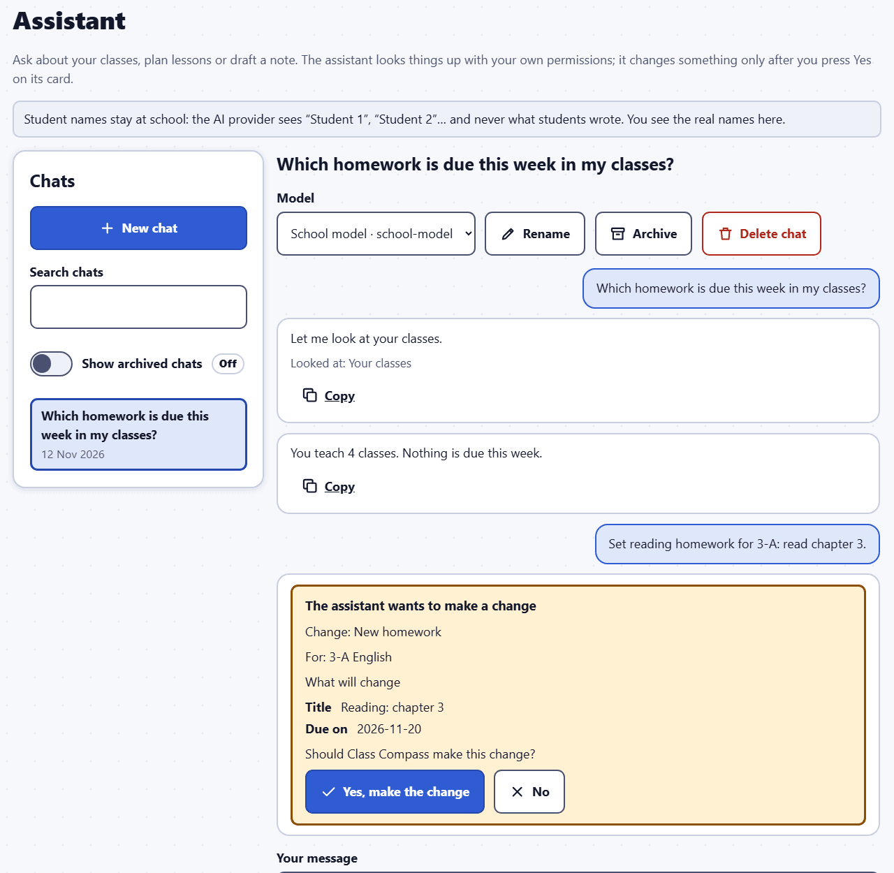

**Assistant** (teacher menu → Today) is a chat with an AI model about your classes: ask what homework is due, have a report summarised, plan lesson topics or draft a note for parents. It works only when an administrator has switched it on and the school's AI tools are on; otherwise the page says why. On a classroom computer the PIN is asked first, and the assistant is never on the classroom screen or a student's page.

- **New chat** starts a chat; the list on the left (on a phone: **All chats**) has **Search chats**, **Show archived chats** and your earlier chats to continue. In a chat: **Rename**, **Archive** (or bring it back) and **Delete chat**. **Model** chooses one of the connections your school (or you, if allowed) set up.
- The answer appears as it is written; **Stop** ends it (what was written stays, marked as stopped). Lines like "Looked at: Class list (3-A English)" say what the assistant read for you; it reads with your own permissions, nothing more.
- **Nothing changes without you.** When the assistant wants to change something (set homework, write a goal, give feedback…), it shows a card: what will change, for which class or student, and **Yes, make the change** or **No**. Only Yes makes the change, exactly as the card shows it, once. The card shows a text exactly as it will be saved and every item of a list (for example all the homework marks); a change that is not one of your classes or students says so and will be refused. Writing a new message instead leaves the card unanswered and nothing changes. Changes are in the audit log under your name, "through an AI tool".
- **Copy** under an answer copies it. Class Compass never sends anything to parents or anyone else: a parent note is a draft that you copy and send yourself.
- Answers are formatted: headings, lists, tables, **bold** text and code. A code block has **Copy code**, and a JSON block (for example a theme package) also **Download as file**. Links open in a new tab; pictures and web page code in an answer are never shown or run, only their text.
- **Attach a file** adds one text file to your next message: a .json, .txt or .md file of up to 200 KB, such as a theme file you already have. It is sent as text with the message (you see it in the chat as a code block). The assistant treats it as data, never as instructions to follow. A theme file is saved exactly as you attached it. Pictures and other files cannot be attached; never attach student work or files with student data.
- **Theme drafts.** Ask the assistant to design a theme for your class ("a calm autumn theme"), or attach a theme file. It checks the package and, when it has no errors, offers to save it as a **theme draft**: a card shows the theme's name, key and base theme, and **Yes, make the change** saves it. A draft does not change anything for your classes: an administrator looks at it on **Themes** (it shows "Proposed by" with your name), and only an administrator can enable it. You can have up to 5 drafts waiting (and all teachers together up to 10).
- **What the AI provider sees:** while your school keeps student names inside the school, the provider sees "Student 1", "Student 2"… and never what students wrote; you see the real names on the page. The line above the chat says which applies. Treat the answers as suggestions and check them.
- Your chats are private: administrators cannot read them. They are deleted a school year after their last message (your administrator can change the period). **Download my chats** saves all of them, with the real names, as a file.

More about what leaves the school: [AI tools](ai-tools.md#the-assistant-chat).

## Students and importing a student list

On the **Students** page you can add a student to your class, add a photo (only when the administrator allowed student photos; you confirm that consent was given) and **Remove from this class**. On a phone each student is a card with the button at the bottom. Deactivating and deleting students is done by the administrator.

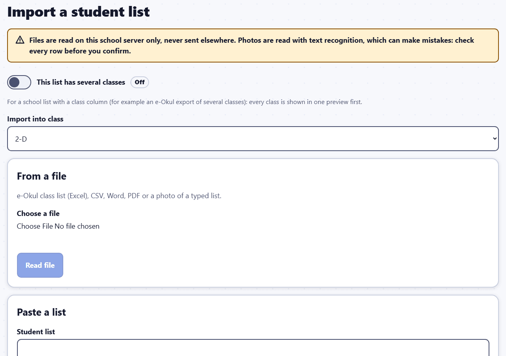

**Import a student list** adds a whole class at once:

1. Choose **Import into class**.
2. **From a file**: an e-Okul class list (Excel), CSV, Word, PDF or a photo of a typed list, then **Read file**. Or **Paste a list**: one student per line, for example "1203 Ayşe Nur Kara"; rows copied from Excel work too.
3. A workbook with several sheets asks **Which sheets should be read?**; the largest is ticked for you. Press **Read the chosen sheets**.
4. **Check the list**: under **Columns**, check which column holds the name, number or class. Rows that need attention are marked (for example "Possibly an existing student"). For each such row choose **Add as new student**, **Existing student** or **Skip**.
5. Press **Confirm: add N, link M**, or **Continue later**.

**A list with several classes** (a school list with a class column): turn on **This list has several classes** first. **Classes in this list** shows each class of the file with its number of rows. Your own classes are recognised however they are written (3/A, 3-A, 3 A, "3. Sınıf / A Şubesi"); other classes are marked **Not one of your classes** and skipped, because you can only import into the classes you teach. Press **Make previews for N classes**, then **Check** each class and confirm it as above. Each class has its own report and its own **Undo import**. A child listed under two of your classes in the file is marked **Also under another class in this list**: the first copy needs your choice and later copies are skipped. When a class you confirmed first now matches a name in another class of the same list, confirming that class marks the row so you can decide.

A .xls file that is really a web page (some school systems save lists like that) is read too: only the text of its table.

Files are read on the school's own server only. Photos are read with text recognition, which can make mistakes: check every row. Names are kept exactly as written. **Earlier imports** lists your imports; **Undo import** (type the class name) removes the students an import added, or deactivates them if something has been recorded for them since.

## Other teacher pages

- **Attendance** (Today): any day of your classes, with notes and lesson exceptions; who recorded what.
- **Lesson topics** (Class setup → Lesson tools): the weekly plan (up to 3 topics a day) and your own topics with icons.
- **Routines** (Class setup → Lesson tools): your routines and their stages, and the routine for each class. A running lesson keeps its routine.
- **Counters**, **Daily Assistant**, **Secret Students**, **Grouping** (Class setup → Lesson tools): the settings and history of these modules.
- **AI tools** (in **Profile and PIN**, only when your administrator switched AI tools on): personal tokens and connected AI apps. See the [AI tools guide](ai-tools.md).

## Getting help

**Help** in the teacher menu opens these guides in your interface language. **English | Türkçe** at the top switches the guide and the list of guides to the other language. On a phone the list of guides is folded into one line above the guide (**Guides: …**); tap it to open another guide. Tap a picture to open it full size. Your administrator has the [administrator guide](admin.md); students and parents have their own [guide](student.md).
