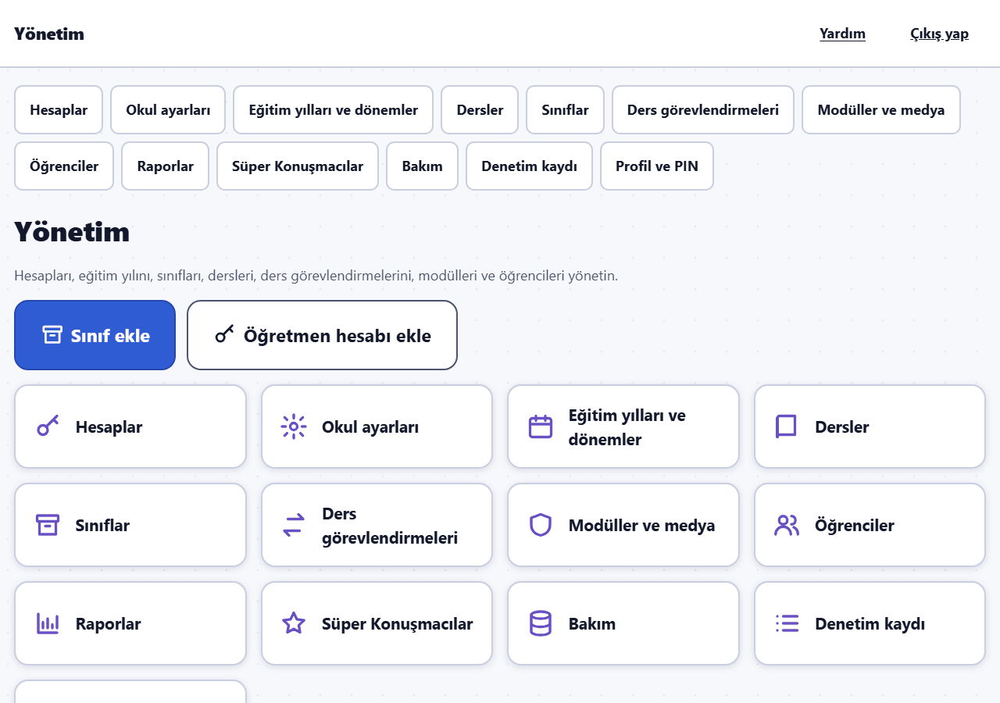
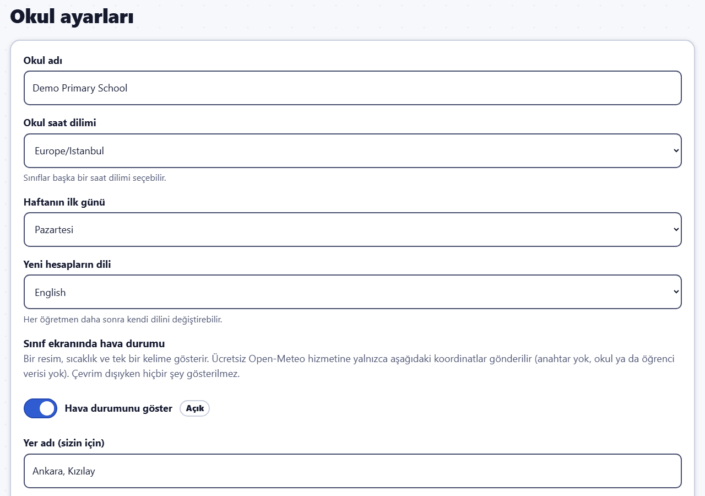
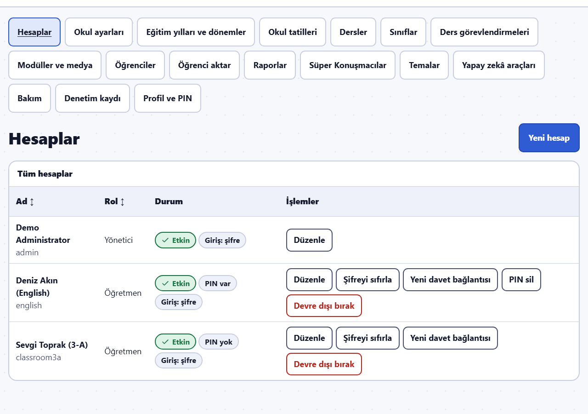
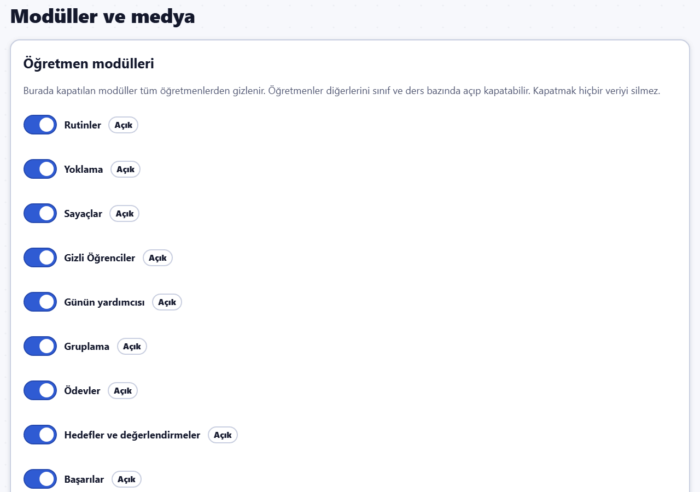
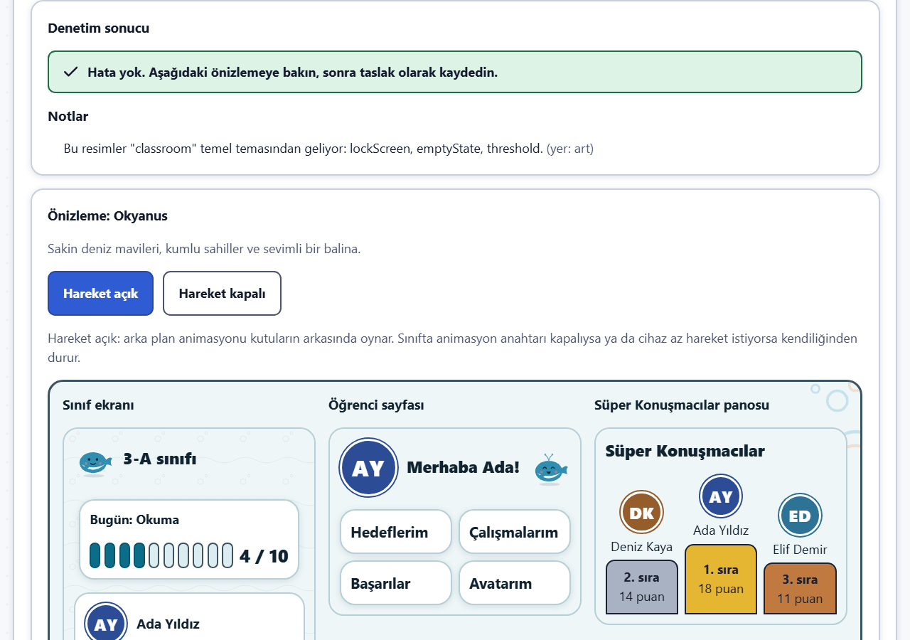
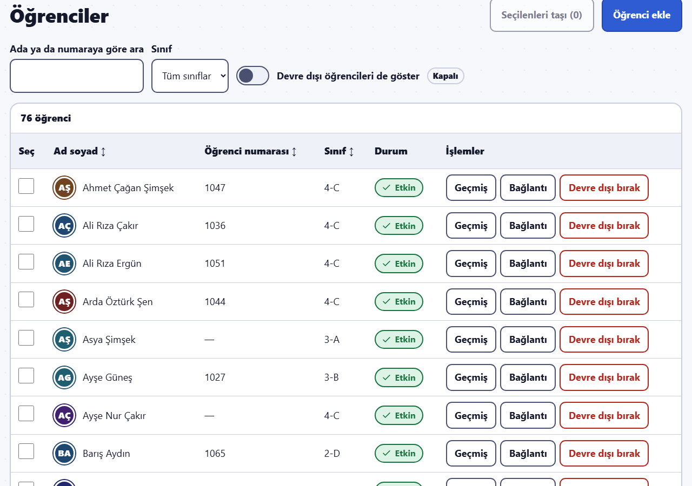
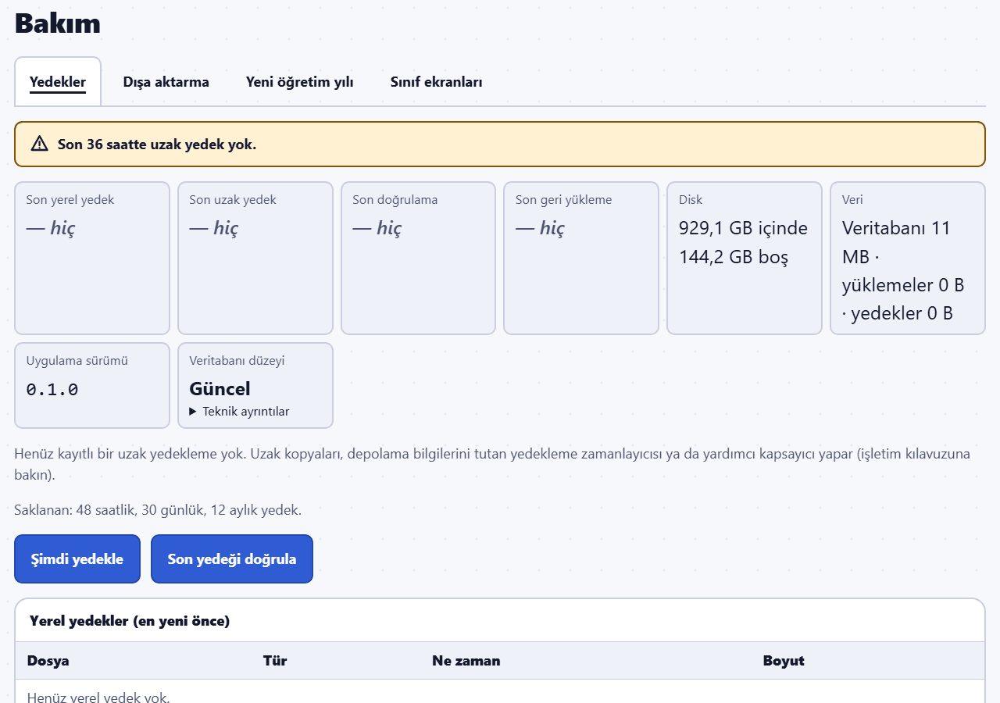

# Yönetici kılavuzu

Bu kılavuz okulun Sınıf Pusulası yöneticileri içindir: okulu kuran, hesapları açan, öğrenci kayıtlarıyla ilgilenen ve verileri güvende tutan kişiler. Sunucunun kendisi (kurulum, e-posta ayarları, diskteki yedekler, geri yükleme) bilgi işlem sorumlusu için Sınıf Pusulası deposundaki `docs/OPERATIONS.md` dosyasında anlatılır; bu kılavuz gerektiğinde oraya yönlendirir.

Resimler hayali demo okulundan alınmıştır. İçlerindeki bütün adlar uydurmadır.

Aceleniz mi var? [Yöneticiler için hızlı başlangıç](quick-start-admin.md)'a bakın.

## Yönetim alanı

Giriş yaptıktan sonra **Yönetim** sayfası açılır. En sık yapılan iki iş **Sınıf ekle** ve **Öğretmen hesabı ekle**'dir; kutucuklar bütün bölümleri açar, diğer sayfalarda bunu menü çubuğu yapar (telefonda ya da tablette tek bir **Bölüm** listesidir). Üst çubuktaki **Yardım** bu kılavuzları açar. Telefonda tablolar her satırı, düğmeleri altta olan bir kart olarak gösterir.

Yönetici hesapları her zaman **şifreyle** giriş yapar (hiçbir zaman e-posta bağlantısıyla değil). Sınıf modu ve PIN kilidi yalnızca öğretmen hesapları içindir; yönetici hesabı hiçbir zaman PIN ile kilitlenmez. Bu yüzden sınıf cihazında yönetici olarak giriş yapmayın. Yönetici yine de **Profil ve PIN** sayfasında bir PIN belirler: **Bakım**, **Şimdi yedekle** ve **Son yedeği doğrula** işlemlerinden önce bu PIN'i sorar.

## İlk kurulum

İlk yönetici hesabını bilgi işlem sorumlusu sunucuda oluşturur (`admin:create`, bkz. `docs/OPERATIONS.md`); web üzerinden kayıt ve varsayılan bir şifre yoktur. Ardından şu sırayla ilerleyin:

1. **Okul ayarları**: **Okul adı**, **Okul saat dilimi** (listeden seçilir; Europe/Istanbul en üsttedir), **Haftanın ilk günü**, **Yeni hesapların dili** ve hava durumu (aşağıda).
2. **Eğitim yılları ve dönemler**: tarihleriyle **Yeni eğitim yılı**, ardından her dönem için **Dönem ekle**. Dönemler yalnızca takvim ayarıdır.
3. **Dersler**: İngilizce ve/veya Türkçe adla **Yeni ders**. İki ad da girilirse öğretmenler adı kendi dillerinde görür.
4. **Sınıflar**: **Sınıf ekle** / **Yeni sınıf**: **Sınıf adı** (örneğin 3-A), **Eğitim yılı**, **Sınıf düzeyi** (bir sayı, örneğin 3), **Tema** (**Temanın büyük önizlemesini göster** daha büyük bir resim açar), **Saat dilimi** (boş = okulun saat dilimi), **Sesler** ve **Animasyonlar** ile sınıf dili.
5. **Hesaplar**: öğretmen hesaplarını açın (aşağıda).
6. **Ders görevlendirmeleri**: bir sınıfa ve derse **Öğretmen görevlendir**. *Öğretmen bir sınıfı yalnızca o sınıfta bir derse girdiğinde görür.*
7. **Öğrenciler**: sınıfları **Öğrenci aktar** sayfasında e-Okul listeleriyle doldurun (aşağıda); öğretmenler sınıflarını öğrencileri eklenmiş olarak bulur. Öğretmenler kendi sınıflarına da liste aktarabilir (Öğretmen kılavuzu, "Öğrenci listesi aktarma"); siz de **Öğrenciler** sayfasında **Öğrenci ekle** diyebilirsiniz.
8. **Modüller ve medya**: okulun neleri kullanacağına karar verin.

## Hesaplar ve davetler

**Yeni hesap**: **Kullanıcı adı** (3–64 harf, rakam ya da . _ @ -), **Ad**, **E-posta (isteğe bağlı)**, **Rol** (Öğretmen ya da Yönetici) ve **Arayüz dili** (kişinin giriş yaptıktan sonra gördüğü dil; profilinden değiştirebilir). Sonra **İlk giriş** yöntemini seçin:

- **Davet bağlantısı (önerilen)**: 7 gün geçerli, tek kullanımlık bir bağlantı. Kişi şifre ya da e-posta giriş bağlantıları arasından seçim yapar (yöneticiler her zaman şifre kullanır); öğretmenler ardından sınıf PIN'ini belirler. Hesabın e-posta adresi varsa ve okulda e-posta ayarlanmışsa davet, hesabın dilinde e-postayla gönderilir; her zaman **Bağlantıyı kopyala** diyebilir ya da QR kodu gösterebilirsiniz.
- **Geçici şifre**: size yalnızca **bir kez** gösterilir. Kişiye güvenli bir yolla iletin; ilk girişte değiştirmesi gerekir.

Listede her hesabın durumu (**Etkin**, davet kullanılana kadar **Davet bekliyor** ya da **Devre dışı**), PIN belirlenip belirlenmediği, **Şifresini değiştirmeli** ve kişinin nasıl giriş yaptığı (**Giriş: şifre** ya da **Giriş: e-posta bağlantıları**) görünür. İşlemler:

- **Şifreyi sıfırla**: yeni bir geçici şifre; kişinin bütün oturumları kapanır. E-posta bağlantısı kullanan bir hesabı yeniden şifreli girişe döndürür.
- **PIN sil**: bir kişi PIN'ini unuttuğunda. Bütün cihazlarda oturumu kapanır ve yeni bir PIN belirler.
- **Yeni davet bağlantısı** / **Daveti iptal et**.
- **Devre dışı bırak** / **Yeniden etkinleştir**: devre dışı bir kişi giriş yapamaz; kayıtları korunur. Kendinizi devre dışı bırakamazsınız ve en az bir etkin yönetici kalmalıdır.
- **Düzenle**: ad, e-posta, arayüz dili. E-postayı değiştirmek açık davetleri ve giriş bağlantılarını iptal eder.

## E-posta (SMTP)

Sınıf Pusulası davetler, e-posta giriş bağlantıları ve şifre sıfırlama için e-posta gönderir. E-posta tarayıcıdan değil, bilgi işlem sorumlusu tarafından sunucuda ayarlanır: sunucunun ayar dosyasında `SMTP_HOST`, `SMTP_PORT`, `SMTP_USER`, `SMTP_PASS` ve `SMTP_FROM` (bkz. `docs/OPERATIONS.md`).

- **465 numaralı port** doğrudan TLS kullanır; **587 numaralı port** (varsayılan) STARTTLS sunmalıdır. Sınıf Pusulası hiçbir zaman şifrelemesiz e-posta göndermez ve e-posta sunucusunun sertifikasını denetler; bu yüzden TLS desteklemeyen bir sunucu çalışmaz.
- **Okul ayarları** e-postanın çalışıp çalışmadığını gösterir: "E-posta ile şifre sıfırlama kullanılabilir" ya da "E-posta ile şifre sıfırlama kapalı (e-posta sunucusu ayarlanmadı)".
- **E-posta yoksa**, e-posta bağlantısıyla giren hesaplar **giriş yapamaz**. **Bakım** bu hesaplar için uyarır; onlara geçici şifre (**Şifreyi sıfırla**) ya da yeni bir davet bağlantısı verin.

## Eğitim yılı ve yeni yıla geçiş

**Eğitim yılları ve dönemler**: tarihleri ve dönemleri düzenleyin, bir yılı **Arşivle**yin. Arşivlenen yıl salt okunurdur: arşivden çıkarılana kadar içindeki hiçbir şey değişemez; raporları erişilebilir kalır.

Yıl sonunda **Bakım** → **Yeni öğretim yılı**'nı kullanın:

1. **Hangi yıldan**, **Yeni yılın adı**, **İlk gün** ve **Son gün**. Bu alanlar eski yılın bir yıl sonrasıyla doldurulmuş gelir; gerekirse değiştirin (tarihlerin takvimi vardır). Düğmelerin altındaki satır neyin eksik olduğunu söyler.
2. Seçin: **Sınıfları yeniden oluştur (sınıf + 1)**, **Aynı öğretmen ve dersleri koru**, **Öğrencileri ilk gün üst sınıfa geçir**, **Eski yılı arşivle (salt okunur)**.
3. **Önizle**. Her sınıf ayrı ayrı kapatılabilir (örneğin mezun olan son sınıf: yeniden oluşturulmaz ve kimse oradan üst sınıfa geçmez) ve yeni adlar değiştirilebilir. Her değişiklikten sonra **Yeniden önizle**.
4. **Yeni yılı başlat**: onaylamak için eski yılın adını yazın. Her şey tek seferde yapılır ve denetim kaydına geçer. Geçmiş öğrencilerle birlikte kalır.

Tek tek sınıflar **Sınıflar** → **Sınıfı üst sınıfa taşı** ile de taşınabilir.

## Sınıflar ve ders görevlendirmeleri

**Sınıflar**: **Yeni sınıf**, **Sınıfı düzenle** (ad, düzey, tema, saat dilimi, sesler, animasyonlar, sınıf dili ve öğrenci sayfası dili), **Arşivle** (salt okunur; arşivden çıkarılabilir) ve **Sınıfı üst sınıfa taşı** (bütün güncel öğrencileri başka bir eğitim yılındaki bir sınıfa taşır; önce o sınıfı oluşturun).

**Ders görevlendirmeleri**: **Öğretmen görevlendir** (öğretmen, sınıf, ders). Öğretmen bir sınıfa girmeyi bıraktığında **Görevlendirmeyi bitir**: sınıfı artık görmez, ders kayıtları korunur ve raporları yalnızca o dersi verdiği günleri kapsar. **Sona eren görevlendirmeleri göster** eskileri listeler.

## Modüller ve medya

Sayfanın beş sekmesi vardır: **Modüller**, **Fotoğraf ve medya**, **Varsayılan hedefler**, **Varsayılan başarılar** ve **Nazik sözcükler**.

- **Öğretmen modülleri**: burada kapatılan modüller bütün öğretmenlerden gizlenir. Diğerlerini öğretmenler sınıf ve ders bazında açar ya da kapatır.
- **Okul geneli modüller**: **Süper Konuşmacılar** (varsayılan olarak kapalı). Bkz. [Süper Konuşmacılar kılavuzu](super-speakers.md).
- **Fotoğraf, ses ve belgeler**: **Öğrenci fotoğrafları**, **Fotoğraf kanıtı** ve **Ses kaydı kanıtı** **izinler doğrulanana kadar kapalıdır**. Bunları ancak okul velilerin iznini ve KVKK kapsamındaki tutumunu netleştirdikten sonra açın. **Belge kanıtı** (metin, bağlantı ve belgeler) varsayılan olarak açıktır ve kapatılabilir.
- **Varsayılan hedefler**: **Arşivle** (her satırın sağında) bir varsayılan kategoriyi ya da hedefi bütün sınıflardan kaldırır (öğrencilerin hâlihazırdaki hedefleri korunur); **Geri getir** geri getirir. Öğretmenler de bir varsayılanı yalnızca kendi sınıflarında gizleyebilir. Aynı sekmede, öğrencilerin yazmaya başlamak için dokunabildiği **Varsayılan cümle başlangıçları** da bulunur (bkz. Öğretmen kılavuzu, "Cümle başlangıçları"): **Arşivle** bir başlangıcı okuldaki bütün sınıflardan kaldırır.
- **Varsayılan başarılar**: hazır bir başarıyı bütün sınıflar için arşivleyin ya da geri getirin. Aynı adı taşıyan başarılar düzeylerini de gösterir (örneğin "· Bronz"). Verilmiş başarılar korunur.
- **Nazik sözcükler**: bütün okul için **Engellenen sözcükler** ve **İzin verilen sözcükler** (satır başına bir; izin verilen sözcük her zaman kazanır) ve bir hedefin ne kadar uzun olması gerektiği (**Bir hedefte en az sözcük**, varsayılan 3, ve **Bir hedefte en az harf**, varsayılan 12).

*Bir modülü kapatmak onu gizler ama tüm verilerini korur.*

## Temalar

Tema; sınıf ekranının, öğrenci sayfalarının ve Süper Konuşmacılar panosunun renklerini, yazılarını, biçimlerini, maskotunu, resimlerini, seslerini ve kutlamalarını belirler. **Temalar** sayfası **Hazır temalar**'ı (**Önizle** ile) ve okulunuzun içe aktardığı temaları listeler. Öğretmenler sınıfları için temayı Sınıf ayarları'ndan seçer; siz de **Sınıflar** sayfasından ve Süper Konuşmacılar panosu için seçebilirsiniz.

Yeni bir tema bir **tema paketi** olarak gelir: tek bir JSON dosyası; örneğin tema kılavuzundan yararlanarak bir yapay zekâ asistanıyla ya da bir meslektaşınızın hazırladığı. Paket yalnızca renkler, boyutlar ve çizimler içerir, asla program içermez; Sınıf Pusulası her parçasını denetler.

1. **Tema içe aktar** altında **Tema dosyası (.json)**'nı seçin ya da metnini **Tema paketi (JSON)** kutusuna yapıştırın ve **Paketi denetle**'ye basın.
2. **Denetim sonucu** hataları (örneğin arka planı üzerinde okunamayacak kadar soluk bir yazı rengi: dosyada ya da metin kutusunda düzeltip yeniden denetleyin) ve **Notlar**'ı listeler. Henüz hiçbir şey kaydedilmemiştir.
3. Önizlemeye bakın: **Sınıf ekranı**, **Öğrenci sayfası**, **Süper Konuşmacılar panosu**, **Kutlama** (**Kutlamayı oynat**), maskot ve resimler, **Sesler** ve **Karşıtlık** (her renk çifti oranıyla).
4. **Taslak olarak kaydet**. Taslak yalnızca önizlenebilir. Beğendiğinizde listede **Aç**'a basın: öğretmenler temayı artık seçebilir. **Kayıtlı "…" temasının yerine koy** aynı anahtarla zaten kayıtlı bir temayı günceller.

Listede: **Kapat** temayı yeni seçimlerden kaldırır (onu kullanan sınıflar seçimlerini korur ve tema yeniden açılınca tekrar gösterir), **Dışa aktar** paketini paylaşmak ya da değiştirmek için indirir, **Sil** bir onaydan sonra temayı kaldırır; onu kullanan sınıflar ve pano varsayılan temaya geçer. En çok 30 tema içe aktarılabilir. Her değişiklik denetim kaydına geçer.

Teknik ayrıntıların hepsi (her renk, sınırlar, çizim kuralları, örnek bir tema) depodaki `docs/THEMING.md` dosyasındadır; yapay zekâ araçları da onu okuyabilir ([Yapay zekâ araçları](ai-tools.md)).

## Yapay zekâ araçları

**Yapay zekâ araçları** (yönetim menüsü) öğretmenlerin Claude gibi bir yapay zekâ asistanını Sınıf Pusulası'na bağlamasını sağlar. Varsayılan olarak kapalıdır; öğrenci adları da siz okulun KVKK sorumlusuyla birlikte aksine karar verene kadar okulda kalır. Ayrıntıların hepsi [Yapay zekâ araçları kılavuzu](ai-tools.md)'ndadır.

## Hava durumu

**Okul ayarları** → **Sınıf ekranında hava durumu**: **Hava durumunu göster**, bir **Yer adı** (sizin için) ile **Enlem** ve **Boylam**. Ücretsiz Open-Meteo hizmetine yalnızca bu koordinatlar gönderilir (anahtar yok, okul ya da öğrenci verisi yok). Sunucunun api.open-meteo.com adresine internet erişimi olmalıdır; yoksa hava durumu yalnızca görünmez.

## Öğrenci aktar

**Öğrenci aktar**, öğretmenler başlamadan önce eğitim yılının sınıflarını doldurmak içindir. **Eğitim yılının sınıfları** tablosu açık eğitim yıllarındaki her sınıfı öğrenci sayısıyla gösterir; öğrencisi olmayan sınıfta **Boş** yazar, tablonun üstündeki satır da kaç sınıfın hâlâ boş olduğunu söyler.

1. Bir sınıfın yanındaki **… sınıfına aktar** düğmesine basın (ya da sınıfı **Aktarılacak sınıf** listesinden seçin).
2. e-Okul dosyasını seçin (Excel, CSV, Word, PDF ya da yazılı listenin fotoğrafı) ve **Dosyayı oku** deyin ya da listeyi yapıştırıp **Önizle** deyin. Her şey bu sunucuda okunur; fotoğraflardaki yazı tanıma da sunucuda yapılır.
3. Önizlemeyi öğretmenlerin yaptığı gibi kontrol edin (Öğretmen kılavuzu, "Öğrenci listesi aktarma"): sütunlar, işaretli satırlar ve zaten kayıtlı olabilecek öğrenciler. Sonra onaylayın.
4. Sınıfın öğrenci sayısı artar. Sıradaki sınıfa geçin.

Bir dosya tek bir sınıfa okunur. e-Okul dışa aktarımınızda birden çok sınıf varsa her sınıf için ayrı liste alın ya da aynı dosyayı her sınıf için bir kez okutun: dosyada sınıf sütunu varsa başka sınıfların satırları **Başka bir sınıfta listelenmiş** diye işaretlenir ve atlanır.

Aşağıdaki geçmiş, **Okuldaki tüm aktarmalar** listesini kimin yaptığıyla birlikte gösterir. **Aktarmayı geri al**, öğretmenlerde olduğu gibi aktarmanın eklediklerini kaldırır. Öğretmenler yöneticinin yaptığı aktarmaları görmez ve geri alamaz; öğrencileri sınıflarında hazır bulur. Her aktarma ve geri alma, adınızla denetim kaydına yazılır.

## Öğrenciler

**Öğrenciler** okulun bütün öğrencilerini listeler: **Ada ya da numaraya göre ara**, sınıfa göre süz, **Devre dışı öğrencileri de göster**.

- **Öğrenci ekle**.
- **Öğrencileri taşı**: öğrencileri işaretleyip **Seçilenleri taşı**'ya basın, sınıfı ve isteğe bağlı bir **Taşıma tarihi** seçin (boş = bugün; ileri bir tarih öğrencileri o güne kadar kendi sınıflarında tutar). Geçmişleri onlarla birlikte taşınır.
- **Geçmiş**: öğrencinin hangi sınıflarda bulunduğu ve neden (eklendi, aktarıldı, taşındı, üst sınıfa geçti).
- **Devre dışı bırak**: öğrenci sınıf listelerinden kalkar; bütün kayıtları korunur ve yeniden etkinleştirilebilir. Kişisel bağlantısı çalışmaz olur.
- **Kalıcı olarak sil**: yalnızca pasif bir öğrenci için. Sınıf Pusulası nelerin silineceğini gösterir (kayıtlar, dosyalar ve fotoğraflar, öğrencinin adının geçtiği geçmiş kayıtları). Bu işlem geri alınamaz ve bugünden önce alınmış yedekler süreleri dolana kadar öğrenciyi içermeye devam eder. Sınıf sayaçları ve yardımcı toplamları ad olmadan doğru kalır, ancak öğrencinin devam, ödev işaretleri ve Süper Konuşmacılar puanları silinir; bu yüzden raporlar ve puan geçmişi onları artık saymaz. Öğretmenlerin başka yerlere yazdığı ve öğrencinin adını içeren serbest metinler (örneğin bir ders değerlendirmesi) değiştirilmez. Denetim kaydında yalnızca adsız bir "bir öğrenci silindi" notu kalır.
- **Bağlantı**: öğrencinin kişisel bağlantısı (kopyala, yazdır) ile **Acil durum** iptali ya da yenilemesi (bkz. Öğretmen kılavuzu, "Öğrenci bağlantıları"). Devre dışı bir öğrencinin bağlantısı çalışmaz: QR kod ya da adres gösterilmez, **Öğrenciyi yeniden etkinleştir** sunulur ve acil durum işlemi yalnızca iptal eder.

## Raporlar ve denetim kaydı

**Raporlar**: **Okul geneli kullanım** raporu (sınıf, ders ve öğretmen başına sayılar, öğrenci verisi yok) ile bütün sınıf ve ders raporları. Öğretmenlerin kendi ders değerlendirme notları yöneticilere gösterilmez. Her tablonun **CSV** indirmesi vardır ve her indirme kayda geçer.

**Denetim kaydı**: kim neyi ne zaman değiştirdi, sözcüklerle (örneğin "Davet bağlantısı oluşturuldu", kayıt türü "Hesap"). **Kayıt türü** ve **İşlem** listelerinden süzün. Şifreler, PIN'ler ve gizli seçimler burada hiçbir zaman gösterilmez.

## Dışa aktarma

**Bakım** → **Dışa aktarma**:

- **Tüm okul verisini dışa aktar**: her tablo için bir elektronik tablo (CSV), isteğe bağlı olarak yüklenen dosyalar (**Yüklenen dosyaları dahil et**) ve bir içerik listesi bulunan bir ZIP dosyası. Hazırlamak için `EXPORT` yazın. Dosya her öğrencinin verisini **ve öğretmenlerin özel notlarını** içerir: güvenli tutun ve yalnızca okulun veri koruma kurallarının izin verdiği biçimde paylaşın. Hiçbir zaman dahil edilmez: şifreler, PIN'ler, giriş bilgileri, öğrenci bağlantı kodları, eşleştirme kodları ve hiç açıklanmamış Gizli Öğrenciler.
- **Bir öğrencinin verisi (KVKK talebi)**: öğrenciyi seçip **Dışa aktarmayı hazırla**'ya basın. O öğrenci hakkında kaydedilmiş her şey, dosyalarıyla birlikte. Özel öğretmen notları yazarında kalır; dosya kaç tane olduğunu belirtir.

Dışa aktarılan dosya yalnızca **bir kez**, bir saat içinde ve yalnızca sizin tarafınızdan indirilebilir; sonra silinir. Hazırlama ve indirme denetim kaydına geçer.

## Yedekler ve geri yükleme

**Bakım** → **Yedekler**: **Son yerel yedek**, **Son uzak yedek**, **Son doğrulama** ve **Son geri yükleme**, disk kullanımı, veri boyutu, uygulama sürümü, veritabanı düzeyi (**Güncel** ya da kaç güncellemenin yeniden başlatma beklediği; **Teknik ayrıntılar** bilgi işlem sorumlusu için iç adı gösterir) ve yerel yedeklerin listesi. Son yedek başarısız olduğunda, yakın tarihli bir uzak kopya olmadığında, veritabanı güncellemeleri yeniden başlatma beklediğinde ya da e-posta bağlantısıyla giren hesaplar giriş yapamadığında burada uyarılar çıkar.

**Şimdi yedekle** ve **Son yedeği doğrula** PIN'inizi sorar ve kayda geçer. PIN'i bir kez **Profil ve PIN** sayfasında belirleyin (önce şu anki şifreniz, sonra 4–8 rakam); PIN yoksa düğme bunu açıklar ve oraya bağlantı verir. Sunucudaki zamanlanmış yedekler bu düğmelere bağlı değildir.

Yedekler sunucuda kendiliğinden alınır (bilgi işlem sorumlusunun ayarladığı gibi saatlik yerel kopyalar ve her gece bir uzak kopya). **Yedekten geri yükleme tarayıcıdan değil, sunucuda yapılır**: önce uygulama durdurulmalıdır. Adım adım işlem, uzak kopyalar ve geri yükleme tatbikatı `docs/OPERATIONS.md` dosyasındadır ("Backups", "Restore").

## Kısaca Bakım sayfası

- **Yedekler**: durum, uyarılar, **Şimdi yedekle**, **Son yedeği doğrula**, yedek listesi.
- **Dışa aktarma**: tüm okul verisi ve tek bir öğrencinin verisi.
- **Yeni öğretim yılı**: yeni yıla geçiş.
- **Sınıf ekranları**: her öğretmenin sınıf panosunun en son açıldığı ekran (aşağıda).

## Sınıf ekranları

**Bakım** → **Sınıf ekranları**, her öğretmen için sınıf panosunun en son açıldığı ekranı gösterir: ne zaman açıldığı, pencere ve ekran boyutu, piksel oranı, tarayıcı ve sistem (örneğin "Chrome 142 · Windows"), ekranın dokunmatik olup olmadığı, panonun tam ekranda olup olmadığı (öğretmenler derslerde tam ekranı kendileri için kapatabilir; bu bilgi kaydedilmeye başlanmadan önce görülen ekranlarda "Kaydedilmedi" yazar), öğretmenin yazı boyutu ve pano ayarları ile son beş farklı boyut (böylece farklı sınıflar görünür). Okul, her sınıfa gitmeden sınıf ekranlarını planlayabilir.

**Ne kaydedilir, neden?** Sınıf panosu her açıldığında (pencere boyutu değişince de en fazla dakikada bir) pano yalnızca bu ekran bilgilerini gönderir. Öğrencilerle ilgili hiçbir şey, tarayıcının tam kimlik metni, adres ya da yazılan bir şey kaydedilmez. Her öğretmen için yalnızca en son değer ve son beş boyut tutulur; bunları yalnızca yöneticiler görür. Tüm okul dışa aktarımında (hesap ayarları arasında) yer alır. Bu özellik ayrı bir modüldür ve ileride kaldırılabilir; verisi de tek bir veritabanı komutuyla silinir (`docs/DECISIONS.md`, D-165).

## Yardım

Üst çubuktaki **Yardım** bu kılavuzları açar. Öğretmenler için [Öğretmen kılavuzu](teacher.md) vardır; [Süper Konuşmacılar kılavuzu](super-speakers.md) okul geneli puan panosunu anlatır.
