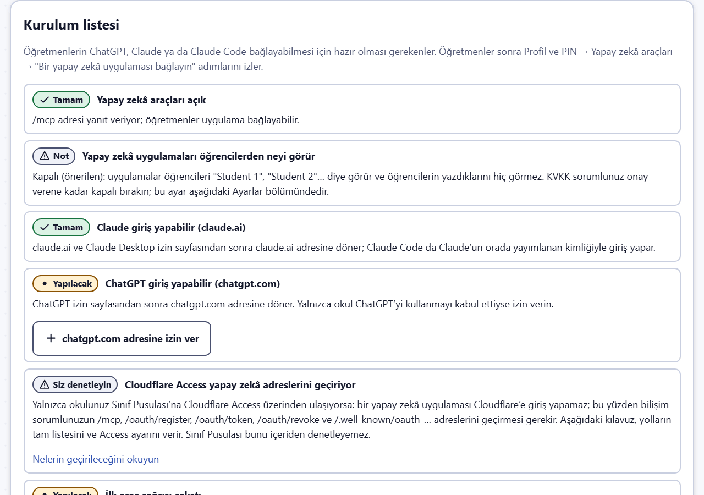
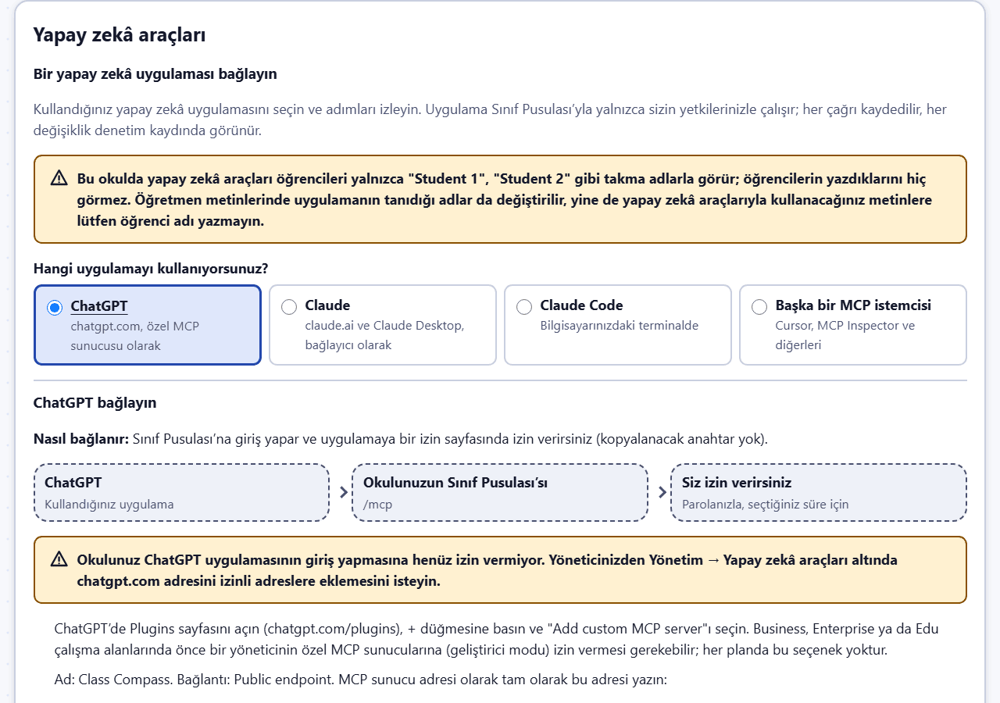
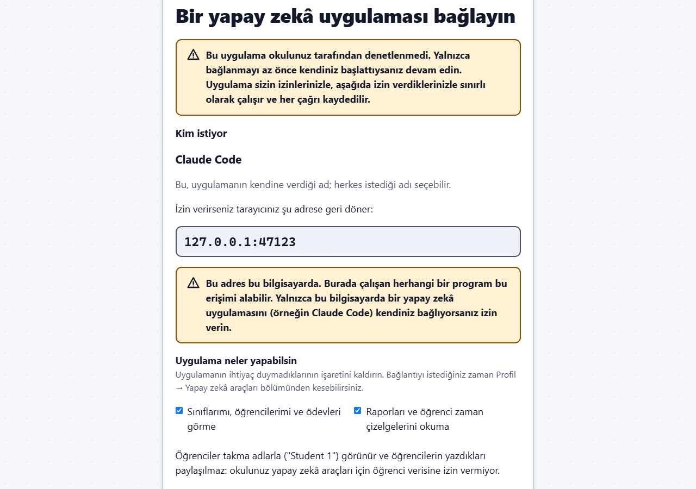

# Yapay zekâ araçları: bir yapay zekâ asistanı bağlamak

Sınıf Pusulası, **ChatGPT**, **Claude** ya da **Claude Code** gibi bir yapay zekâ asistanının sınıflarınızla sizin adınıza çalışmasına izin verebilir: bir raporu okuyup kısa bir haftalık özet yazmak, hazır hedef önermek, haftanın ders konularını planlamak ya da bir tema tasarlamak gibi. Asistan, yapay zekâ araçları için açık bir standart olan **Model Context Protocol (MCP)** ile okulunuzun Sınıf Pusulası adresindeki `/mcp` bölümüne bağlanır.

Asistan, Sınıf Pusulası’nda sizin yapabildiklerinizin tam olarak aynısını yapabilir; üstelik yalnızca seçtiğiniz bölümlerde. Yaptığı her çağrı kaydedilir (neyin ne zaman çağrıldığı; içeriği asla), yaptığı her değişiklik de denetim kaydında adınızla ve "yapay zekâ aracıyla" notuyla görünür.

Yapay zekâ araçları bir yönetici açana kadar **kapalıdır**. Yönetici, okulun KVKK sorumlusuyla birlikte başka bir karar vermedikçe **öğrenci adları okulun içinde kalır**.

## Okuldan ne çıkar

**Takma adlarla** (varsayılan; okulun "Öğrenci verisi yapay zekâ araçlarına" ayarı kapalıyken tek seçenek):

- Öğrenciler **"Student 1", "Student 2"** gibi takma adlarla, kimlikleri de `student-1`, `student-2` diye görünür. Numaralar bir anahtar için hep aynı kalır; böylece asistan bir öğrenciyi sorular boyunca izleyebilir. Kendi isteklerinde `student-3` yazabilir (yalnızca sizin öğrencileriniz için).
- Sizin ya da başka öğretmenlerin yazdığı metinlerdeki (ders sonu değerlendirmesi, ders hedefi, geri bildirim, ödev başlığı) öğrenci adları ve okul numaraları, uygulamanın tanıyabildiği ölçüde değiştirilir: Türkçe yazımlar (İ/I, ş, ğ…), büyük ya da küçük harf ve kesme işaretli ekler ("Elif’in") de tanınır. Öğrencinin tam adı takma adıyla, tek başına yazılmış bir ad ya da soyadı `[name]` ile, okul numarası da `[student no.]` ile değiştirilir.
- **Öğrencinin yazdığı her şey** (hedefler, değerlendirmeler, kendine notlar, kanıt metinleri ve bağlantılar) **gönderilmez**.
- Çıkanlar: okulun adı, öğretmen adları, sınıf ve ders adları, tarihler, toplamlarıyla birlikte sayılar, takma ad başına yoklama ve ödev durumları, adları değiştirilmiş kendi metinleriniz, hedef kategorileri ve hazır hedefler, ayarlar.

> **Yapay zekâ araçlarıyla kullanacağınız metinlere (geri bildirim, ders sonu değerlendirmesi, ders hedefi, ödev başlığı) lütfen öğrenci adı ya da numarası yazmayın.** Uygulama her şeyi tanıyamaz: yanlış yazılmış adlar ve lakaplar, öğrencinin eski adı, okuldan ayrılıp silinmiş bir öğrencinin adı, küçük harfle ve kesme işareti olmadan ek almış bir ad ("elifin"), küçük harfle yazılmış Can, Su, Ay, Will ve May adları ve başında "no" olmayan kısa (bir ile üç haneli) numaralar yazıldığı gibi gider. Öğretmen adları ve okulunuzun adı değiştirilmez.

**Adlarla** (yalnızca yönetici öğrenci verisine izin verdiyse ve yalnızca "Adlar" seçilerek oluşturulan anahtarlarda):

- Öğrenci adları ve öğrencilerin yazdıkları da gönderilir. Öğrencilerin yazdıkları `untrustedText` olarak işaretlenir; asistan bunları bir talimat olarak değil, yalnızca veri olarak ele alır.

**Hiçbir durumda gönderilmeyenler:** dosyalar, fotoğraflar ve ses kayıtları; öğretmenin özel notları ve ödev notları; açıklanmadan önce Gizli Öğrenci seçimleri; gruplama seviyeleri; öğrenci bağlantılarının adresleri ve kodları; parolalar, PIN’ler ve oturum bilgileri; dışa aktarmalar, yedekler ve öğrenci silme.

> Verinin nereye gideceği kullandığınız yapay zekâ aracına bağlıdır: Claude Code ile kendi hesabınız üzerinden Anthropic’e gider. Yalnızca okulunuzun onayladığı araçları kullanın; denerken yalnızca kurgusal veriyle çalışın.

## Asistan sohbeti

Öğretmen alanındaki **Asistan** sayfası ([öğretmen kılavuzu](teacher.md#asistan)) aynı araçları aynı kurallarla, okulun kurduğu bir yapay zekâ sağlayıcısı bağlantısı (**Asistan bağlantıları**) üzerinden kullanır. Yalnızca **yapay zekâ araçları açıkken** ve bir yönetici sohbeti açtıysa çalışır.

- Sağlayıcıya ulaşanlar yukarıda sayılanlardır: öğrenci verisi anahtarı kapalıyken öğrenciler (her öğretmen için ayrı) "Student 1", "Student 2"… olur; mesajınıza yazdığınız adlar da gönderilmeden önce aynı biçimde değiştirilir, başka adlar `[name]` olur ve öğrencilerin yazdıkları gönderilmez. Sayfada gerçek adları görürsünüz; Sınıf Pusulası onları kendi sunucusunda geri koyar.
- Asistan sizin yetkilerinizle okur ve hiçbir değişikliği kendiliğinden yapmaz: her değişiklik siz **Evet**’e basana dek bir kartta bekler. Öğrencilerin yazdıkları, asistanın asla uymaması gereken veri olarak işaretlenir.
- Mesajlarınız ve yanıtlar okulun sunucusunda (gönderildikleri biçimde) saklanır ve son mesajdan bir öğretim yılı sonra silinir; velilere ya da başka birine hiçbir şey gönderilmez.

## Yöneticiler için: açma



Yönetim menüsünde **Yapay zekâ araçları**’nı açın. Sayfa bir **Kurulum listesi** ile başlar; her satırda **Tamam**, **Yapılacak**, **Not** ya da **Siz denetleyin** yazar (yalnızca renkle değil, simgenin yanında bir sözcükle):

1. **Yapay zekâ araçları açık**; kapalıyken bir **Yapay zekâ araçlarını aç** düğmesiyle.
2. **Yapay zekâ uygulamaları öğrencilerden neyi görür**: aşağıdaki öğrenci verisi ayarını hatırlatır (kapalıyken yalnızca takma adlar; KVKK sorumlunuz onay verene kadar kapalı bırakın).
3. **Claude giriş yapabilir (claude.ai)** ve 4. **ChatGPT giriş yapabilir (chatgpt.com)**: her uygulamanın kendi belgelerinde yazan dönüş adresi. **claude.ai adresine izin ver** / **chatgpt.com adresine izin ver** onu tek tıkla izinli adreslere ekler (listedeki her değişiklik gibi denetim kaydına yazılır). Yalnızca okulunuzun kullanmayı kabul ettiği uygulamalara izin verin. `claude.ai` baştan izinlidir; Claude Code’un girişini de kapsar.
5. **Cloudflare Access yapay zekâ adreslerini geçiriyor**: Sınıf Pusulası bunu içeriden göremez, bu yüzden hep **Siz denetleyin** yazar; aşağıdaki [Cloudflare Access](#cloudflare-access) bölümüne bakın.
6. **İlk araç çağrısı çalıştı**: okulda herhangi bir uygulama bir araç kullanır kullanmaz, sonuncusunun zamanıyla birlikte işaretlenir.

Listenin altında:

- **Yapay zekâ araçları açık**: `/mcp` adresini açar. Kapalıyken hiçbir anahtar çalışmaz ve yeni anahtar oluşturulamaz.
- **Bir anahtarın en uzun geçerlilik süresi**: 7 ile 90 gün arası (varsayılan 90). Öğretmenler her anahtar için daha kısa bir süre seçer.
- **Öğrenci verisi yapay zekâ araçlarına**: varsayılan olarak kapalı. **Yalnızca okulunuzun KVKK sorumlusu onay verdikten** ve veli aydınlatma metni bunu belirttikten sonra açın. Açılan pencere okuldan nelerin çıkacağını listeler; onaylamak için `STUDENT DATA` yazın. Kapattığınızda bütün anahtarlar için hemen geçerli olur.
- **Okuldan ne çıkar** bölümü, yukarıdaki listeyi geçerli ayara göre tekrarlar.
- **Okuldaki anahtarlar** her anahtarı (gizli değerini asla göstermeden) hesabı, izinleri, gizlilik ayarı ve son kullanımıyla listeler. **İptal et** bir anahtarı hemen durdurur. Bu sayfadaki değişiklikler denetim kaydına yazılır.
- **Bu okuldaki bağlı uygulamalar**, öğretmenlerin ve yöneticilerin izin sayfası üzerinden bağladığı her uygulamayı (ChatGPT, claude.ai, Claude Desktop, Claude Code) **Bağlantıyı kes** düğmesiyle listeler.
- **Kayıtlı yapay zekâ uygulamaları**, Sınıf Pusulası’na kendini kaydeden uygulamaları listeler. Herkes bir uygulama kaydedebilir; ancak bir kişi izin sayfasında izin vermedikçe uygulama hiçbir şey yapamaz. **İptal et**, o uygulamanın bütün bağlantılarını sona erdirir. Kimsenin kullanmadığı kayıtlar 30 gün sonra kaybolur.
- **Yapay zekâ uygulamaları için izinli adresler**: bir uygulamanın, izin sayfasından sonra kullanıcıları geri gönderebileceği sunucular. `claude.ai` (claude.ai ve Claude Desktop için) baştan listededir; ChatGPT için `chatgpt.com` gerekir (kurulum listesi onu tek tıkla ekler); kişinin kendi bilgisayarındaki adreslere (Claude Code) her zaman izin verilir. Her satıra bir sunucu adı yazın. Yalnızca okulunuzun kullanmayı kabul ettiği bir yapay zekâ aracı için sunucu ekleyin.

Yapay zekâ araçlarını kapatmak, bütün bağlı uygulamaların bağlantısını keser.

## Cloudflare Access

Okulunuz Sınıf Pusulası’na Cloudflare Access üzerinden ulaşıyorsa, bilişim sorumlusunun bazı adresleri geçirmesi gerekir: bir yapay zekâ aracı Cloudflare’e giriş yapamaz. ChatGPT ve Claude bu adresleri kendi sunucularından çağırır; Claude Code ise öğretmenin bilgisayarından çağırır. Bu yüzden orada çalışan bir öğretmen için ya o adresin geçirilmesi ya da bir Access hizmet anahtarı (service token) gerekir (Claude Code sayfası, iki başlığıyla birlikte komutu gösterir). Bunu yalnızca okul yapay zekâ araçlarını kullanmak istiyorsa yapın; yapılmazsa yapay zekâ araçları bağlanamaz, Sınıf Pusulası’nın geri kalanı etkilenmez.

Bilişim sorumlusunun Cloudflare Zero Trust → Access → Applications altında yapacakları (kaynak koddaki `docs/OPERATIONS.md` dosyasının "AI tools" bölümüyle aynı):

1. Okulun adresinde tam olarak şu yolları kapsayan bir **self-hosted application** ekleyin: `/mcp`, `/.well-known/oauth-protected-resource`, `/.well-known/oauth-protected-resource/mcp`, `/.well-known/oauth-authorization-server`, `/oauth/register`, `/oauth/token` ve `/oauth/revoke`.
2. Ona eylemi **Bypass** olan tek bir kural (policy) verin, kapsamı **Everyone** olsun (ya da daha sıkı olarak yalnızca yapay zekâ sağlayıcılarının yayımladığı adres aralıkları; OpenAI listesini değiştirir, en az ayda bir yenileyin).
3. Bu yollara bunun yerine daha geniş ve daha sıkı bir uygulamanın (örneğin `*.<alan adı>`) uygulanmadığını denetleyin.
4. `/oauth/authorize` adresini ve izin sayfası `/oauth/consent`’i normal Access girişinin arkasında bırakın: bunlar öğretmenin kendi tarayıcısında açılır ve tarayıcı, uygulamanın geri kalanında olduğu gibi Access’ten geçer.

Bu adresler girişi kendileri denetler (anahtar, okul anahtarı, hesap) ve tarayıcı çerezlerini kabul etmez; böylece uygulamanın geri kalanı Access arkasında kalır.

## Bir yapay zekâ uygulaması bağlayın



**Profil ve PIN**’i açın (öğretmenler menüden, yöneticiler yönetim menüsünden) ve **Yapay zekâ araçları** bölümünü bulun. Sınıf bilgisayarında önce PIN sorulur. İlk sırada **Bir yapay zekâ uygulaması bağlayın** gelir:

1. **Hangi uygulamayı kullanıyorsunuz?** **ChatGPT**, **Claude** (claude.ai ve Claude Desktop), **Claude Code** ya da **Başka bir MCP istemcisi**’ni seçin.
2. Sayfa **nasıl bağlandığını** (izin sayfasında giriş ya da kişisel anahtar) söyler, bağlantının küçük bir resmini gösterir ve okulunuzun tam adresiyle, **kopyalama** düğmeleriyle numaralı adımlar verir. Adres okulun sunucu ayarlarından gelir; elle yazmak yerine kopyalayın.
3. Uygulamadaki adımları izleyin (her uygulama için aşağıda), sonra uygulamaya sınıflarınızla ilgili bir şey sorun; örneğin "Sınıf Pusulası’ndaki sınıflarımı listele."
4. **Bağlantıyı denetle**’ye basın. Uygulamanın kullandığı son aracı, ne zaman ve hangi bağlantı ya da anahtarla kullandığını gösterir; örneğin "ChatGPT uygulamasından son araç çağrısı: list_my_classes, 11 Kas 2026 09:30 (bağlı uygulama "ChatGPT")". Bunun için yeni bir şey kaydedilmez: var olan çağrı kaydı okunur; o kayıt neyin sorulduğunu ya da yanıtlandığını hiçbir zaman tutmaz.

Yapay zekâ araçları kapalıysa sayfa bunu söyler ve yöneticinizin yapacaklarını listeler. Okul bir uygulamanın dönüş adresine (örneğin `chatgpt.com`) henüz izin vermediyse sayfa, bunu yöneticinize iletmenizi ister; kişisel anahtar (Claude Code, diğer istemciler) buna gerek duymadan çalışır.

Kişisel anahtarlarınız ve bağlı uygulamalarınız **Gelişmiş: kişisel anahtarlar ve bağlı uygulamalar** altındadır. Çalışan bir anahtarınız ya da bağlı bir uygulamanız varken bu bölüm kendiliğinden açılır.

## ChatGPT

ChatGPT, **özel MCP sunucusu** olarak bağlanır (OpenAI buna uygulama ya da eklenti der) ve izin sayfasında giriş yapar; anahtar yapıştırmazsınız. Okul yöneticisinin önce `chatgpt.com` adresine izin vermiş olması gerekir. Denerken yalnızca kurgusal veriler kullanın ve yalnızca okulunuz ChatGPT kullanmayı kabul ettiyse bağlayın.

1. ChatGPT’de **Plugins** sayfasını açın (`chatgpt.com/plugins`), **+** düğmesine basın ve **Add custom MCP server**’ı seçin. Business, Enterprise ya da Edu çalışma alanlarında önce bir yöneticinin özel MCP sunucularına (geliştirici modu) izin vermesi gerekebilir; her planda bu seçenek yoktur.
2. **Name**: Class Compass; yanına kısa bir **Description** (açıklama; örneğin "Okuldaki sınıflarım"). **Connection**: Public endpoint. **MCP server URL**: Profil ve PIN → Yapay zekâ araçları bölümünde görünen adres; örneğin `https://school.example.org/mcp`.
3. **Authentication**: OAuth. İstemci kimliğini ve gizli anahtarı (client ID, secret) boş bırakın: ChatGPT kendini Sınıf Pusulası’na kendisi kaydeder.
4. Risk uyarısını okuyun, **I understand and want to continue**’yu, ardından **Create as a plugin**’i seçin. ChatGPT’nin bulduğu araçlara göz atın ve eklentiyi yükleyin.
5. Yeni bir sohbet başlatın, **@** yazıp Class Compass’ı seçin ve örneğin şunu sorun: "Sınıflarımı listele." İlk seferde ChatGPT okulunuzun Sınıf Pusulası’nı açar: giriş yapın (sınıf bilgisayarında önce PIN), izin sayfasını okuyun ve şifrenizle **İzin ver**’e basın; ChatGPT `chatgpt.com`’a döner ve yanıtlar. Sonra Profil sayfasında **Bağlantıyı denetle**’ye basın.

## Kişisel anahtar oluşturma

**Profil ve PIN → Yapay zekâ araçları**’nı, ardından **Gelişmiş: kişisel anahtarlar ve bağlı uygulamalar**’ı açın (sınıf bilgisayarında önce PIN sorulur). **Bir yapay zekâ uygulaması bağlayın** bölümündeki Claude Code ve "Başka bir MCP istemcisi" adımlarında da aynı formu açan bir **Anahtar oluştur** düğmesi vardır.

1. **Yeni anahtar**’a basın.
2. **Ad**: nerede kullanacağınız, örneğin "Dizüstü bilgisayarımdaki Claude Code".
3. **İzinler**: yalnızca asistanın gerçekten ihtiyaç duyduklarını seçin. Başlangıçta okuma izinleri seçili gelir. Öğretmenler şunları seçebilir: sınıflarımı, öğrencilerimi ve ödevleri görme; raporları ve öğrenci zaman çizelgelerini okuma; hedefleri okuma; hedef, hazır hedef, cümle başlangıcı ve geri bildirim yazma; ödev verme ve işaretleme; süren bir derste sınıf işlemleri; sınıf ayarlarını değiştirme. Yöneticiler şunları seçebilir: okul yapısını ve okul geneli raporları okuma; okul ayarlarını değiştirme; tema taslağı kaydetme.
4. **Geçerlilik süresi**: gün sayısı; en fazla okulun izin verdiği kadar.
5. **Öğrenciler nasıl görünsün**: yalnızca okul adlara izin veriyorsa görünür. Takma adlar güvenli varsayılandır.
6. **Mevcut parolanızı** yazın (e-posta bağlantısıyla giriş yapan hesaplar önce yeniden giriş yapar) ve **Anahtar oluştur**’a basın.

Anahtar (`ccmcp_` ile başlar) **yalnızca bir kez gösterilir**. Onu ya da hazır Claude Code komutunu kopyalayın ve bir parola gibi saklayın. Sınıf Pusulası yalnızca parmak izini saklar.

Listede anahtarlarınız izinleri, son geçerlilik tarihi ve son kullanımıyla görünür. **İptal et** bir anahtarı hemen durdurur; yeniden gerektiğinde yeni bir anahtar oluşturun.

## Claude Code

Claude Code kurulu olan kendi bilgisayarınızda penceredeki komutu çalıştırın. Komut şuna benzer (örneklerin yerine okulunuzun adresi ve sizin anahtarınız gelir):

```
claude mcp add --transport http class-compass https://school.example.org/mcp --header "Authorization: Bearer ccmcp_…"
```

Ardından Claude’a örneğin şunu sorun: "class-compass’ı kullan: 3-A İngilizce dersinin geçen haftasının kısa bir özetini çıkar." Claude işe **list_my_classes** ile başlar; isterseniz bir şeyi değiştirmeden önce size sorar.

**Cloudflare Access arkasındaysa.** Okulunuzun adresi Cloudflare Access arkasındaysa ve bilişim sorumlunuz size bir Access hizmet anahtarı verdiyse, onun iki başlığını anahtarlı komuta ekleyin (Profil sayfasındaki Claude Code adımları bunu yer tutucularla gösterir):

```
claude mcp add --transport http class-compass https://school.example.org/mcp --header "Authorization: Bearer <your token>" --header "CF-Access-Client-Id: <id>" --header "CF-Access-Client-Secret: <secret>"
```

Bunun için kişisel anahtar kullanın: giriş yaparak bağlanmak `/oauth/…` adreslerini de gerektirir ve hizmet anahtarı bunlara ulaşamayabilir.

İşe yarayan araçlar: **class_overview**, **class_report** (rapor büyükse birkaç bölüm isteyin), **student_summary**, **goal_library**, **create_goal_preset**, **create_sentence_starter**, **get_topic_plan** ve **set_topic_plan**, **create_homework**; temalar için **theme_schema**, **validate_theme**, **preview_theme**, **export_theme** ve yöneticiler için **import_theme_draft** (taslak kaydeder; bir temayı etkinleştirmek **Temalar** sayfasında sizin kararınız olarak kalır). Hazır istekler (prompts): haftalık özet, hazır hedefler, konu planı, tema tasarımı.

**Asistanla tema hazırlamak.** Asistan tema kılavuzunu ve eksiksiz örnek temaları (her hazır tema için bir tane) okuyabilir, **export_theme** ile herhangi bir temanın kopyasını alabilir, işini **validate_theme** ile denetleyip **preview_theme** ile tüm renk kontrastlarını görebilir. Bunların hiçbirinde okul verisi yoktur. Bir yöneticinin asistanı sonucu taslak olarak kaydedebilir; önizlemeye bakıp temayı **Temalar** sayfasında siz açarsınız.

## claude.ai ve Claude Desktop

claude.ai ve Claude Desktop, **özel bağlayıcı** (custom connector) olarak bağlanır. Anahtar yapıştırmazsınız: Claude sizi, izin verdiğiniz bir Sınıf Pusulası sayfasına (aşağıdaki "izin sayfası") gönderir. Denerken yalnızca kurgusal veriler kullanın ve yalnızca okulunuz Claude kullanmayı kabul ettiyse bağlayın.

1. claude.ai’de **Customize → Connectors** bölümünü açın (Claude Desktop’ta da aynı yer), **+** düğmesine basın ve **Add custom connector**’ı seçin. Team ve Enterprise planlarında bağlayıcıyı Claude kuruluşunun bir sahibi (Owner) **Organization settings → Connectors** altında ekler; siz sonra onda **Connect**’e basarsınız.
2. **Name**: örneğin "Sınıf Pusulası". **Remote MCP server URL**: okulunuzun adresi ve sonuna `/mcp`, tam olarak Profil → Yapay zekâ araçları bölümünde göründüğü gibi; örneğin `https://school.example.org/mcp`. Claude’un kendisi bulduğu giriş ayarlarını ("Use Claude's published identity" ya da "Register automatically") değiştirmeyin; client ID ve secret alanlarını boş bırakın.
3. **Add**’e, ardından **Connect**’e basın. Bir tarayıcı penceresinde okulunuzun Sınıf Pusulası açılır. İstenirse giriş yapın; sınıf bilgisayarında önce PIN sorulur.
4. İzin sayfasını okuyun, izinleri seçin ve şifrenizle **İzin ver**’e basın (aşağıya bakın). Tarayıcı claude.ai’ye döner ve bağlayıcı bağlı olarak görünür.
5. Bir sohbette araçlar menüsünden bağlayıcıyı açın ve örneğin şunu sorun: "Sınıf Pusulası’nı kullan: 3-A İngilizce dersinin geçen haftasının kısa bir özetini çıkar."

Bağlayıcılar Claude hesabınıza aittir; claude.ai’de eklenen bir bağlayıcı Claude Desktop’ta da görünür. Bağlantı sona erdiğinde (seçtiğiniz sürenin sonunda ya da bağlantıyı kestiğinizde) Claude yeniden bağlanmanızı ister.

## Anahtar yerine girişle Claude Code

Claude Code da aynı izin sayfası üzerinden giriş yapabilir; böylece bir anahtar kopyalamanız gerekmez:

```
claude mcp add --transport http class-compass https://school.example.org/mcp
```

Ardından Claude Code’u başlatın, `/mcp` yazın, **class-compass**’ı ve **Authenticate**’i seçin. Tarayıcınızda izin sayfası açılır; dönüş adresi kendi bilgisayarınızdadır (örneğin `localhost:43215`) ve sayfa bunu belirtir. **İzin ver**’den sonra tarayıcı terminale dönebileceğinizi söyler ve Claude Code bağlanmış olur. Kişisel anahtar (yukarıda) da çalışmaya devam eder; hangisini isterseniz onu kullanın.

## İzin sayfası



Bir yapay zekâ uygulaması bağlanmak istediğinde açılan sayfa sizin kararınızdır; lütfen okuyun:

- **"Bu uygulama okulunuz tarafından denetlenmedi"**: herkes istediği adla bir uygulama yapabilir. Yalnızca bağlanmayı az önce kendiniz başlattıysanız devam edin. Sayfa birdenbire karşınıza çıktıysa (örneğin bir e-postadaki bağlantıdan), **İzin verme**’ye basın.
- **Kim istiyor**: uygulamanın kendine verdiği ad. Bilgileri kendi adresinden gelen uygulamalarda sayfa o adresi de gösterir.
- **İzin verirseniz tarayıcınız şu adrese geri döner**: erişimi alacak sunucu. claude.ai ve Claude Desktop için `claude.ai`, ChatGPT için `chatgpt.com`’dur; Claude Code için kendi bilgisayarınızdaki bir adrestir (`localhost` ya da `127.0.0.1` ve bir sayı) ve sayfa, o bilgisayardaki herhangi bir programın bu erişimi alabileceği konusunda uyarır.
- **Uygulama neler yapabilsin**: uygulamanın istediği izinler, hesabınızın yapabildikleriyle sınırlı olarak. İhtiyaç duyulmayanların işaretini kaldırın. Yönetici izinleri öğretmenlere hiç sunulmaz.
- **Öğrenciler nasıl görünsün**: yöneticiniz öğrenci verisine izin vermedikçe takma adlar; izin verdiyse bir anahtarda olduğu gibi siz seçersiniz.
- **Bağlantı süresi**: uygulamanın ne kadar süre bağlı kalabileceği (en fazla okulun izin verdiği kadar). Uygulama, bir saat geçerli olan ve bu süreye kadar yenilenen bir anahtar alır.
- **İzin ver** için şifrenizi yeniden girmeniz gerekir (e-posta bağlantısıyla giriş yapan hesaplar önce yeniden giriş yapar). **İzin verme**, uygulamayı erişim vermeden geri gönderir.

## Bir uygulamanın bağlantısını kesme

**Profil → Yapay zekâ araçları → Gelişmiş → Bağlı uygulamalar**, bağladığınız uygulamaları listeler: uygulama, döndüğü adres, izinleri, öğrencilerin nasıl göründüğü, son kullanım ve bağlantının ne zamana kadar sürdüğü. **Bağlantıyı kes** uygulamayı hemen durdurur. Bağlantıyı uygulamanın kendisinde de kaldırabilirsiniz; ancak Sınıf Pusulası için geçerli olan, burada kesmektir.

## Bilmekte fayda var

- Bir anahtar yalnızca `/mcp` adresinde çalışır, uygulamanın kendisinde asla; oturum açık bir tarayıcı da `/mcp` adresini kullanamaz.
- Her anahtar dakikada yaklaşık 120 çağrı yapabilir; çok büyük yanıtlar, daha dar bir soru sorulmasını isteyen bir notla kısaltılır.
- Bir hesap devre dışı bırakıldığında ya da parolası sıfırlandığında veya değiştirildiğinde bütün anahtarları ve bağlı uygulamaları kalıcı olarak sona erer (hesap yeniden etkinleştirilse de geri gelmez); sonra yenilerini oluşturun. Yönetici bir anahtarın en uzun geçerlilik süresini kısaltırsa var olan anahtarların ve bağlantıların süresi de kısalır. Yönetici yapay zekâ araçlarını kapatırsa bütün bağlı uygulamaların bağlantısı kesilir (anahtarlar ise araçlar yeniden açılana kadar yalnızca çalışmaz).
- Asistan, tıpkı sizin gibi yalnızca kendi sınıflarınızı ve öğrencilerinizi görür.
