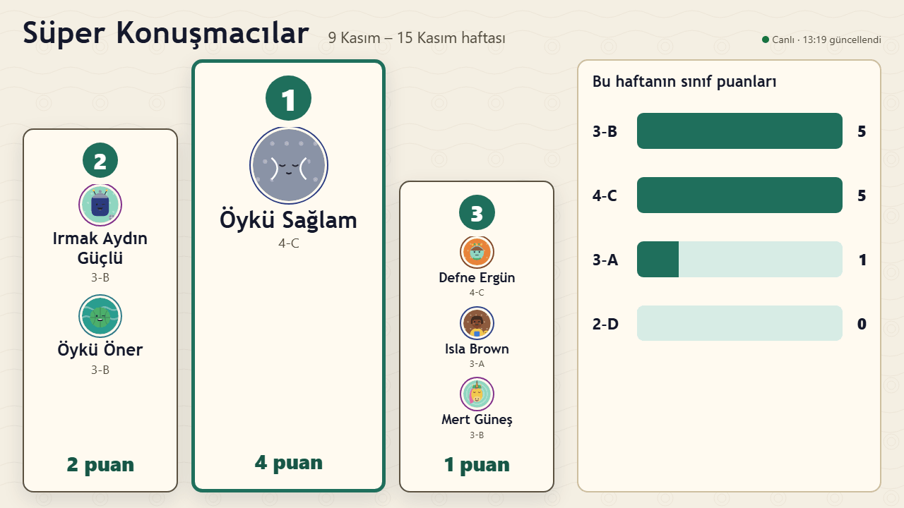

# Süper Konuşmacılar: pano ekranını kurmak

**Pano**, bu haftanın Süper Konuşmacılarını büyük bir ekranda (örneğin koridorda) gösterir: ilk üç öğrenci (eşit puanlıların hepsiyle birlikte), sınıfları ve avatarları ile katılan her sınıfın puanı. Bir öğretmen puan verdikten kısa süre sonra kendiliğinden güncellenir.

## Gerekenler

- Ekrana ve okul ağına ya da internete bağlı, güncel bir tarayıcısı (Chrome, Edge ya da Firefox) olan bir bilgisayar, mini bilgisayar ya da akıllı televizyon.
- Yöneticiden bir **pano bağlantısı** (Yönetim → Süper Konuşmacılar → **Bağlantılar** → **Pano bağlantıları** → **Pano bağlantısı oluştur**). Pano bağlantısı yalnızca panoyu gösterebilir; puan veremez ve başka bir şey açamaz.

## Kurulum

1. Pano bağlantısını o bilgisayarın tarayıcısında açın.
2. Tarayıcıyı tam ekrana alın (genellikle **F11** tuşu).
3. Pano gün boyu açık kalsın diye bilgisayarın ekran koruyucusunu ve uyku modunu kapatın.
4. Yönetici **Pano sesi ve kutlama**'yı açtıysa panoya bir kez tıklayın: tarayıcılar ancak bir tıklamadan sonra ses çalar.

Pano 1920×1080 ve 1280×720 ekranlara kaydırma gerekmeden sığar. Fare imleci kendiliğinden gizlenir.

Okulunuz Süper Konuşmacılar'a kendi web adresini verdiyse (örneğin `speakers.` ile başlayan bir adres), pano bağlantısı bu adresle başlar. Yönetici böyle bir adresi açtığında yeni pano bağlantısını ekranda bir kez açın; eski bağlantı bir giriş sayfasında takılabilir ([Süper Konuşmacılar kılavuzu](super-speakers.md#kendi-web-adresi-isteğe-bağlı)).

## Panoda neler görünür

- Başlık ve **… haftası**. Her hafta, yöneticinin belirlediği zamanda (normalde Pazartesi 00:00) sıfırdan başlar; önceki haftalar geçmişte saklanır.
- **Haftanın ilk üçü**: puanlarıyla 1.–3. sıralar. Puanı eşit olan öğrenciler aynı sırayı paylaşır: iki ya da üç öğrenci neredeyse tek öğrenci kadar büyük, daha fazlası küçük adlarla bir liste hâlinde gösterilir. Henüz kimsenin puanı yokken panoda **Süper konuşmacılarımızı bekliyoruz** yazar.
- **Bu haftanın sınıf puanları**: 0 puanlılar dâhil katılan bütün sınıflar.
- Bağlantı işareti: **Canlı** ya da ağ koptuğunda **Yeniden bağlanıyor…**. Pano kendiliğinden yeniden dener ve bağlantı gelince güncellenir; sayfayı yenilemeniz gerekmez.

## Bir sorun varsa

- **Bu pano bağlantısı artık çalışmıyor**: yönetici yeni bir bağlantı oluşturmuş, bağlantıyı kapatmış ya da Süper Konuşmacılar kendi web adresine taşınmıştır. Pano bağlantısını isteyip yeniden açın.
- Puanlar yerine kısa bir bilgi notu: Süper Konuşmacılar şu anda kapalı.
- Uzun süre **Panoya bağlanılıyor…** yazıyorsa: o bilgisayarın ağ bağlantısını kontrol edin.
