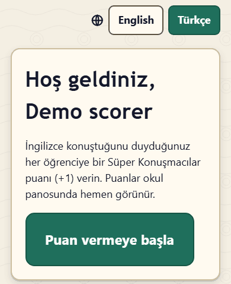
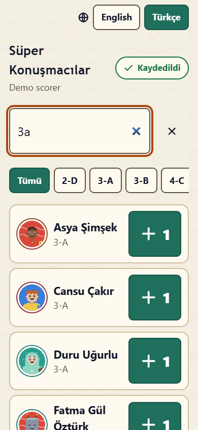

# Süper Konuşmacılar: puanlayıcılar için tek sayfalık kılavuz

Size bir **puanlayıcı bağlantısı** verildi: bu bağlantıyla okulun herhangi bir yerinde İngilizce konuştuğunu duyduğunuz öğrencilere **Süper Konuşmacılar puanı** verirsiniz. Puanlar okul panosunda hemen görünür.

> Bağlantınız size özeldir. Paylaşmayın: bağlantıya sahip olan herkes sizin adınıza puan verebilir.

## 1. Bağlantınızı açın

Yöneticinizin gönderdiği bağlantıyı telefonunuzda açın (ya da QR kodunu okutun). İlk seferde **Hoş geldiniz** sayfası çıkar; **Puan vermeye başla**'ya basın. Üstten **English** ile **Türkçe** arasında geçiş yapabilirsiniz.

## 2. Uygulamayı ana ekranınıza ekleyin (önerilir)

Böylece bağlantı zayıfken bile tek dokunuşla puan verebilirsiniz. Alttaki **Uygulamayı ana ekranınıza ekleyin** bölümünü açın (karşılama sayfasında zaten açıktır). Telefonunuzun bölümü açıktır; diğerinin adımları için okun olduğu başlığa dokunun:

- **Android (Chrome)**: sağ üstteki menü düğmesine (üç nokta) dokunun, "Uygulamayı yükle" ya da "Ana ekrana ekle"yi seçin, sonra Süper Konuşmacılar'ı ana ekranınızdan açın. Oturum kendiliğinden açılır.
- **iPhone ve iPad (Safari)**: Safari'nin altındaki Paylaş düğmesine dokunun, "Ana Ekrana Ekle"yi, ardından **Ekle**'yi seçin. iPhone'daki uygulama ilk açılışta bir **eşleştirme kodu** ister: Safari'de, bağlantı sayfanızda **Eşleştirme kodunu göster**'e dokunun; uygulamayı ana ekrandan açın ve altı rakamı **Uygulamayı bağlayın** bölümüne yazın. Bir kod yalnızca bir kez ve 10 dakika boyunca çalışır; süresi dolduysa **Yeni kod oluştur**'a basın.

## 3. Öğrenciyi bulun ve +1 verin

- **Öğrenci bul** alanına adın bir kısmını ("isik" yazmak "Işık"ı bulur), bir sınıfı ("3a") ya da öğrenci numarasını yazın. Sınıf düğmeleri listeyi daraltır; **Son verilenler** puan verdiğiniz öğrencileri gösterir.
- Öğrencinin kartındaki büyük **+1**'e dokunun. Kısa süre içinde ikinci kez dokunursanız **Bir puan daha eklemek için yeniden dokunun** uyarısı çıkar; böylece yanlışlıkla çift dokunma iki puan vermez.

## 4. Geri alma

- Puanı verdikten hemen sonra alttaki çubukta **Geri al** görünür.
- **Bugün verdiğim puanlar** bugünkü puanlarınızı listeler; geri alma süresi boyunca (yöneticiniz değiştirmediyse 10 dakika) her birinin yanında **Geri al** vardır. Daha sonra yanlış bir puanın kaldırılmasını yöneticiden isteyin.

## 5. Çevrimdışı

Çekmiyor mu? Dokunmaya devam edin. Puanlar telefonunuzda bekler (işaret kaç tane olduğunu gösterir) ve bağlantı gelince gönderilir. Dokunduğunuz güne sayılırlar. Kaydedilemeyen bir puan (örneğin katılmayan bir sınıfın öğrencisi) **Kontrol gerekiyor** altında **Yeniden dene** ve **Kapat** düğmeleriyle görünür.

## Bilmekte yarar var

- Yalnızca katılan sınıfların öğrencileri puan alabilir. Eksi puan yoktur.
- **Bu telefonda oturumu kapat** bu telefondaki oturumu bitirir. Bağlantınız çalışmaya devam eder.
- "Bu puanlayıcı bağlantısı artık çalışmıyor": yönetici yeni bir bağlantı oluşturmuş ya da bağlantıyı kapatmıştır. Yeni bağlantınızı isteyin.
- Yöneticiniz Süper Konuşmacılar'ın kendi web adresine taşındığını söylerse puanlayıcı bağlantınızı yeniden açın. Uygulama ana ekranınızdaysa eski simgeyi silip yeni sayfadan yeniden ekleyin (iPhone'da yeniden eşleştirin).
- Uygulamanın altındaki **Yardım** bu kılavuzu açar.
