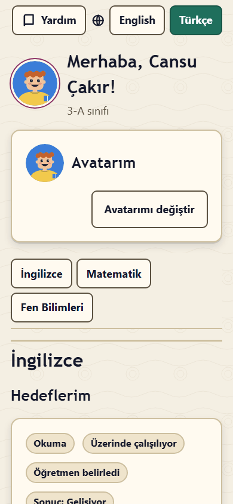
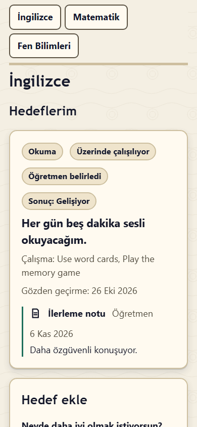
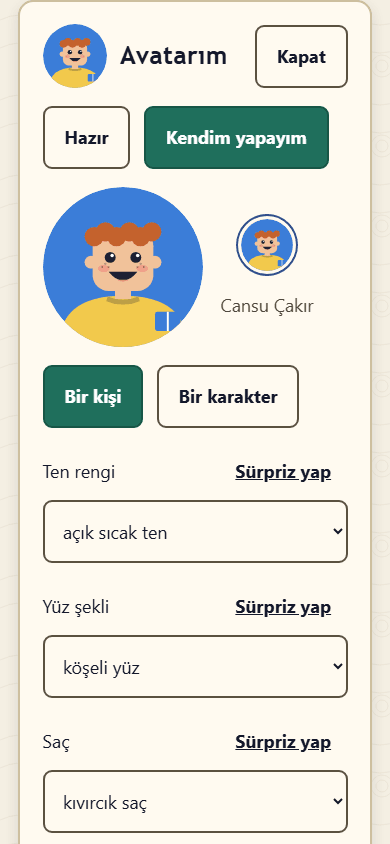

# Sınıf Pusulası'ndaki kendi sayfan: öğrenciler ve veliler için kılavuz

Merhaba! Öğretmenin sana **QR kodlu bir kart** verdi. Bu kart Sınıf Pusulası'nda **sana ait sayfayı** açar. Sayfanda hedefler koyabilir, nasıl gittiğini yazabilir, yaptıklarını gösterebilir ve öğretmeninin sana yazdıklarını okuyabilirsin.

*Velilere: bu kılavuz çocuklar için yazıldı. Sizin için olan bölüm: [Veliler için: gizlilik](#veliler-için-gizlilik).*

## Sayfanı açmak

1. Kartındaki QR kodu telefon ya da tablet kamerasıyla okut veya öğretmeninin verdiği bağlantıyı yaz.
2. Sayfan açılır. Üstte **Merhaba** ve adın yazar.
3. Bir dahaki sefere aynı kart yine aynı sayfayı açar.

**Kartını kimseye gösterme.** Bağlantın yalnızca senin için. Bağlantıyı bilen herkes sayfanı görebilir ve sayfana bir şeyler ekleyebilir. Kartını kaybedersen ya da başka biri gördüyse öğretmenine söyle. Öğretmenin eski bağlantıyı durdurup sana yeni bir kart verebilir.

Ortak kullanılan bir bilgisayarda ya da tablette işin bitince en alttaki **Bu cihazda sayfadan çık** düğmesine bas.

**Yardım** sayfanın en üstündedir. Sınıfın iki dil kullanıyorsa orada **English** ile **Türkçe** arasında da geçiş yapabilirsin.

Birden fazla dersin varsa avatarının altındaki ders adlı düğmeler seni doğrudan o derse götürür.

## Hedeflerim

Hedef, daha iyi olmak istediğin bir şeydir; örneğin "Her hafta bir İngilizce kitap okuyacağım."

- **Hedef ekle** bölümünde **Neyde daha iyi olmak istiyorsun?** sorusunu seç, sonra **Bir hedef seç** ya da **Kendi hedefimi yazmak istiyorum** kutusunu işaretleyip hedefini yaz.
- **Nasıl çalışacağım?** Örneğin: yatmadan önce okumak, bir kelime oyunu oynamak.
- **Hedefimi ekle** düğmesine bas.
- Hedefine ulaşınca **Başardım!** düğmesine bas. Aferin sana!

Öğretmenin de senin için hedef ekleyebilir. Bunlarda **Öğretmen belirledi** yazar.

## Düşüncelerim

Burada bir hedefin hakkında yazarsın. **Hangi hedef?** sorusunu seç, sonra **Ne eklemek istiyorsun?**:

- **Düşünce**: nasıl geçti, neler öğrendin.
- **Not**: hatırlamak istediğin bir şey.
- **Kendimi nasıl hissediyorum**: **Ne kadar eminsin?** 1'den (henüz emin değilim) 5'e (çok eminim) kadar. Bu bir not değildir. Sadece senin ve öğretmeninin nasıl hissettiğini görmesine yardım eder.

## Kanıtlarım

Kanıt, ne yaptığını gösterir. **Ne tür bir kanıt?** sorusunu seç:

- **Yaz**: birkaç cümle.
- **Bağlantı ekle**: https:// ile başlayan bir internet adresi.
- **Belge ekle**: örneğin bir PDF ya da Word dosyası.
- **Resim ekle**, **Fotoğraf çek**, **Sesimi kaydet** (en fazla 5 dakika) ve **Ses dosyası ekle**; ama yalnızca okulun resim ve ses kaydına izin veriyorsa. Bu düğmeleri görmüyorsan okulun bunları açmamıştır.

**Hangi hedef için?** sorusunu seçip birkaç söz de ekleyebilirsin.

## Nazik sözler

Sınıf Pusulası yazdıklarını kaydetmeden önce kontrol eder. **Sözlerimiz nazik olsun. Lütfen o sözcüğü değiştir.** ya da **Lütfen biraz daha yaz.** gibi bir mesaj görürsen yazını değiştirip yeniden dene. Yazın uygun olana kadar hiçbir şey kaydedilmez.

## Öğretmen geri bildirimi ve ödevler

- **Öğretmen geri bildirimi**: öğretmeninin hedeflerin hakkında sana yazdıkları.
- **Ödevlerim**: en yeni ödevlerin ve durumları. Her durumun kendi küçük resmi vardır: **Tamamlandı** için bir onay işareti, **Henüz kontrol edilmedi** için bir saat (öğretmenin ödeve henüz bakmadı). **Eski ödevleri göster** gerisini gösterir.

## Rozetlerim

Rozetler çabanı kutlar: hedef koymak, kanıt eklemek, düşüncelerini yazmak, ödev yapmak, sınıf yardımcısı olmak ve daha fazlası. Bazıları kendiliğinden gelir; bazılarını öğretmenin verir.

- **Rozetlerim** en yeni rozetlerini seviyeleriyle (Bronz, Gümüş ya da Altın), ne için olduklarını, ne zaman kazandığını ve kimin verdiğini gösterir. **Tüm rozetlerimi göster** hepsini gösterir.
- **Sıradaki rozetler** henüz kazanabileceğin rozetleri, seviyelerini ve ne kadar yaklaştığını (örneğin **3/5**) gösterir.
- Öğretmenin kendi **seviyeni** de gösterebilir. Sayfandaki seviyeni yalnızca sen görürsün ve kimse sıralanmaz. Rozetlerini öğretmenlerin görebilir; öğretmenin bir rozeti sınıf ekranında adın ve avatarınla kutlamayı da seçebilir.

Yeni bir rozet kazandığında sayfan bunu bir kez kutlar.

## Avatarım

Avatarın, sınıfının sınıf ekranında gördüğü küçük resmindir. Bir çizimdir, hiçbir zaman fotoğraf değildir.

1. **Avatarımı değiştir** düğmesine bas.
2. **Hazır** bir avatar seç ya da **Kendim yapayım**: **Bir kişi** ya da **Bir karakter**. Yüzü, saçı, giysileri ve daha fazlasını seç. **Sürpriz yap** bir parçayı senin için seçer, **Hepsini rastgele seç** her şeyi değiştirir, **Geri al** bir önceki hâline döner.
3. **Avatarımı kaydet** düğmesine bas.

Bazı parçalarda **açmak için "…" rozetini kazan** yazar: önce o rozeti kazanman gerekir. **Öğretmenin avatar değişikliklerini şimdilik durdurdu.** yazıyorsa avatarını daha sonra değiştirebilirsin.

## Öğretmenin neleri görür

O dersin öğretmenleri sayfandaki o derse ait her şeyi görür: hedeflerini, düşüncelerini, kanıtlarını ve ne kadar emin olduğunu. Hedef, kanıt ve geri bildirim ekleyebilirler. Sayfandaki bir şeyi **gizleyebilirler** de (örneğin yanlışlıkla eklendiyse). Öğretmenin kendisi için kısa özel notlar da tutabilir; bunlar senin sayfanda hiçbir zaman görünmez.

Sınıf arkadaşların senin sayfanı göremez. Sınıf ekranında avatarını ve adını görürler; öğretmenin açarsa öğrenci kartındaki sayılarını ve rozet kutlamalarını da görürler.

## Veliler için: gizlilik

Sınıf Pusulası'nın çocuğunuzun sayfasıyla ne yaptığı, sade bir dille:

- **Veriler nerede saklanır?** Okulun kendi Sınıf Pusulası sunucusunda. Sayfada yalnızca çocuğunuzun öğrenmeyle ilgili kayıtları bulunur: hedefler, düşünceler, kanıtlar, geri bildirim, ödev durumu, rozetler ve avatar. Notlar (karne notları) ve iletişim bilgileri yoktur.
- **Bağlantı bir anahtardır.** Bağlantıya ya da karta sahip olan herkes, okul bağlantıyı durdurana kadar sayfayı açabilir ve sayfaya ekleme yapabilir. Kartı evde saklayın, internette paylaşmayın ve kaybolursa hemen öğretmene haber verin. Öğretmen ya da yönetici eski bağlantıyı hemen durdurup yeni bir kart hazırlayabilir. Öğrenci okuldan ayrılıp pasifleştirildiğinde bağlantı çalışmaz olur.
- **Kim neyi görür?** Çocuğunuzun o dersteki öğretmenleri ve okulun Sınıf Pusulası yöneticileri. Diğer öğrenciler ve veliler göremez. Öğretmenler kendileri için özel notlar yazabilir; bu notlar öğrenciye gösterilmez, ancak yöneticilerin aldığı tüm okul verisi dışa aktarımında yer alır.
- **Resim ve ses.** Okul KVKK kapsamındaki izinleri doğrulayana kadar fotoğraf ve ses kaydı kapalıdır. Resimlere izin verildiğinde konum ve kamera bilgileri sunucuda resimlerden silinir. Belgeler (PDF, Word…) olduğu gibi saklanır; yani bir belgede örneğin onu oluşturan kişinin adı kalabilir.
- **Başkaları neyi görebilir?** Sınıf, çocuğunuzun adını ve avatarını sınıf ekranında görür. Öğretmen açarsa sınıf, öğrenci kartlarındaki sayıları ve ad ile avatarla yapılan kısa rozet kutlamalarını da görür. Okul Süper Konuşmacılar'ı kullanıyorsa en iyi öğrencilerin tam adları, sınıfları ve avatarları bir okul ekranında gösterilir; puan verenler de katılan sınıflardaki öğrencileri ada, sınıfa ve öğrenci numarasına göre arayabilir.
- **Nazik sözcük denetimi.** Bir sözcük reddedildiğinde metin saklanmaz; yalnızca deneme sayısı sayılır. Öğretmen isterse bu sayıyı görebilir.
- **Haklarınız.** Okuldan çocuğunuzla ilgili verilerin bir kopyasını ya da silinmesini isteyebilirsiniz (KVKK). Okulun yöneticisi tek bir öğrencinin verisini dışa aktarabilir ve öğrenci pasifleştirildikten sonra kayıtlarını kalıcı olarak silebilir; bundan önce alınmış yedekler süreleri dolana kadar veriyi içermeye devam eder.
- **Sayfa herkese açık değildir.** Arama motorlarında gösterilmez ve sayfa kendi adresini başka web sitelerine göndermez.

Sorularınız için lütfen sınıf öğretmeniyle ya da okul yönetimiyle iletişime geçin.
