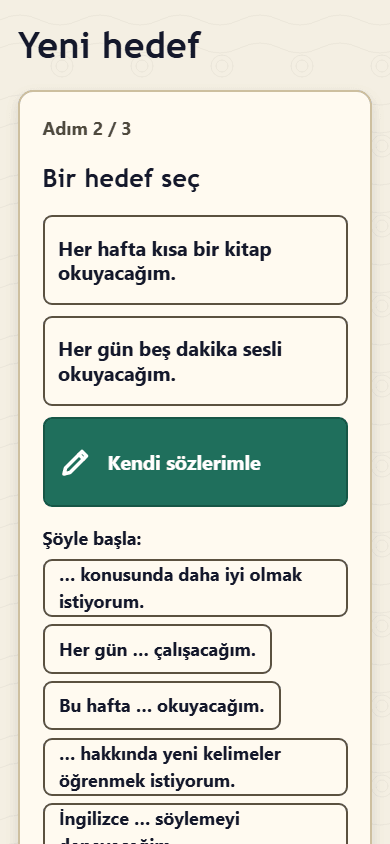
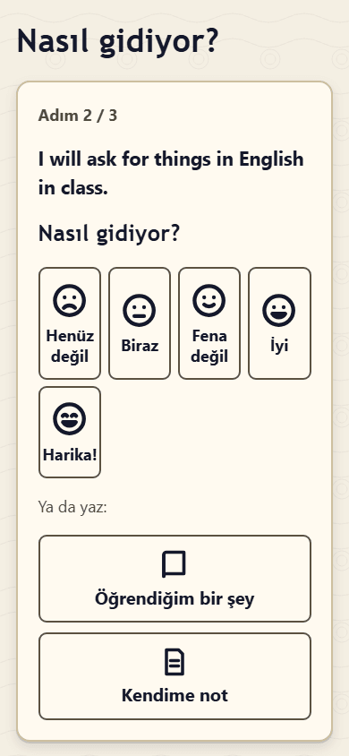
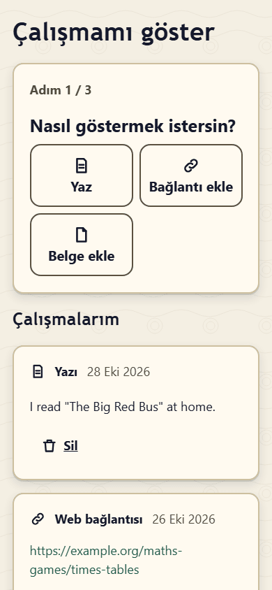
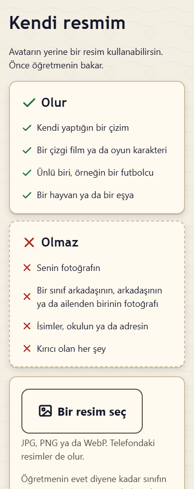
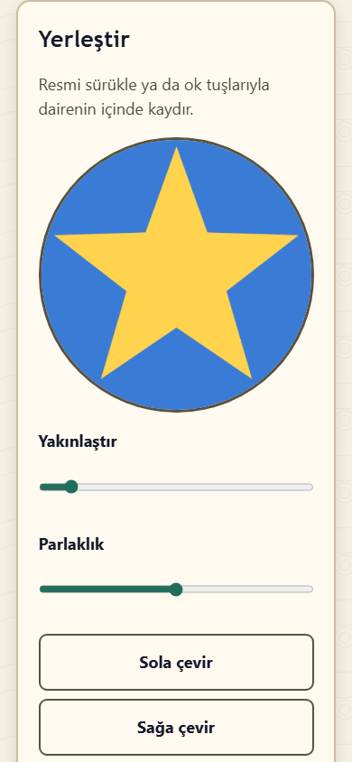
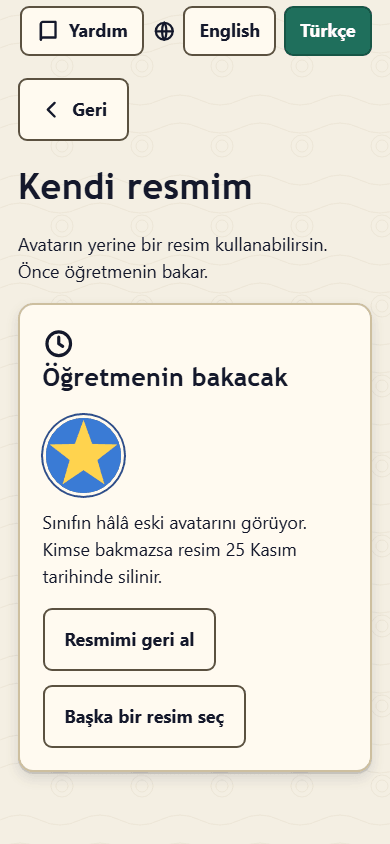

# Sınıf Pusulası'ndaki kendi sayfan: öğrenciler ve veliler için kılavuz

Merhaba! Öğretmenin sana **QR kodlu bir kart** verdi. Bu kart Sınıf Pusulası'nda **sana ait sayfayı** açar. Sayfanda hedefler koyabilir, nasıl gittiğini yazabilir, yaptıklarını gösterebilir ve öğretmeninin sana yazdıklarını okuyabilirsin.

*Velilere: bu kılavuz çocuklar için yazıldı. Sizin için olan bölüm: [Veliler için: gizlilik](#veliler-için-gizlilik).*

## Sayfanı açmak

1. Kartındaki QR kodu telefon ya da tablet kamerasıyla okut veya öğretmeninin verdiği bağlantıyı yaz.
2. Sayfan açılır. Üstte **Merhaba** ve adın yazar.
3. Bir dahaki sefere aynı kart aynı sayfayı yeniden açar.

**Kartını kimseye gösterme.** Bağlantın yalnızca senin için. Ona sahip olan herkes sayfanı görebilir ve sayfana bir şeyler ekleyebilir. Kartını kaybedersen ya da başka biri gördüyse öğretmenine söyle. Öğretmenin eski bağlantıyı durdurup sana yeni bir kart verebilir.

Ortak kullanılan bir bilgisayarda ya da tablette işin bitince ana ekranın altındaki **Bu cihazda sayfadan çık** düğmesine bas.

**Yardım** sayfanın üstündedir. Sınıfın iki dil kullanıyorsa oradan **English** ile **Türkçe** arasında da geçebilirsin.

## Ana ekran

Sayfan avatarınla, **Merhaba** ve adınla, bir de sınıfınla başlar. **Ne yapmak istiyorsun?** yazısının altında büyük kutucuklar vardır:

- **Hedeflerim**
- **Yeni hedef**
- **Nasıl gidiyor?**
- **Çalışmamı göster**
- **Başarılarım**
- **Ödevlerim**
- **Avatarım**

Açmak için bir kutucuğa dokun. Yalnızca sınıfının kullandığı kutucukları görürsün. Birden fazla dersin varsa önce adının altındaki ders düğmelerinden birine dokun (örneğin **İngilizce**); sayfan bunu bu telefonda ya da tablette hatırlar.

Kutucukların çoğu birkaç kısa adım açar. Üstteki **Adım 1 / 3** nerede olduğunu söyler. **İleri** devam eder, **Geri** bir adım geri gider (telefonunun geri tuşu da olur). Kaydedince başladığın yere dönersin.

## Yeni hedef

Hedef, daha iyi olmak istediğin bir şeydir; örneğin "Her hafta bir İngilizce kitap okuyacağım."

1. **Neyde daha iyi olmak istiyorsun?** Bir kutucuğa dokun.
2. **Bir hedef seç**: hazır bir hedefe dokun ya da **Kendi sözlerimle**'yi seçip hedefini yaz.
3. **Nasıl çalışacaksın?** Bir fikre dokun ya da **Fikrim** kutusuna yazıp **Bu fikri ekle**'ye bas. Birden fazla fikir ekleyebilirsin.
4. **Hedefimi kaydet**'e bas.

Öğretmenin de senin için hedef ekleyebilir. Bu hedeflerde **Öğretmen belirledi** yazar.

## Cümle başlangıçları

Yazdığın yerlerde **Şöyle başla:** ve birkaç cümle başı görebilirsin; örneğin "… konusunda daha iyi olmak istiyorum." Birine dokun: kutuya yerleşir; kutuda ___ senin sözcüklerinin yerini gösterir. ___ yerine kendi sözcüklerini yaz.

Daha önce bir şey yazdıysan sayfa **Yazdıklarının yerine bu konulsun mu?** diye sorar. **Evet, değiştir** ya da **Hayır, benimkiler kalsın**'ı seç.

Yalnızca cümle başı yetmez: **Cümleni bitir: ___ olan yere kendi sözcüklerini yaz.** yazısını görürsen sözcüklerini ekleyip yeniden dene.

## Nasıl gidiyor?

1. Hedefini seç.
2. 1'den 5'e kadar nasıl gittiğini söylemek için bir yüze dokun: **Henüz değil**, **Biraz**, **Fena değil**, **İyi** ya da **Harika!** Bu bir not değildir; yalnızca senin ve öğretmeninin nasıl hissettiğini görmesine yardım eder. İstersen **Nedenini anlat** kutusuna birkaç söz yaz.
3. Ya da başka bir şey yaz: **Öğrendiğim bir şey** ya da **Kendime not** (hatırlamak istediğin bir şey).
4. **Kaydet**'e bas.

## Çalışmamı göster

1. **Nasıl göstermek istersin?**
   - **Yaz**: birkaç cümle.
   - **Bağlantı ekle**: https:// ile başlayan bir web adresi.
   - **Belge ekle**: örneğin bir PDF ya da Word dosyası.
   - **Resim ekle**, **Fotoğraf çek**, **Sesimi kaydet** (en fazla 5 dakika) ve **Ses dosyası ekle**; ama yalnızca okulun resim ve ses kaydına izin veriyorsa. Bu düğmeleri görmüyorsan okulun bunları açmamıştır.
   - **Video çek** ve **Video ekle**; ama yalnızca okulun videolara izin veriyorsa. Bir video en fazla 3 dakika olabilir. Telefonda ya da tablette **Video çek** kameranı açar; bilgisayarda kendini görürsün, **Kaydı başlat**'a, sonra **Durdur**'a basarsın (kayıt 3:00'te kendiliğinden durur), videoyu izler ve **Bu videoyu kullan** ya da **Yeniden çek**'i seçersin. **Video ekle** en fazla 150 MB'lık bir MP4, MOV ya da WebM video alır.
   - **İpucu:** videonu burada, Sınıf Pusulası'nda çek. Başka bir kamera uygulamasıyla çekilen bir video, çekildiği yerin bilgisini taşıyabilir; Sınıf Pusulası bunu yapabildiği yerde siler ama her dosya türünden silemez.
2. **Hangi hedef için?** Bir hedefe dokun ya da **Tüm öğrendiklerim için**'i seç.
3. Çalışmanı anlat ya da dosyayı seç; istersen **Birkaç sözcük** ekle. **Çalışmamı kaydet**'e bas.

**Kaydedildi!** yazısını ve **Çalışmalarım** listesini görürsün. Kendi çalışmalarını orada silebilirsin: sayfa **Silinsin mi? Sonra geri getiremezsin.** diye sorar. **Evet, sil** ya da **Hayır, kalsın**'ı seç.

## Hedeflerim

**Hedeflerim** hedeflerini ve **Bu hedef için yazılanlar**'ı gösterir: senin sözlerin, çalışmaların ve öğretmeninin yazdıkları (**Öğretmenimden**).

- **Nasıl gittiğini anlat** o hedef için **Nasıl gidiyor?** ekranını açar.
- **Çalışmamı ekle** o hedefe çalışma ekler: **Çalışmamı göster**'deki seçeneklerin aynısı, yalnızca **Hangi hedef için?** sorusu yok. **Çalışmamı kaydet**'e basınca hedefine geri dönersin. **Çalışman bu hedefe eklendi.** yazısını ve çalışmanı **Bu hedef için çalışmalarım** altında görürsün. Kendi çalışmalarını orada da silebilirsin.
- Hedefini başardığında **Başardım!**'a bas. Aferin!
- **Sözlerimi değiştir** ile yazdıklarını değiştirebilirsin: hedefini ya da onun hakkında yazdıklarını. Sözlerini değiştir ve **Sözlerimi kaydet**'e bas (ya da **Vazgeç**). Yalnızca kendi yazdıklarını değiştirebilirsin.
- **Hedefi sil** de önce sorar.

## Nazik sözler

Sınıf Pusulası yazdıklarını kaydetmeden önce kontrol eder. **Kaydet**'e bastığında **Sözlerimiz nazik olsun. Lütfen o sözcüğü değiştir.** ya da **Lütfen biraz daha yaz.** gibi bir mesaj görebilirsin. Yazını değiştirip yeniden dene. Yazı uygun olana kadar hiçbir şey kaydedilmez.

## Ödevlerim

**Ödevlerim** en yeni ödevlerini ve durumlarını gösterir. Her durumun kendi küçük resmi vardır: **Tamamlandı** için bir onay işareti, **Henüz kontrol edilmedi** için bir saat (öğretmenin henüz bakmadı). **Eski ödevleri göster** gerisini gösterir.

## Başarılarım

Başarılar emeğini kutlar: hedef koymak, çalışmanı göstermek, öğrendiklerini yazmak, ödev yapmak, sınıfın yardımcısı olmak ve daha fazlası. Bazıları kendiliğinden gelir, bazılarını öğretmenin verir.

- **Başarılarım** en yeni başarılarını seviyeleriyle (Bronz, Gümüş ya da Altın), ne için olduklarıyla, ne zaman kazandığınla ve kimin verdiğiyle gösterir. **Tüm başarılarımı göster** hepsini gösterir.
- **Sıradaki başarılar** daha kazanabileceğin başarıları, seviyelerini ve ne kadar yaklaştığını gösterir (örneğin **3 / 5**).
- Öğretmenin kendi **seviyeni** de gösterebilir. Seviyeni sayfanda yalnızca sen görürsün ve kimse sıralanmaz. Öğretmenlerin başarılarını görebilir; öğretmenin bir başarıyı sınıf ekranında adın ve avatarınla kutlamayı da seçebilir.

Yeni bir başarı kazandığında sayfan onu bir kez kutlar ve kutucuğunda **Yeni!** yazar.

## Avatarım

Avatarın, sınıfının sınıf ekranında gördüğü küçük resmindir. Bir çizimdir, asla fotoğraf değildir.

1. **Avatarım**'ı açıp **Avatarımı değiştir**'e bas.
2. **Hazır**'ı ya da **Kendim yapayım**'ı seç: **Bir kişi** ya da **Bir karakter** (örneğin bir dinozor, tek boynuzlu at ya da ejderha). Bir ailenin resmine dokunup karakterlerini gör, sonra yüz, saç, kıyafet ve daha fazlası için beğendiğin resimlere ve renklere dokun; seçtiğinin üstünde bir onay işareti olur. **Sürpriz yap** senin için bir parça seçer, **Hepsini rastgele seç** her şeyi değiştirir, **Geri al** geri götürür.
3. **Avatarımı kaydet**'e bas.

Bazı parçalarda **açmak için "…" başarısını kazan** yazar: önce o başarıyı kazanman gerekir. **Öğretmenin avatar değişikliklerini şimdilik durdurdu.** yazıyorsa avatarını daha sonra değiştirebilirsin.

### Kendi resmimi kullan

Okulun ve öğretmenin izin veriyorsa **Avatarım**'da **Kendi resmimi kullan** düğmesi olur. Avatarının yerine bir resim kullanabilirsin; önce öğretmenin bakar.

- **Olur**: kendi yaptığın bir çizim, bir çizgi film ya da oyun karakteri, ünlü biri (örneğin bir futbolcu), bir hayvan ya da bir eşya.
- **Olmaz**: senin fotoğrafın, bir sınıf arkadaşının, arkadaşının ya da ailenden birinin fotoğrafı, isimler, okulun ya da adresin, kırıcı olan her şey.

1. **Bir resim seç**'e bas ve bir resim seç (JPG, PNG ya da WebP).
2. Yerleştir: resmi sürükleyerek ya da ok tuşlarıyla dairenin içinde kaydır. **Yakınlaştır** ve **Parlaklık**'ı, **Sola çevir**, **Sağa çevir**, **Ayna** ya da **Baştan başla**'yı kullan. **Nasıl görünecek** büyük ve küçük kartı gösterir.
3. **Öğretmenime gönder**'e bas.

Öğretmenin evet diyene kadar sınıfın avatarını görür (**Öğretmenin bakacak**). **Resmimi geri al** diyebilirsin. Kimsenin bakmadığı resim 14 gün sonra silinir. Öğretmenin **Bu olmaz** derse resim hemen silinir ve nedenini görürsün; yeniden denemek için **Başka bir resim seç**'e bas. **Resmimi artık kullanma** resmi siler, avatarın geri gelir. Kendi resmin kullanılırken de avatarını değiştirebilirsin: sonrası için saklanır, resmini kullanmayı bırakınca geri gelir.

## Öğretmenin neleri görür

O dersteki öğretmenlerin, sayfanda o dersle ilgili her şeyi görebilir: hedeflerini, onlar hakkında yazdıklarını, çalışmalarını ve nasıl gittiğini. Hedef, çalışma ve geri bildirim ekleyebilirler. Sayfandan bir şeyi **gizleyebilirler** de (örneğin yanlışlıkla eklendiyse). Öğretmenin kendisi için kısa özel notlar da tutabilir; bunlar sayfanda asla görünmez. Bir şey eklediğinde öğretmenin kendi alanında bununla ilgili bir bildirim görebilir.

Sınıf arkadaşların sayfanı göremez. Sınıf ekranında avatarını ve adını görürler; öğretmenin açarsa öğrenci kartındaki sayılarını ve başarı kutlamalarını da görürler. Öğretmenin sınıf ekranında adına dokunduğunda sınıf yalnızca güzel şeylerin yazdığı küçük bir kart görür: en yeni başarıların, bu haftaki Süper Konuşmacılar puanların, sınıf yardımcısı olduğun günler ve sayıların.

## Veliler için: gizlilik

Sınıf Pusulası'nın çocuğunuzun sayfasıyla ne yaptığı, sade bir dille:

- **Veriler nerede saklanır?** Okulun kendi Sınıf Pusulası sunucusunda. Sayfada yalnızca çocuğunuzun öğrenmeyle ilgili kayıtları bulunur: hedefler, düşünceler, kanıtlar, geri bildirim, ödev durumu, başarılar ve avatar. Notlar (karne notları) ve iletişim bilgileri yoktur.
- **Bağlantı bir anahtardır.** Bağlantıya ya da karta sahip olan herkes, okul bağlantıyı durdurana kadar sayfayı açabilir ve sayfaya ekleme yapabilir. Kartı evde saklayın, internette paylaşmayın ve kaybolursa hemen öğretmene haber verin. Öğretmen ya da yönetici eski bağlantıyı hemen durdurup yeni bir kart hazırlayabilir. Öğrenci okuldan ayrılıp pasifleştirildiğinde bağlantı çalışmaz olur.
- **Kim neyi görür?** Çocuğunuzun o dersteki öğretmenleri ve okulun Sınıf Pusulası yöneticileri. Diğer öğrenciler ve veliler göremez. Öğretmenler kendileri için özel notlar yazabilir; bu notlar öğrenciye gösterilmez, ancak yöneticilerin aldığı tüm okul verisi dışa aktarımında yer alır.
- **Öğretmenlere bildirimler.** Çocuğunuz sayfasına bir şey eklediğinde öğretmenleri kendi öğretmen alanlarında bununla ilgili kısa bir satır görebilir. Öğretmen isterse günde bir e-posta alır; bu e-posta yalnızca kaç yeni şey beklediğini ve isteğe bağlı olarak çocukların adlarını söyler, çocuğunuzun yazdıklarını asla içermez.
- **Resim ve ses.** Okul KVKK kapsamındaki izinleri doğrulayana kadar fotoğraf ve ses kaydı kapalıdır. Resimlere izin verildiğinde konum ve kamera bilgileri sunucuda resimlerden silinir. Belgeler (PDF, Word…) olduğu gibi saklanır; yani bir belgede örneğin onu oluşturan kişinin adı kalabilir.
- **Videolar.** Okul açana kadar videolar kapalıdır (çoğu zaman çocuğun yüzünü ve sesini gösterirler, bu yüzden okulun önce KVKK kapsamında izin alması gerekir). Bir video gönderildiği gibi saklanır (en fazla 3 dakika ve 150 MB); onu yalnızca çocuğunuz, o dersteki öğretmenleri ve yöneticiler izleyebilir. Sınıf Pusulası'nda çekilen videolarda konum bilgisi olmaz. Başka bir kamera uygulamasıyla çekilen bir video, çekildiği yeri taşıyabilir: Sınıf Pusulası MP4, MOV ve WebM dosyalarındaki konum ve cihaz etiketlerini görüntüyü değiştirmeden siler, ama bazı kameralar yeri yeniden kodlamadan silinemeyecek biçimde saklar; en güvenlisi videoyu uygulamada çekmektir. Videolar diğer dosyalar gibi okulun yedeklerinde ve dışa aktarmalarında yer alır ve çocuğun verileriyle birlikte silinir.
- **Başkaları neyi görebilir?** Sınıf, çocuğunuzun adını ve avatarını sınıf ekranında görür. Öğretmen açarsa sınıf, öğrenci kartlarındaki sayıları ve ad ile avatarla yapılan kısa başarı kutlamalarını da görür. Öğretmen sınıf ekranında bir çocuğun adına dokunduğunda sınıf yalnızca olumlu şeylerin yer aldığı küçük bir kart görür (son başarılar, bu haftaki Süper Konuşmacılar puanı, sınıf yardımcısı olduğu günler, sayılar); devam, ödev, hedefler, notlar ya da karşılaştırmalar asla yer almaz. Okul Süper Konuşmacılar'ı kullanıyorsa en iyi öğrencilerin tam adları, sınıfları ve avatarları bir okul ekranında gösterilir; puan verenler de katılan sınıflardaki öğrencileri ada, sınıfa ve öğrenci numarasına göre arayabilir.
- **Yapay zekâ araçları.** Okul, öğretmenlerin Sınıf Pusulası ile bir yapay zekâ asistanı (örneğin Claude Code) kullanmasına izin verebilir; okulun yöneticisi açmadıkça bu kapalıdır. Varsayılan olarak asistana çocuğunuzun adı ya da çocuğunuzun yazdığı hiçbir şey verilmez: öğrenciler "Student 1", "Student 2" gibi takma adlarla görünür, öğretmen notlarındaki adlar ve okul numaraları da uygulamanın tanıyabildiği ölçüde değiştirilir (yanlış yazılmış bir ad ya da bir lakap tanınmaz; bu yüzden öğretmenlerden, yapay zekâ araçlarıyla kullanacakları metinlere ad yazmamaları istenir). Adlar ve çocuğunuzun yazdıkları, ancak okul KVKK sorumlusunun onayıyla böyle karar verirse öğretmenin kullandığı yapay zekâ hizmetiyle paylaşılabilir; okul bu durumda sizi bilgilendirir. Fotoğraflar, ses kayıtları, dosyalar ve öğretmenin özel notları hiçbir zaman paylaşılmaz.
- **Nazik sözcük denetimi.** Bir sözcük reddedildiğinde metin saklanmaz; yalnızca deneme sayısı sayılır. Öğretmen isterse bu sayıyı görebilir.
- **Haklarınız.** Okuldan çocuğunuzla ilgili verilerin bir kopyasını ya da silinmesini isteyebilirsiniz (KVKK). Okulun yöneticisi tek bir öğrencinin verisini dışa aktarabilir ve öğrenci pasifleştirildikten sonra kayıtlarını kalıcı olarak silebilir; bundan önce alınmış yedekler süreleri dolana kadar veriyi içermeye devam eder.
- **Sayfa herkese açık değildir.** Arama motorlarında gösterilmez ve sayfa kendi adresini başka web sitelerine göndermez.

Sorularınız için lütfen sınıf öğretmeniyle ya da okul yönetimiyle iletişime geçin.
