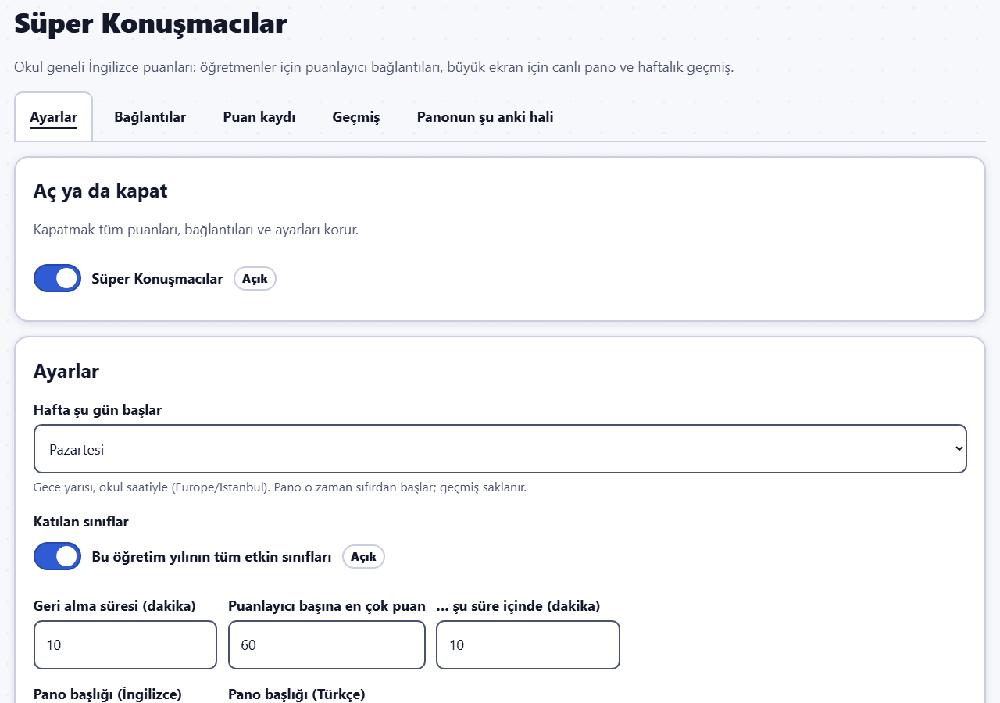
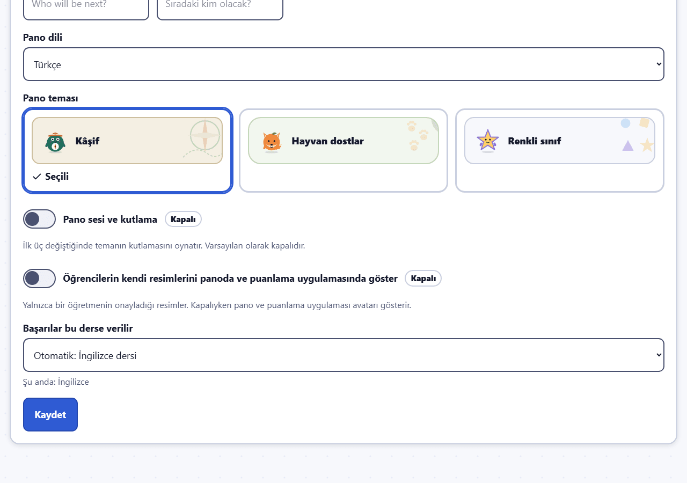
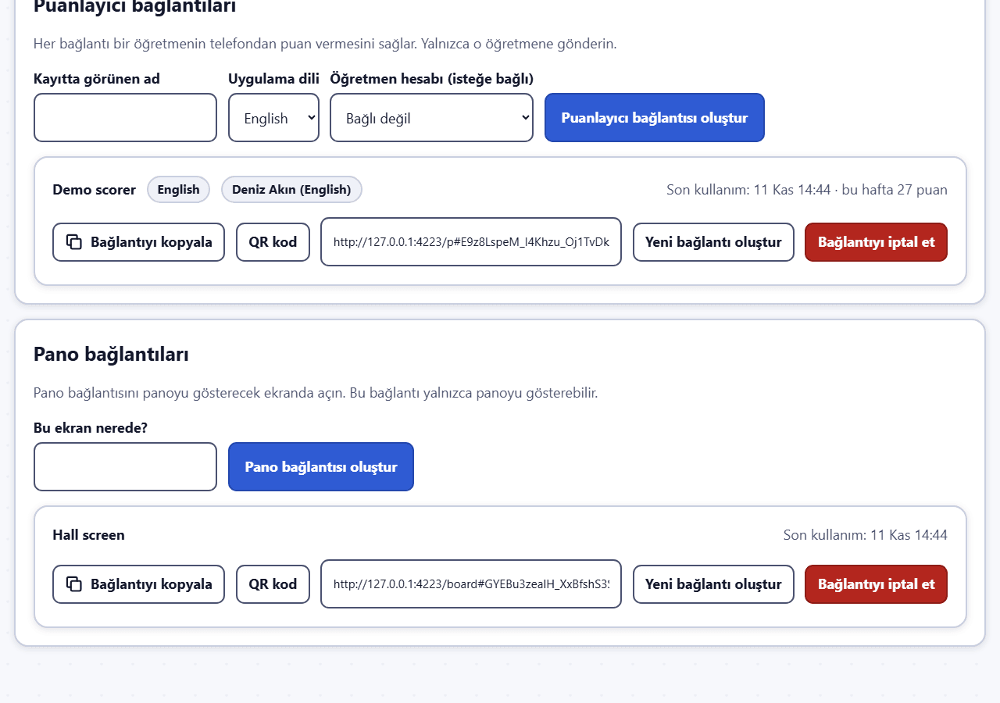

# Süper Konuşmacılar: yöneticiler için kılavuz

**Süper Konuşmacılar**, okul genelinde bir İngilizce puan panosudur. Bir öğrencinin İngilizce konuştuğunu duyan öğretmen, telefonundan ona bir puan (+1) verir; koridordaki büyük ekran haftanın ilk üç öğrencisini ve bütün sınıfların puanlarını canlı olarak gösterir. Pano her hafta sıfırdan başlar; verilen her puan geçmişte saklanır.

Bu bir **okul geneli modüldür**: varsayılan olarak kapalıdır, yalnızca yönetici açar ve tek bir sınıfa ait değildir. Kapatmak hiçbir puanı, bağlantıyı ya da ayarı silmez.

Resimler hayali demo okulundan alınmıştır. İçlerindeki bütün adlar uydurmadır.

İlgili tek sayfalık kılavuzlar: [puanlayıcılar için](scorer.md) ve [pano ekranı için](board-screen.md).

## Modülü açın

Yönetim menüsünden **Süper Konuşmacılar**'ı açın. **Aç ya da kapat** bölümünden modülü açın. (Aynı anahtar **Modüller ve medya** → **Okul geneli modüller** altında da vardır.) Modül kapalıyken puanlayıcı bağlantılarıyla puan verilemez ve panolarda kısa bir bilgi notu görünür.

## Ayarlar

**Ayarlar** sekmesi:

- **Haftanın ilk günü**: okul saatine göre gece yarısı. Pano o anda sıfırdan başlar; geçmiş korunur.
- **Katılan sınıflar**: **Bu öğretim yılının tüm etkin sınıfları** ya da bunu kapatıp sınıfları tek tek seçin. Diğer sınıfların öğrencileri puan alamaz.
- **Geri alma süresi (dakika)**: bir puanlayıcının kendi verdiği puanı ne kadar süre geri alabileceği (varsayılan 10).
- **Puanlayıcı başına sınır**: **Süre (dakika)** içinde **En çok (puan)**; altındaki satır bunu bir cümle olarak okur. Art arda kontrolsüz dokunmaları durdurur (varsayılan: 10 dakikada 60 puan).
- **Pano başlığı (İngilizce)** ve **Pano başlığı (Türkçe)** ile henüz kimsenin puanı yokken ve podyumda boş bir yer varken gösterilen **Pano mesajları**. Hazır mesaj için alanı boş bırakın.
- **Pano dili** ve **Pano teması**.
- **Öğrencilerin kendi resimlerini panoda ve puanlama uygulamasında göster**: yalnızca bir öğretmenin onayladığı resimler; varsayılan olarak kapalıdır, kapalıyken pano ve puanlama uygulaması avatarı gösterir.
- **Pano sesi ve kutlama**: ilk üç değiştiğinde temanın kutlamasını oynatır. Varsayılan olarak kapalıdır. Tarayıcılar ses çalmak için birinin panoya bir kez tıklamasını bekleyebilir.
- **Başarılar bu derse verilir**: puanlar bu derste Süper Konuşmacılar başarılarını kazandırır (ilk puan, 5, 10 ve 25 puan). Varsayılan (**Otomatik: İngilizce dersi**), İngilizce adı "English" olan derstir. Böyle bir ders bulunamazsa siz bir ders seçene kadar Süper Konuşmacılar başarısı verilmez.

## Puanlayıcı ve pano bağlantıları

**Bağlantılar** sekmesi.

**Puanlayıcı bağlantıları**: her bağlantı **tek bir öğretmenin** telefondan puan vermesini sağlar. Yalnızca o öğretmene gönderin.

1. **Kayıtta görünen ad** (örneğin "Deniz Hanım"), **Uygulama dili** (öğretmen telefonda değiştirebilir) ve isterseniz bağlanacak bir **Öğretmen hesabı**.
2. **Puanlayıcı bağlantısı oluştur**. Ardından bağlantıyı **Kopyala**yın ya da öğretmenin okutması için **QR kod**unu gösterin.

**Pano bağlantıları**: bir pano bağlantısı yalnızca panoyu gösterebilir.

1. **Bu ekran nerede?** (örneğin "Koridor ekranı").
2. **Pano bağlantısı oluştur**'a basın, sonra bağlantıyı büyük ekrana bağlı bilgisayarda açın (bkz. [pano ekranı kılavuzu](board-screen.md)).

Listede her bağlantının en son ne zaman kullanıldığı ve puanlayıcılar için bu haftaki puanlar görünür. **Yeni bağlantı oluştur** bir bağlantıyı yeniler: eski bağlantı hemen çalışmaz olur ve onu kullanan telefon ya da ekranların oturumu kapanır; verilmiş puanlar korunur. **Bağlantıyı iptal et** bir bağlantıyı durdurur (örneğin bir öğretmen okuldan ayrıldığında); daha sonra yenisini oluşturabilirsiniz.

> Puanlayıcı bağlantılarını anahtar gibi koruyun: bağlantıya sahip olan herkes o öğretmen adına puan verebilir.

## Puan kaydı

**Puan kaydı** sekmesi puanları en yeniden eskiye doğru, her birinin **Durum**u (**Sayılıyor** ya da nasıl kaldırıldığı) ve işlemiyle listeler; dönem, sınıf ve puanlayıcıya göre süzgeçler ile **Kaldırılan puanları göster** seçeneği vardır. **Kaldır** yanlış verilmiş bir puanı geri alır: bir neden yazın. Puan bundan sonra panoda ve raporlarda sayılmaz; kaldırma işlemi ve nedeni kayda geçer. Kazanılmış başarılar korunur. Kaldırmak bir puanı hiçbir zaman silmez; bir öğrencinin puanlarını yalnızca öğrenciyi kalıcı olarak silmek (yönetim alanı) siler.

Puanlayıcı yalnızca kendi puanlarını ve yalnızca geri alma süresi içinde geri alabilir. Bu süreden sonra puanı yönetici buradan kaldırır.

## Geçmiş

**Geçmiş** sekmesi seçilen bir dönemi gösterir: **Haftanın kazananları** (her tam haftanın ilk üçü, panonun gösterdiği gibi; eşit puanlar aynı sırayı paylaşır), **Sınıf ve haftaya göre puanlar**, **Puanlayıcıya göre puanlar** ve **Öğrenciye göre puanlar**; her birinin CSV indirmesi vardır. Kaldırılan puanlar sayılmaz.

Süper Konuşmacılar puanları başarı dersinin sınıf raporunda ve öğrenci zaman çizelgesinde de görünür (Öğretmen kılavuzu, "Raporlar ve CSV").

## Panonun şu anki hali

**Panonun şu anki hali** sekmesi, bir pano ekranına gerek kalmadan panoyu o anki hâliyle gösterir.

## Kendi web adresi (isteğe bağlı)

Sunucu yöneticisi Süper Konuşmacılar'a kendine ait bir web adresi verebilir (örneğin okulun adresinin başına `speakers.` eklenerek; OPERATIONS.md, "Super Speakers on its own hostname"). Bu adreste yalnızca puanlayıcı uygulaması ve pano açılır; böylece ana adres ek bir giriş istese bile pano ekranları ve telefonlar onu açabilir. Uygulamanın geri kalanı bu adreste açılmaz.

Bu özellik açılmadan önce:

- Her puanlayıcıdan uygulamayı bir kez internet bağlantısıyla açmasını ve telefonunda bekleyen puan olmadığını (işaret görünmediğini) kontrol etmesini isteyin. Hâlâ bekleyen puanlar kaybolmaz: uygulama bir sonraki kez internet bağlantısıyla açıldığında önce bu puanları gönderir, ancak ondan sonra yeni adrese geçer. Önceden kontrol etmek bu beklemeyi önler.
- Yeni bağlantıları göndermeye hazır olun (yeni adres açılır açılmaz **Bağlantılar** sekmesinde görünürler).

Bu özellik açıldığında:

- **Bağlantılar** sekmesi yeni adresleri gösterir, yeni QR kodlar da bu adresleri kullanır. Her bağlantının gizli kısmı aynı kalır.
- Eski bağlantılar ve basılı QR kodlar yalnızca ana adresi hâlâ açabilen cihazlarda yeni adrese yönlendirilir. Ana adres ek bir giriş istiyorsa (yeni adresin nedeni de budur), bu girişi yapmamış bir pano ekranı ya da telefon o girişte kalır ve Süper Konuşmacılar'a hiç ulaşamaz. Bu yüzden **yeni bağlantıları yeni adres açıldığında gönderin ve QR kodları o anda yeniden basın**; sonraya bırakmayın.
- **Pano ekranları**: her ekranda yeni pano bağlantısını açın (**Bağlantılar** sekmesinden kopyalayın). Yalnızca sayfası yenilenen bir ekranda "Bu pano bağlantısı artık çalışmıyor" yazar.
- **Puanlayıcılar**: yeni puanlayıcı bağlantılarını açarlar. Uygulamayı ana ekrana eklemişlerse eski Süper Konuşmacılar simgesini silip yeni sayfadan yeniden eklerler; iPhone'da yeni bir kodla yeniden eşleştirirler.
- Puanlar, geçmiş, ayarlar ve bağlantıların gizli kısmı değişmez.

## Bilmekte yarar var

- Puanlar yalnızca artı yöndedir (+1). Eksi puan yoktur.
- Pano ilk üç öğrencinin (eşit puanlıların hepsinin) adını soyadını, sınıfını ve avatarını, ayrıca 0 puanlı sınıflar dâhil sınıf toplamlarını gösterir.
- Telefonda çevrimdışı verilen bir puan bağlantı geri geldiğinde gönderilir ve dokunulduğu güne sayılır (en fazla 4 gün geriye kadar).
- Öğrenciler kendi sayfalarında hiçbir sıralama görmez; yalnızca kendi Süper Konuşmacılar başarılarını görürler.
