# Öğretmen kılavuzu

Bu kılavuz, derslerinde Sınıf Pusulası'nı kullanan sınıf öğretmenleri ve branş öğretmenleri için hazırlandı. Sıradan bir okul gününü izler: giriş yapmak, dersi sınıf ekranında yürütmek ve dersten sonra öğretmen alanında yapılan işler.

Resimler hayali bir okuldan ("Demo İlkokulu") alınmıştır. İçlerindeki bütün adlar uydurmadır.

> **Modüller.** Özelliklerin çoğu bir *modüle* bağlıdır (Yoklama, Sayaçlar, Gizli Öğrenciler, Günün Yardımcısı, Gruplama, Ödevler, Hedefler ve değerlendirmeler, Başarılar, Rutinler). Okulda hangi modüllerin kullanılacağına yöneticiniz karar verir; siz de her sınıfınız için bunları **Sınıf ayarları**'ndan açar ya da kapatırsınız. Burada anlatılan bir şeyi bulamıyorsanız büyük olasılıkla o modül kapalıdır. Bir modülü kapatmak geçmiş kayıtlarını hiçbir zaman silmez.

Sınıf Pusulası'nı ilk kez mi kullanıyorsunuz? [Öğretmenler için hızlı başlangıç](quick-start-teacher.md) ile başlayın.

## Giriş yapmak

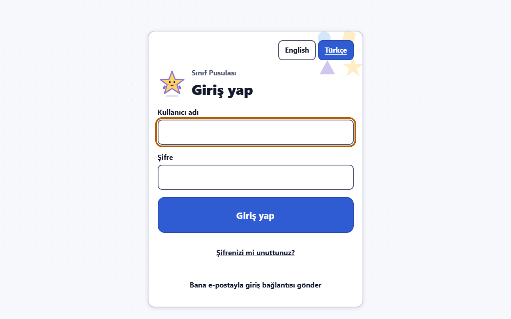

Hesabınızı okul yöneticiniz açar. Genellikle size bir **davet bağlantısı** gelir (e-postayla ya da bağlantı veya QR kod olarak). Bağlantıyı 7 gün içinde açın. Davet sayfası **Kullanıcı adınız**'ı ayrı bir kutuda gösterir: not alın, şifreyle her girişte bunu yazarsınız. Sonra nasıl giriş yapmak istediğinizi seçin:

- **Şifreyle**: kullanıcı adınızı ve kendi belirlediğiniz şifreyi (en az 10 karakter) yazarsınız.
- **E-posta giriş bağlantılarıyla**: şifreniz olmaz. Her girişte giriş sayfasında **Bana e-postayla giriş bağlantısı gönder** düğmesine basıp e-posta adresinizi yazarsınız. Bir dakika içinde bir bağlantı ve 6 haneli bir kod gelir. Bağlantıyı açıp **Giriş yap**'a basın ya da kodu e-postayı istediğiniz cihaza yazın. İkisi de yalnızca bir kez ve 15 dakika boyunca çalışır. Sayfa yazdığınız adresi tekrar gösterir, böylece yazım hatasını görebilirsiniz; **Başka bir e-posta adresi kullan** ile adresi yeniden yazabilirsiniz. Bu seçenek yalnızca okulda e-posta gönderimi ayarlanmışsa görünür.

Yöneticiniz size davet yerine **geçici şifre** verdiyse ilk girişte kendi şifrenizi belirlemeniz gerekir.

Şifrenizi mi unuttunuz? Okulda e-posta ayarlanmışsa giriş sayfasındaki **Şifrenizi mi unuttunuz?** bağlantısını kullanın; sıfırlama bağlantısı bir saat geçerlidir. Değilse yöneticinizden şifrenizi sıfırlamasını isteyin. Bir giriş ya da sıfırlama bağlantısının süresi dolduysa sayfası **Bana yeni bir giriş bağlantısı gönder** ya da **Yeni bir sıfırlama bağlantısı iste** ve **Giriş sayfasına dön** düğmelerini gösterir. Şifre ile e-posta bağlantısı arasında daha sonra **Profil ve PIN** → **Nasıl giriş yapıyorsunuz** bölümünden geçiş yapabilirsiniz.

> Giriş sayfasının üstünde **English | Türkçe** düğmeleri vardır; bu cihaz seçiminizi hatırlar. Seçim yapılmadıysa sayfa tarayıcının dilini ya da okulun yeni hesaplar için seçtiği dili kullanır. Giriş yaptıktan sonra Sınıf Pusulası kendi arayüz dilinizle açılır (Profil ve PIN → **Dil**).

## PIN ve sınıf kilidi

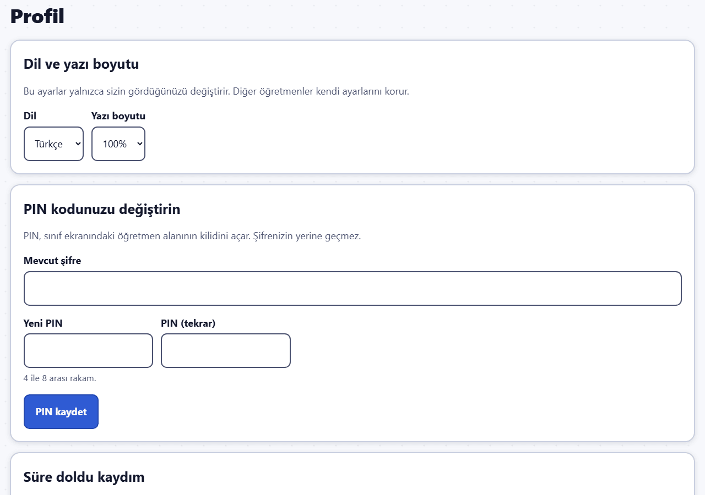

Sınıf ekranı genellikle bütün sınıfa yansıtılır. Öğretmen alanınızın tahtada görünmemesi için Sınıf Pusulası onu bir **PIN** ile kilitler:

1. Öğretmen menüsünden **Profil ve PIN**'i açın.
2. **PIN belirleyin** bölümünde mevcut şifrenizi yazın (e-posta bağlantısıyla giren hesaplar bunun yerine yeniden e-postayla giriş yapar), ardından **4 ile 8 arası rakamdan** oluşan PIN'i iki kez yazıp **PIN kaydet**'e basın.

PIN şifrenizin yerini tutmaz. PIN belirlemeden sınıf ekranını açamazsınız.

Kilit şöyle çalışır:

- Sınıf ekranını açtığınızda o cihaz **sınıf moduna** geçer. Bundan sonra **Öğretmen alanı** PIN'inizi sorar.
- Kilidi açtığınızda her zaman önce **Öğretmen menüsü** açılır; öğrenci bilgisi olan bir sayfa doğrudan açılmaz.
- Öğretmen alanı **3 dakika boyunca hiçbir dokunuş ya da tuş olmazsa** yeniden kilitlenir. **Sınıf ekranında görünüyor** yazan çubuktaki **Kilitle** düğmesiyle hemen de kilitleyebilirsiniz.
- Birkaç kez yanlış PIN girilirse kısa bir bekleme olur; daha fazla yanlış PIN sizi o cihazdan çıkarmadan önce kilit ekranı uyarır.
- **Bu cihazda sınıf modundan çık** (öğretmen menüsünde) sınıf modunu bitirir; örneğin okul çıkışında kendi dizüstü bilgisayarınızda.

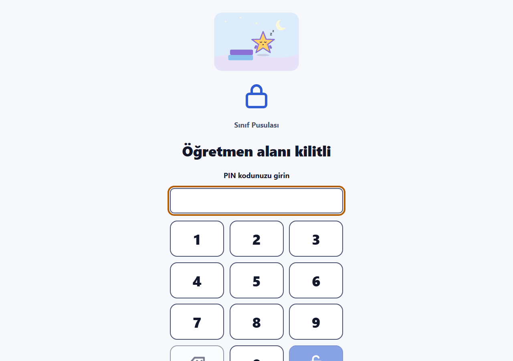

PIN'inizi mi unuttunuz? **Profil ve PIN**'de şifrenizle yeni bir PIN belirleyin ya da yöneticinizden PIN'inizi silmesini isteyin (bu durumda bütün cihazlarda oturumunuz kapanır ve yeni bir PIN belirlersiniz).

**Profil ve PIN**'de ayrıca **Dil**, **Yazı boyutu** ve **Aralıklar** seçilir (yalnızca sizin gördüğünüzü değiştirir; **Aralıklar** — Sık, Normal ya da Geniş — öğretmen sayfalarındaki tablo ve kartların ne kadar yer kapladığını belirler, düğmeler aynı boyutta kalır, sınıf ekranının boyutu ise **Ekran** menüsündedir), derslerin tam ekranda açılıp açılmayacağı belirlenir (**Dersler** → **Derslerde tam ekran**, bkz. [Tam ekran](#tam-ekran)) ve **Süre doldu kaydım** kaydedilir (bkz. [Sesler ve kutlamalar](#sesler-ve-kutlamalar)).

## Öğretmen menüsü

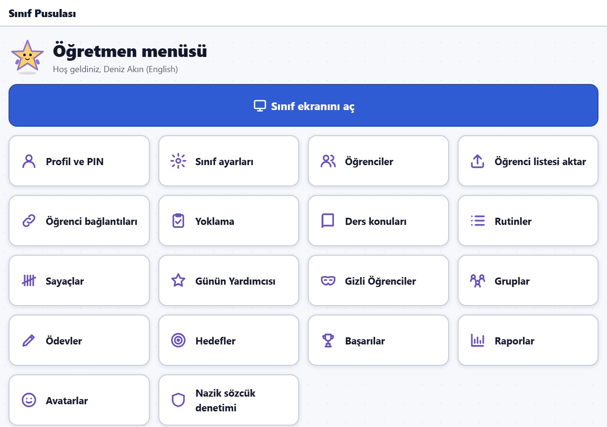

Öğretmen menüsü, öğretmen alanının başlangıç sayfasıdır ve üç bölümden oluşur:

- **Sınıf ekranını aç** (ya da **Sınıf ekranına dön**) sizi ders ekranına götürür.
- **Bugün**: her gün kullandığınız sayfalar: **Yoklama**, **Ödevler**, **Hedefler**, **Raporlar**, **Bildirimler** (zil simgesi; yanında yeni bildirimlerin sayısı yazar, bkz. [Bildirimler](#bildirimler)) ve **Asistan** (bkz. [Asistan](#asistan)).
- **Sınıf kurulumu**: bir kez ayarlayıp arada bir değiştirdiğiniz her şey için tek bir kutucuk. Üç sekmeli bir sayfa açar:
  - **Sınıflar ve öğrenciler**: **Sınıf ayarları**, **Öğrenciler**, **Öğrenci listesi aktar**, **Öğrenci bağlantıları**, **Avatarlar**.
  - **Ders araçları**: **Ders konuları**, **Rutinler**, **Sayaçlar**, **Günün Yardımcısı**, **Gizli Öğrenciler**, **Gruplar**.
  - **Başarılar ve nazik sözcükler**: **Başarılar**, **Nazik sözcük denetimi**.

Altta **Profil ve PIN**, **Yardım** (bu kılavuzlar), **Bu cihazda sınıf modundan çık** (yalnızca sınıf modunda) ve **Çıkış yap** bulunur.

Bütün sınıflarınızda kapalı olan bir modülün sayfaları menüde görünmez. Böyle bir sayfayı eski bir yer iminden açarsanız sayfa modülün kapalı olduğunu söyler ve **Sınıf ayarlarını aç** düğmesini gösterir; hiçbir şey silinmemiştir. Öğretmen alanının diğer sayfalarında üstteki bağlantı satırı (zil simgesiyle birlikte) sayfaları açar; telefonda ya da tablette bu tek bir **Sayfa** listesidir.

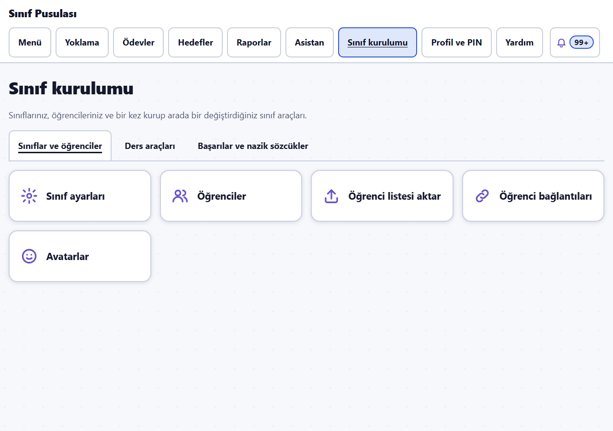

## Dersi başlatmak ve bitirmek

### Dersi başlatın

1. **Sınıf ekranını aç**'a basın.
2. Birden fazla sınıfa ya da derse giriyorsanız üstteki sınıfa dokunun, örneğin **3-A · İngilizce**. Etkin sınıf ve ders her zaman üstte yazar; böylece hiçbir şey yanlış sınıfa kaydedilmez.
3. **Dersi başlat**'a basın. Adımlar açık olan modüllere göre değişir:
   - **Yoklama**: siz değiştirmedikçe herkes "Var" sayılır. Bir öğrenciye dokunarak Yok, Geç, İzinli ve Var arasında geçiş yapın.
   - **Bugünün yardımcısı**: bugün kimin yardım edeceği ve görevleri. Yardımcının şimdiden yaptığı görevleri işaretleyin (örneğin "Sınıfın düzenlenmesine yardım et"); işaretler ders başladığında kaydedilir.
   - **Bugünün konusu**: dersin odağı (Dinleme, Okuma, Kelime bilgisi, Dil bilgisi, Yazma, Konuşma, Sesletim ya da kendi konularınız). **Ders konuları**'ndaki haftalık plan bir öneri getirir; değiştirebilirsiniz.
   - **Bugünün hedefi** (yalnızca sınıfta **Ders hedefleri** açıksa, bkz. [Ders hedefleri](#ders-hedefleri)): sınıfın okuyabileceği kısa bir cümle, örneğin "Hava durumunu sorup cevaplayabiliriz." Bugün hedef koymayacaksanız boş bırakın.
   - **Rutin**: bu dersin rutinini seçin.
4. **Derse başla**'ya basın. Pano tüm ekranı kaplar (tam ekran); tarayıcının çubukları sınıftan yer çalmaz.

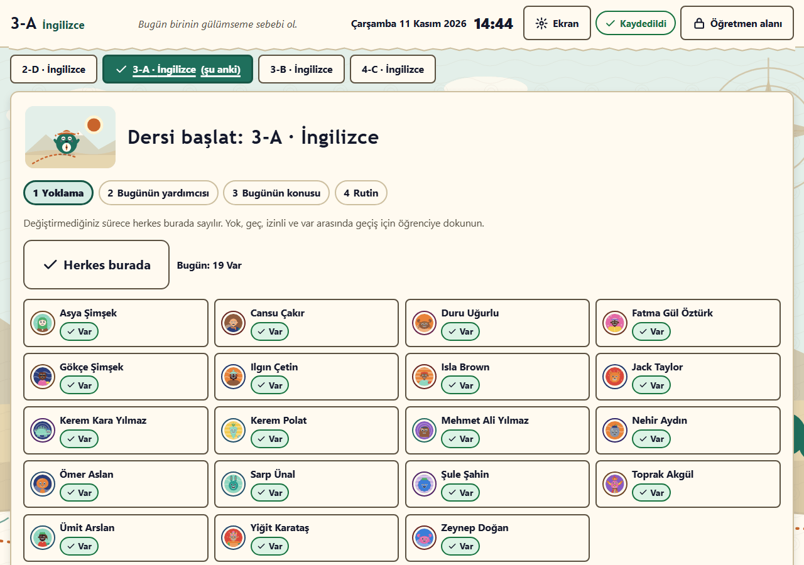

### Tam ekran

Ders sürerken üst çubukta bir **Tam ekran** düğmesi vardır; tam ekrandayken bu düğme küçük bir **Tam ekrandan çık** düğmesine dönüşür. Sayfa tam ekranda kaldığı sürece bu düğme üst çubukta (ve öğretmen alanında) durur, ders bittikten sonra da; böylece dokunarak her zaman çıkabilirsiniz. Klavyedeki **Esc** tuşu da her zaman tam ekrandan çıkarır. Pencereler, PIN kilidi, kutlamalar ve bildirimler tam ekranda da çalışır. **Kaydet ve dersi bitir** tam ekrandan çıkar; **Derse dön** tam ekranı korur.

Bunu istemiyorsanız **Profil ve PIN** → **Dersler** bölümünde **Derslerde tam ekran** ayarını kapatın. Bu sizin kendi ayarınızdır ve girdiğiniz her sınıf bilgisayarında geçerlidir; panodaki **Tam ekran** düğmesi yine çalışır. Tam ekranı olmayan tarayıcılarda (örneğin iPhone'da) düğme görünmez ve hiçbir şey değişmez.

Sayfayı yenileseniz ya da başka bir sınıfa geçip geri dönseniz de ders sürer. Dersi süren sınıf **Ders sürüyor** olarak işaretlenir. Kablosuz ağ koparsa dokunuşlarınız cihazda saklanır ve sonra gönderilir; kayıt göstergesinde **Çevrimdışı – N değişiklik bekliyor** yazar. Sunucunun kaydedemediği her şey **Kontrol gerekiyor** altında **Yeniden dene** ve **Kapat** düğmeleriyle görünür.

### Dersi bitirin

**Dersi bitir**'e basın. Modüllere göre şu adımlardan geçersiniz:

- **Gizli Öğrenciler**: gizli öğrencileri açıklayın ve sonuçlarını kaydedin (bkz. [Gizli Öğrenci](#gizli-öğrenci)).
- **Yardımcıya teşekkür**: yardımcının bugün yaptığı görevleri işaretleyin, sonra ona teşekkür edin.
- **Aferin!**: bu derste kazanılan otomatik başarılar; yalnızca sınıf bunu Başarılar'da seçtiyse.
- **Hedefimiz**: yalnızca dersin bir hedefi varsa. **Hedefimize ulaştık mı?** **Evet, ulaştık!**, **Kısmen** ya da **Henüz değil**. Cevaplamak isteğe bağlıdır; seçimi kaldırmak için aynı cevaba yeniden dokunun.
- **Değerlendirme**: **Ders nasıl geçti?** (Zordu, İdare eder, İyi, Harika) ve kendiniz için isteğe bağlı bir not.

**Kaydet ve dersi bitir**'e basın. **Ders kaydedildi** özeti süreyi, ulaşılan rutin aşamalarını ve yoklamayı gösterir. **Derse dön** bitirmeyi iptal eder ve süren derse geri götürür.

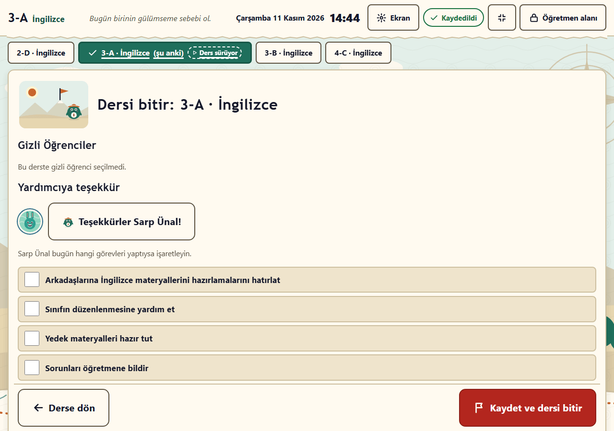

## Sınıf ekranı

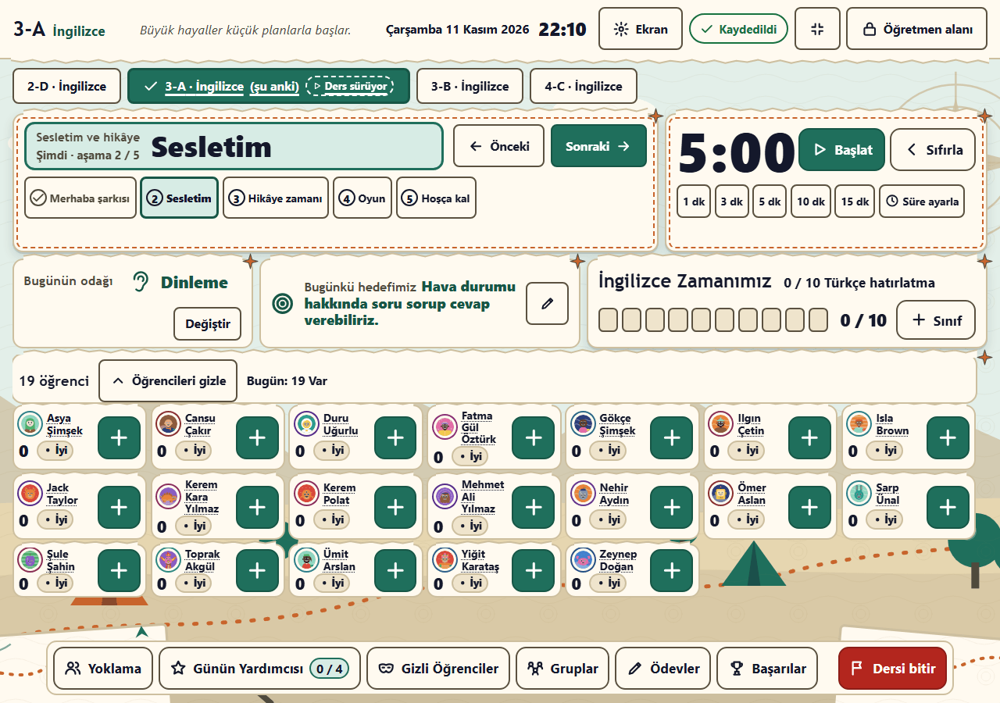

**Üst çubukta** sınıf ve ders, **günün sözü** (açıksa), gün, tarih ve saat ile hava durumu (yönetici açtıysa ve sunucu hava durumu hizmetine ulaşabiliyorsa) görünür. Sağ tarafta:

- Kayıt durumu.
- **Ekran** bu ekranın ayarlarını açar:
  - **Sınıf dili**: yalnızca sınıf iki dil kullanıyorsa; ekranı iki dil arasında değiştirir.
  - **Boyut**: **Küçük**, **Normal** ya da **Büyük**. Sınıfın arkasından okunabilen boyutu seçin; ekran ayrıca kendini görüntü alanına uydurur. Ders ekranında bu boyut öğrenci kartlarının başlangıç boyutudur: kalabalık olmayan bir sınıfın kartları boş alanı dolduracak kadar büyür (en fazla Büyük'e kadar), kalabalık bir sınıfın kartları olabildiğince çoğu görünecek kadar küçülür (okunabilir bir boyutun altına inmez; görünmeyenlere "Aşağıda … öğrenci daha var" düğmesiyle inilir) ve bir ad hiçbir zaman bir kelimenin ortasından bölünmez. Seçim bu cihazda hatırlanır.
  - **Bu cihazda sesler**.
  - **Yerleşimi düzenle** (bkz. [Yerleşimi düzenlemek](#yerleşimi-düzenlemek)).
  - **Ses kontrolü** (bkz. [Sesler ve kutlamalar](#sesler-ve-kutlamalar)).
- **Öğretmen alanı** (PIN'inizi sorar).

Üst çubuğun altındaki ders panosu yukarıdan aşağıya şu kutulardan oluşur:

1. **Geniş bir satır**: bütün aşamaları görünen **rutin** ve yanında büyük bir **zamanlayıcı**.
2. **Bugünün odağı** (dersin konusu, **Değiştir** ile) ve **sınıf çubuğu** (sayaç).
3. Bütün genişliği kaplayan **öğrenci kartları**. Üstlerindeki **Öğrencileri gizle** / **Öğrencileri göster** kartları katlar (örneğin tahtada bir şey gösterirken). Kartlar kutularına sığan boyutu alır: az öğrencili bir sınıfta daha büyük, kalabalık bir sınıfta daha küçük. Kartların hepsi sığmadığında (1280×720 bir projeksiyonda 40 kişilik bir sınıf) kartlar kendi kutularının içinde kayar, **Öğrencileri gizle** satırının sonundaki **Aşağıda … öğrenci daha var** düğmesi kaç öğrencinin görünmediğini söyler ve onlara kaydırır. Kartta sayının yanında küçük işaretler de görünebilir: öğrencinin bu derste aldığı başarı sayısıyla bir kupa ve gruplar gösterilirken grup numarası (grup simgesi ve numara). Yalnızca olumlu bir şey gösterirler, asla sıfır göstermezler; modül o sınıf için kapatılınca kaybolurlar.
4. **Ders araçları**: altta büyük düğmelerden oluşan bir satır: **Yoklama**, **Günün Yardımcısı**, **Gizli Öğrenciler**, **Gruplar**, **Ödevler** ve **Başarılar**. Bir düğme kendi panelini tam ekran açar; siz paneli **Kapat** düğmesiyle (ya da Esc tuşuyla) kapatana kadar alttaki pano bekler. Bir panelde yaptığınız işlerin mesajları ve **Geri al** düğmesi panelin içinde görünür. Bir düğmenin üstündeki küçük sayı sınıfla ilgili bir şeyi sayar, örneğin seçilen gizli öğrencileri; özel hiçbir şey göstermez. **Dersi bitir** her zaman satırın sonunda kalır. Telefonda bu satır kısa tek bir satırdır: sığan düğmeler, kalanların sayısını gösteren **Diğer** ve **Dersi bitir**. Dar bir telefonda **Diğer** yalnızca sayıyı gösterebilir (örneğin **+5**). **Diğer** bütün düğmeleri birkaç satırda açar; **Daha az** onları yeniden katlar.

Modülü bu sınıfta kapalı olan bir kutu hiç görünmez; boşalan yeri yanındaki kutular alır. Kısa mesajlar (örneğin **Ders başladı: 3-A · İngilizce**) sol altta kısa bir süre görünür. **Geri al** içeren mesajlar biraz daha uzun kalır.

**Klavyeyle** (örneğin projeksiyona bağlı bir dizüstü bilgisayarda): Sekme (Tab) tuşu kutudan kutuya ve içlerindeki düğmelere geçer, Enter ya da boşluk tuşu düğmeye basar, Esc tam ekran paneli kapatır.

### Yerleşimi düzenlemek

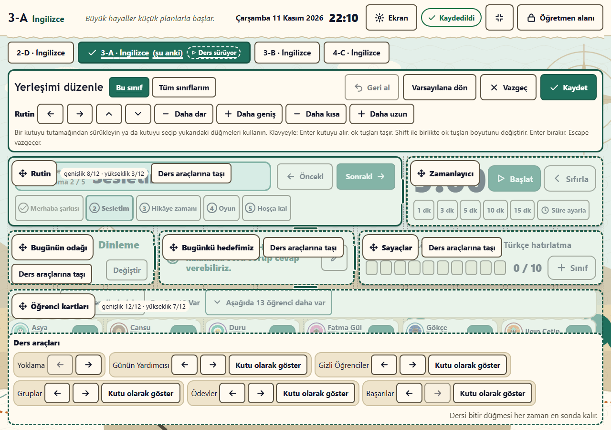

Panodaki kutuları kendiniz taşıyıp boyutlarını değiştirebilirsiniz; örneğin zamanlayıcıyı büyütebilir ya da sayaçları ders araçları satırına alabilirsiniz:

1. **Ekran** → **Yerleşimi düzenle**. Yerleşim size ait olduğu için PIN'iniz sorulur.
2. Bir kutuyu tutamağından başka bir yere sürükleyin; **Ders araçları** satırına bırakırsanız orada bir düğme olur. İki kutunun arasındaki çizgiyi sürükleyerek genişliklerini ya da yüksekliklerini değiştirin. Ya da bir kutuyu seçip üstündeki düğmeleri kullanın (**…: sola taşı**, **Daha geniş**, **Daha uzun**, **Ders araçlarına taşı**, **Kutu olarak göster**…). Klavyeyle: Enter kutuyu alır, ok tuşları taşır, Shift ile birlikte ok tuşları boyutunu değiştirir, Enter bırakır, Esc vazgeçer.
3. **Geri al** son değişikliği geri alır. **Şunun için kaydet** altında **Bu sınıf** ya da **Tüm sınıflarım**'ı seçip **Kaydet**'e basın. **Varsayılana dön** varsayılan yerleşimi geri getirir; **Vazgeç** kaydetmeden çıkar.

Kaydettiğiniz ya da vazgeçtiğiniz anda öğretmen alanı yeniden kilitlenir. Yerleşimi düzenlemek için geniş bir ekran gerekir; dar bir pencerede düğmenin altında **Daha geniş bir ekran gerekir.** yazar. Bir sınıf için kaydettiğiniz yerleşim, tüm sınıflarınız için kaydettiğinizin önüne geçer.

### Sınıf ekranında öğrenci kartı

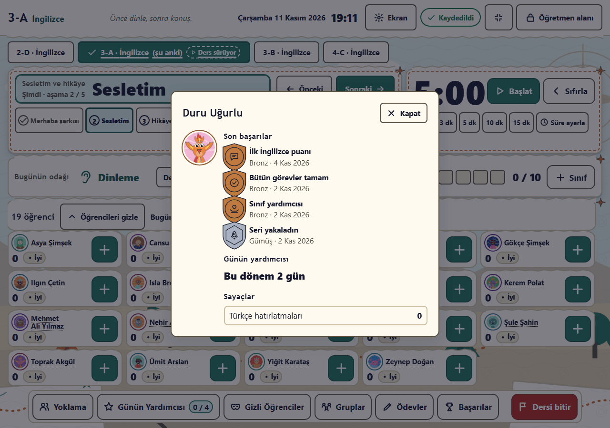

Öğrenci kartındaki **ada** dokunduğunuzda sınıfın da görebileceği küçük bir kart açılır: **Son başarılar**, **Bu hafta Süper Konuşmacılar** (öğrencinin kendi puanı), **Günün yardımcısı** (bu dönem kaç gün) ve **Sayaçlar** (yalnızca hatırlatma kutuları açıkken). Kart yalnızca olumlu şeyler gösterir: devam, ödev, hedef, not, seviye ya da başka öğrencilerle karşılaştırma asla yer almaz ve istatistiklere bağlantı yoktur. Öğrenci kartındaki **+** düğmesi eskisi gibi bir hatırlatma sayar. İstatistikler yalnızca öğretmen alanındadır (bkz. [Öğrenci istatistikleri](#öğrenci-istatistikleri)).

### Ders hedefleri

**Ders hedefleri** her sınıfta kapalı başlar; bir sınıf ve ders için **Sınıf ayarları** → **Modüller**'den açarsınız. Açıkken:

- **Dersi başlat**'ta isteğe bağlı tek bir cümlelik **Bugünün hedefi** adımı vardır.
- Pano **Bugünkü hedefimiz**'i öğrenci kartlarının üstünde kendi satırında **Değiştir** ile gösterir (yeni cümleyi yazıp **Hedefi kaydet** ya da **Hedefi kaldır**). Hedef yoksa yalnızca küçük bir **Hedef koy** düğmesi kalır. Her kutu gibi **Yerleşimi düzenle** ile taşınabilir ya da **Ders araçları** satırına alınabilir.
- **Dersi bitir**, dersin hedefi varsa **Hedefimize ulaştık mı?** diye sorar.
- **Raporlar**'da bir **Ders hedefleri** bölümü vardır: her dersin hedefi ve cevabı, cevaplanan hedeflerden kaçına ulaşıldığı, kısmen ulaşıldığı ya da henüz ulaşılmadığı. Kimsenin cevaplamadığı bir hedef "kaydedilmedi" olarak görünür.

Hedef sınıfa gösterilir; çocuklar için yazın. Modülü kapatmak adımı, kutuyu ve rapor bölümünü gizler; kaydedilmiş hedefler saklanır.

### Rutin ve zamanlayıcı

- **Rutin**: o anki aşama (**Şimdi · aşama 2 / 6**); rutinin bütün aşamaları görünür. **Sonraki aşama** ve **Önceki aşama** düğmelerini kullanın ya da bir aşamaya dokunun.
- **Zamanlayıcı**: 1, 3, 5, 10 ya da 15 dakikayı seçin ya da **Süre ayarla** ile rakam tuşlarından bir süre yazın (1 3 0, 1:30 demektir). **Başlat**, **Duraklat** ve **Sıfırla**. Süre dolduğunda sınıfın **Sınıf ayarları** → **Süre bittiğinde** bölümünde seçtiği çalar.

### Ders sırasında yoklama

**Yoklama** (ders araçları satırında) bugünün listesini açar. Bir değişiklik normalde **tüm gün** için geçerlidir ve sınıfın diğer öğretmenleriyle paylaşılır. Gün içinde geç gelen ya da erken ayrılan bir öğrenci için **Yalnızca bu ders için** kutusunu işaretleyin. **Diğer herkes burada** kalanları doldurur. Önceki günler ve derse özel durumlar öğretmen alanındaki **Yoklama** sayfasındadır.

### Sayaçlar

Bir sayaç bütün sınıf için (**sınıf çubuğu**) ve/veya her öğrenci için bir şey sayar; örneğin İngilizce hatırlatmalarını. Sınıf çubuğundaki **+** ile bir tane ekleyin. Çubuk dolduğunda seçilen tepki bir kez, sakin bir biçimde görünür ve hiçbir öğrencinin adını söylemez. Tepki "Sınıf yeniden başlıyor" ise **Çubuğu yeniden başlat**, onayladıktan sonra çubuğu 0'a döndürür (dokunuşlar kayıtlı kalır). Ardından 10 dakika boyunca, o sayaca yeniden dokunulana kadar sayaçta **Yeniden başlatmayı geri al** görünür; çubuğu eski hâline getirir. Sınıf sesleri açıksa çubuk dolduğunda kısa bir ses çalar.

Her öğrenci kartında öğrencinin sayısı ve bir **+** düğmesi görünür. Bir sınıfta gizlemek için Sınıf ayarları → Sayaçlar'daki **Öğrenci kartlarında hatırlatma kutuları** anahtarını kapatın. Her dokunuştan sonra **Geri al** düğmeli kısa bir mesaj çıkar. Sayaçlar puan değil, sayıdır. Sayaçları, adlarını, sınırını, düzeylerini ve tepkilerini **Sayaçlar** sayfasında oluşturup düzenlersiniz; **Haftalık geçmiş** öğrenci ve haftaya göre sayıları gösterir.

### Gruplar ve grup ekranı

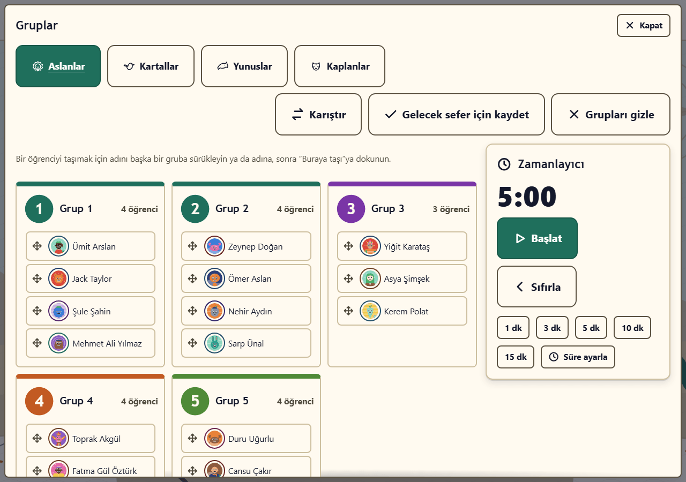

Ders araçları satırındaki **Gruplar**'a basın (Gruplar panonuzda bir kutuysa **Grup seç**'e, gruplar zaten gösteriliyorsa **Grupları aç**'a). Tam ekran grup ekranı grup seçeneklerini gösterir; dört varsayılan seçenek Aslanlar, Kartallar, Yunuslar ve Kaplanlar'dır ve her biri Grup 1'den Grup 5'e kadar gruplar verir.

- Bir seçeneğe dokunarak o gün sınıfta olan öğrenciler için gruplar oluşturun. Gelmeyen öğrenciler yalnızca bu derste dışarıda kalır.
- **Karıştır** yeni gruplar oluşturur; **Karıştırmayı geri al** öncekileri geri getirir.
- Bir öğrenciyi taşımak için adını başka bir gruba sürükleyin ya da adına, sonra yeni gruptaki **Buraya taşı** düğmesine dokunun. Tablette sürüklemeden önce ada basılı tutun. Grupların altındaki **Grupta değil** bölümü öğrenciyi bu ders için gruplardan çıkarır. Klavyeyle bir ada gidin, sürükleme tutamacına sağ okla geçin, Enter'a basın, Sekme (Tab) ile gruba gidin ve yeniden Enter'a basın.
- **Gelecek sefer için kaydet** bu grupları bir dahaki sefer için o seçeneğe kaydeder.
- Taşımak için dokunduğunuz öğrenci renkli gösterilir; mesajın yanındaki **Vazgeç** seçimi bırakır.
- Zamanlayıcı grup ekranında da vardır.

Seviyeler, eşleşme kuralları ("birlikte çalışmalı / çalışmamalı") ve notları sınıf ekranında **hiçbir zaman** gösterilmez. Bunları **Gruplar** sayfasında (**Düzenler**, **Seviyeler**, **Eşleşme kuralları** sekmeleri) yönetirsiniz. Sınıf ayarlarında grup ekranında öğrenci adlarının büyük harfle gösterilmesini seçebilirsiniz.

**Seviyeler** sekmesi: her öğrencinin seviyesini yazın ve **Kaydet**'e basın. Sayılar, A1 ve B1 gibi kodlar ve alışılmış sözcükler (Başlangıç … İleri, Beginner … Advanced) gerçek sıralarına konur; diğer sözcükler bunlardan sonra alfabetik sırayla gelir. **Kullanılan sıra** satırı seviye gruplarının kullanacağı sırayı gösterir.

**Seviye listesi** (isteğe bağlı) kendi sözcüklerinizi ve sıralarını seçmenizi sağlar, örneğin Başlıyor, Gelişiyor, Güçlü, Yıldız:

- **Şu an kullanılan seviyelerden liste yap**, öğrencilerinizin şu anki seviyeleriyle, bugün kullanılan sırayla başlar. **Boş bir liste başlat** sıfırdan başlar.
- Her satıra bir seviye yazın, en düşük en üstte. Sırayı yukarı ve aşağı oklarla değiştirin; **Seviye ekle** yeni bir satır ekler, çarpı işareti bir satırı kaldırır. Sonra **Listeyi kaydet**'e basın.
- Liste varken her öğrencinin seviyesi listeden seçilir (ya da **Seviye yok**). Listede olmayan bir seviye silinmez, "(listede yok)" diye gösterilir; seviye grupları bu seviyeleri listeden sonraya koyar. **Listede olmayan seviyeler** bölümünde o seviyedeki bütün öğrencileri listedeki bir seviyeye çevirebilirsiniz.
- Liste sınıfa ve derse aittir; o sınıfın o dersine giren her öğretmen aynı listeyi görür. Listeyi değiştirmek var olan grupları değiştirmez: listeyi kullanmak için **Yeni gruplar oluştur**'a (ya da grup ekranında **Karıştır**'a) basın. **Listeyi kaldır** seviyeleri yeniden yazılır hâle getirir; hiçbir öğrencinin seviyesi değişmez.

**Grupları düzenle** (Düzenler sekmesi) grupları yan yana gösterir. Bir adı başka bir gruba ya da **Grupta değil** bölümüne sürükleyin veya bir ada, sonra gruptaki **Buraya taşı** düğmesine dokunun. **Kaydet**'e basana kadar hiçbir şey kaydedilmez. Her grubun altındaki **Grup adı ve görevler** grubun İngilizce ve Türkçe adını ve isteğe bağlı görevleri içerir.

### Günün Yardımcısı

**Günün Yardımcısı** (ders araçları satırında) bugünün yardımcısını ve görevlerini işaret kutularıyla gösterir; başlangıç ekranında işaretledikleriniz burada da işaretlidir. Yardımcı "Yok" olarak işaretlenirse sıradaki öğrenci kendiliğinden görevi alır. **Gizle** / **Asistanı göster** paneli bu ders için gizler; varsayılanı **Günün Yardımcısı** sayfasında belirlersiniz (**Ayarlar**: okul günleri, görevler, **Derslerde asistan panelini göster**). **Hafta** sekmesinde **Bu haftayı planla**, planı **Duyur**, iki günü yer değiştir ya da bir gün için **Yardımcıyı ata**; **Geçmiş** sıraları gösterir.

### Gizli Öğrenci

1. Ders sırasında **Gizli Öğrenciler**'i açıp **Gizli öğrencileri seç**'e basın. Sınıf Pusulası derste olan öğrencilerden seçer (varsayılan 2; **Gizli Öğrenciler** sayfasında 1 ile 10 arası). Dersin sonuna kadar kimse, siz bile, kimin seçildiğini göremez. **Yeniden seç** onları geri koyar ve yenilerini seçer.
2. **Dersi bitir** sırasında **Gizli öğrencileri açıkla**'ya basın. Davul sesli kısa bir geri sayım çalar (**Hemen göster** bunu atlar).
3. **Sizin kaydınız** altında her biri için bir sonuç kaydedin: **Hedefe ulaştı**, **Çalışmaya devam** ya da **Değerlendirilmedi**; isterseniz bir not ekleyin.
4. **{name} için kutlama** o öğrenci için kutlamayı oynatır.

Seçilen öğrenci derste yoksa yerine başkası seçilir; gelmeyen öğrencinin sırası daha sonraki bir tura kalır.

### Başarılar: derste başarı vermek

1. **Başarılar**'ı açıp **Başarı ver**'e basın.
2. **Kim alıyor?**: öğrencileri işaretleyin ya da **Tüm sınıf**'ı seçin.
3. **Bir başarı seçin**. Başarı, adlar ve avatarlarla kısa bir kutlama için **Ekranda kutla**'yı işaretleyin.
4. **N öğrenciye ver**'e basın.

Başarıyı verdikten hemen sonra ekranın altındaki mesaj birkaç saniye **Geri al** sunar. Sonrasında da bu derste verdiğiniz bir başarıyı 10 dakika içinde geri alabilirsiniz (**Bu derste verilen başarılar** → **Geri al**). Daha sonra yanlışlıkla verilmiş bir başarıyı öğretmen alanından kaldırırsınız (bkz. [Başarılar ve avatarlar](#başarılar-ve-avatarlar)). Otomatik başarılar ekranda hiçbir zaman duyurulmaz; sınıf bunları Dersi bitir'deki **Aferin!** adımında topluca görebilir.

### Derste ödev

**Sınıf ekranında kontrole izin ver** açıksa (Ödevler → Ayarlar; varsayılan olarak kapalı) **Ödevler** paneli bu hafta teslim edilecek ödevleri, her biri için bir **Kontrol et** düğmesiyle gösterir. **Kapat** kontrol listesinin başlığının yanındadır. Özel notlar sınıf ekranında hiçbir zaman görünmez.

### Sesler ve kutlamalar

- **Sınıf ayarları** → **Sınıf ekranı**: **Tema**, **Ses düzeyi** ve **Dene** ile **Sesler**, **Animasyonlar**, **Günün sözü** ve **Süre bittiğinde**: **“Time’s up!” de** (bilgisayar İngilizce söyler; bilgisayarda İngilizce ses yoksa zil çalar), **Kendi kaydım**, **Zil** ya da **Sessiz**.
- **Kendi kaydım**: **Profil ve PIN** → **Süre doldu kaydım** bölümünde en fazla 5 saniyelik bir kayıt yapın ya da bir ses dosyası seçin.
- **Bu cihazda sesler** (sınıf ekranının üst çubuğu → **Ekran**) yalnızca bu cihazın sesini kapatır.
- Tarayıcılar sesi ancak biri ekrana dokunduktan ya da bir tuşa bastıktan sonra çalar. O zamana kadar üst çubukta **Ses kapalı · Sesi aç** görünür; ona dokunun (herhangi bir dokunuş da olur), kısa bir deneme sesi çalar. Yine de bir şey duymuyorsanız **Ekran** → **Ses kontrolü**'nü açın: neyin eksik olduğunu söyler (sınıf ya da bu cihaz için sesler kapalı, ses düzeyi 0, tarayıcı dokunuş bekliyor), **Son ses**'i gösterir, **Sesi dene** düğmesi vardır ve **Tanılama bilgisini kopyala** ayrıntıları Sınıf Pusulası'yla ilgilenen kişiye göndermeniz için kopyalar. Bilgisayarın kendi ses düzeyini ve hoparlörünü de kontrol edin.
- Kutlamalar yalnızca siz ekranda bir şey yaptığınızda çalar (açıklanan bir Gizli Öğrenci, **Ekranda kutla**), kendiliğinden asla. Hareketin azaltılmasını isteyen bir cihazda hareketsiz, sakin bir sürüm gösterilir.

## Ödev kontrolü

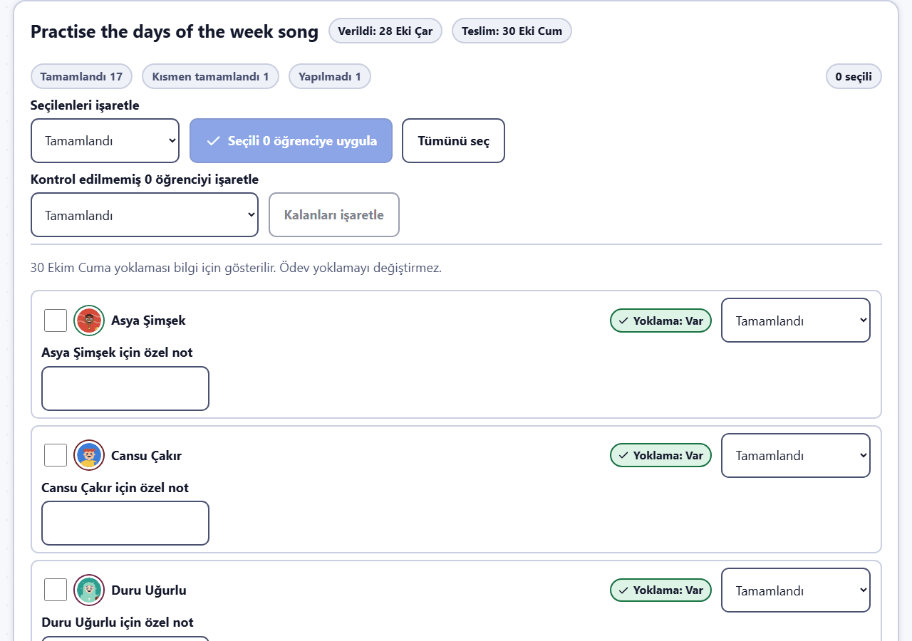

**Ödevler** sayfasında sınıfı ve dersi seçin.

- **Ödevler** sekmesi: başlık, ayrıntılar, **Verilme tarihi**, **Teslim tarihi** ve isteğe bağlı bir **Özel not** (yalnızca siz görürsünüz) ile **Ödev ekle**. Ödevlere **Gün**, **Hafta** ya da **Ay** olarak, teslim ya da verilme tarihine göre göz atın.
- **{title} kontrol et** kontrol listesini açar: öğrencileri seçin (ya da **Tümünü seç**), **Seçilenleri işaretle** ile durumu seçin ve **Seçili N öğrenciye uygula**'ya basın. **Kontrol edilmemiş N öğrenciyi işaretle** + **Kalanları işaretle** listeyi tamamlar. Bir toplu işlemi geri alabilir, her öğrenciye özel not ekleyebilirsiniz. O günün yoklaması yalnızca bilgi için gösterilir.
- **Eksikler**: yapılmadı ya da kısmen yapıldı olarak işaretlenen ödevleri listeler.
- **Ayarlar**: durumlar (yeni ödevler bu listeyi kullanır; mevcut ödevler kendi durumlarını korur) ve **Sınıf ekranında kontrole izin ver**.

İşaretlenmemiş bir öğrenci **Kontrol edilmedi** görünür, hiçbir zaman "Yapılmadı" değil.

## Hedefler, kanıtlar ve geri bildirim

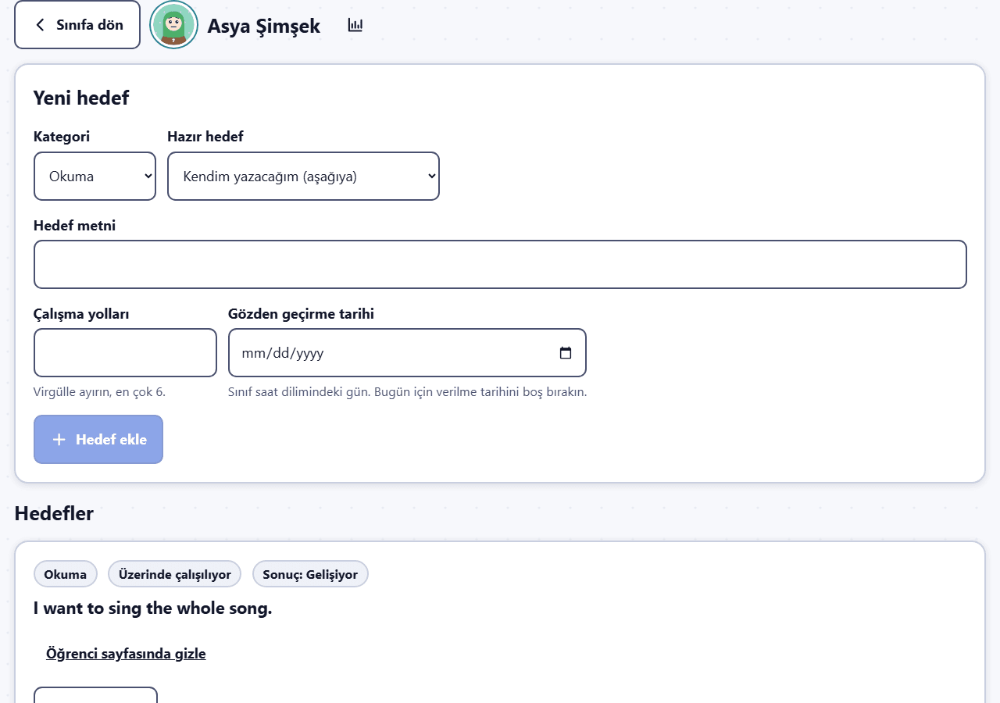

**Hedefler** sayfasında sınıfı ve dersi seçin. **Öğrenciler** sekmesi her öğrenciyi etkin hedefleri, ulaşılan hedefleri, kanıtları, son "ne kadar eminim" değeri ve son etkinliğiyle listeler. Öğrenciyi açmak için adına dokunun:

- **Yeni hedef**: bir **Kategori** ve bir **Hazır hedef** seçin ya da **Kendim yazacağım (aşağıya)**'yı seçip hedefi **Hedef metni**'ne yazın; **Çalışma yolları** (en fazla 6, virgülle ayrılmış) ve bir **Gözden geçirme tarihi** ekleyin.
- Her hedefte: **İlerleme notu**, **Sonucu kaydet** (dört sonuç adınız) ve öğrencinin kendi düşünceleri ve öz değerlendirmeleri ("Ne kadar eminsin?", 1–5). Öğrencinin öz değerlendirmesi ile sizin değerlendirmeniz her zaman ayrı tutulur.
- **Kanıtlar**: siz de kanıt ekleyebilirsiniz (öğrencinin sayfasında "Öğretmen" diye işaretlenir ve öğrenci değiştiremez): **Yaz**, **Bağlantı ekle**, **Belge ekle** ve yalnızca yöneticiniz izin verdiyse **Resim ekle**, **Fotoğraf çek**, **Sesimi kaydet** ve **Ses dosyası ekle**. **Kanıtı sil** kendi eklediğiniz kanıtı ve dosyasını siler.
- Bir hedefin üzerindeki **Kanıt ekle**, kanıt formunu o hedef için açar (örneğin öğrencinin sınıfta yaptığı bir çalışma kâğıdını belge olarak ekleyebilirsiniz). **Kanıtlar** listesi her kanıtın hangi hedef için olduğunu gösterir. Öğrenci fotoğraflarında okulun izin kuralları aynen geçerlidir: resmi yalnızca yöneticiniz fotoğraf kanıtına izin verdiyse ekleyin.
- **Öğrenciye geri bildirim**: bir hedef ya da **Bu dersteki tüm hedefler**'i seçin, yazın ve **Geri bildirimi kaydet**'e basın. Öğrenci bunu kendi sayfasında okur.
- **Konu göster** hedefleri ve kanıtları kategoriye göre süzer.
- **Öğrenci sayfasında gizle** bir öğrencinin hedefini, kaydını ya da kanıtını onun sayfasından gizler (örneğin bir yanlışlıktan sonra). Öğrencinin yazdıkları olduğu gibi saklanır ve değişiklik kayda geçer.

**Kategoriler ve hazır hedefler** sekmesinde okulun varsayılan kategorileri ve hedefleri ile sizinkiler bulunur. **Arşivle** bir varsayılanı yalnızca sizin sınıflarınızda gizler (diğer öğretmenler etkilenmez); **Geri getir** geri getirir. "Okul tarafından arşivlendi" yazanları yönetici arşivlemiştir. **Yeniden adlandır** her kategoriye yeni bir ad verir; o dersteki sınıflarınızın her dili için bir kutu vardır. Varsayılan bir kategorinin yeni adı yalnızca sizindir: sınıflarınız, öğrenci sayfaları, ders konuları ve raporlar bu adı gösterir, hedefler aynı kategoride kalır, diğer öğretmenler okulun verdiği adı görmeye devam eder (**Sizin verdiğiniz ad** etiketiyle; **Okulun adını kullan** eski ada döner). **Sonuç adları**, bir hedefi değerlendirirken kullandığınız dört adı belirler.

### Cümle başlangıçları

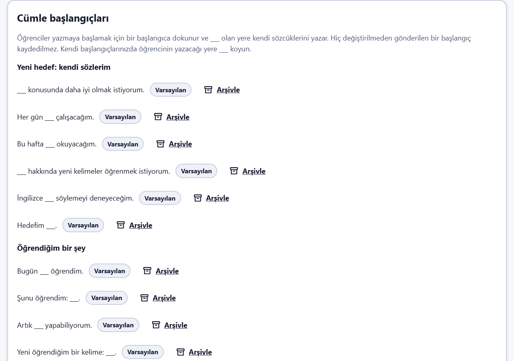

Öğrenciler kendi sayfalarında yazmaya başlamak için bir **cümle başlangıcına** dokunabilir, örneğin "___ konusunda daha iyi olmak istiyorum." Başlangıç kutuya yerleşir, ___ seçili gelir ve öğrenci onun yerine kendi sözcüklerini yazar. Hiç değiştirilmeden gönderilen bir başlangıç kaydedilmez; öğrenciden cümlesini bitirmesi istenir.

**Cümle başlangıçları** listesi **Kategoriler ve hazır hedefler** sekmesindedir. Sınıf Pusulası'nda öğrencilerin yazdığı her yer için İngilizce ve Türkçe hazır başlangıçlar vardır (**Öğrencilerin gördüğü yer**: yeni hedefte kendi sözcükleri ve çalışma fikirleri, "Nasıl gidiyor?", "Öğrendiğim bir şey", "Kendime not" ve "Çalışmamı göster" adımları).

- **Yeni cümle başlangıcı**: öğrencilerin nerede göreceğini, isterseniz yalnızca hangi kategorideki hedefler için olduğunu seçin; başlangıcı İngilizce ve/veya Türkçe yazın, öğrencinin yazacağı yere ___ koyun ve **Cümle başlangıcı ekle**'ye basın. Sınıf Pusulası, ___ yerine bir sözcük konduğunda başlangıcın nazik ve gerçek bir cümle olup olmadığını denetler.
- **Arşivle** hazır bir başlangıcı yalnızca sizin sınıflarınızda gizler; **Geri getir** geri getirir. Yöneticinin arşivlediği başlangıçlar bütün okulda kaldırılmıştır.

Bir öğrenci kaba bir sözcük ya da anlamsız bir şey yazdığında Sınıf Pusulası nazikçe değiştirmesini ister ve metni kaydetmez. Bkz. [Nazik sözcük denetimi](#nazik-sözcük-denetimi).

## Özel notlar

Bir öğrencinin hedef sayfasındaki **Özel notlar** yalnızca sizin içindir. Öğrenciye, sınıf ekranında ya da diğer öğretmenlere hiçbir zaman gösterilmez. Şunu bilin: yalnızca yöneticilerin alabildiği **tüm okul verisi dışa aktarımı** bu notları da içerir. Tek bir öğrencinin verisinin dışa aktarımı içermez.

## Öğrenci bağlantıları ve kart yazdırma

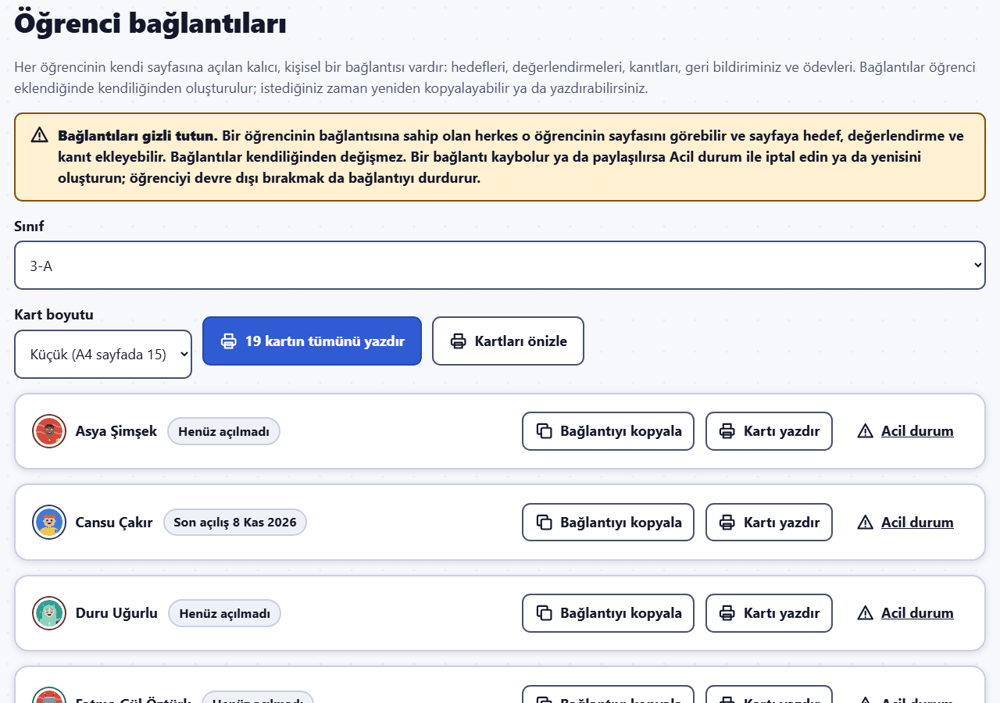

Her öğrencinin kendi sayfasına (hedefleri, değerlendirmeleri, kanıtları, sizin geri bildiriminiz, ödevleri, başarıları ve avatarı) giden **kalıcı, kişisel bir bağlantısı** vardır. Bağlantılar öğrenci eklendiğinde kendiliğinden oluşur.

**Öğrenci bağlantıları** sayfasında sınıfı seçin. Her öğrenci için **Bağlantıyı kopyala**, QR kodu göster ya da **Kartı yazdır**. Tarayıcı kendisi kopyalayamadığında (örneğin https olmayan bir okul ağında) bağlantı küçük bir pencerede seçili olarak açılır; elle kopyalayabilirsiniz. **Tüm kartları yazdır** bütün sınıfı A4'e basar: **Küçük (A4 sayfada 15)** ya da **Büyük (A4 sayfada 8)**; **Kartları önizle** önce gösterir. QR kodlar her temada beyaz üzerine siyahtır.

> **Bağlantıları gizli tutun.** Bir öğrencinin bağlantısına sahip olan herkes o öğrencinin sayfasını görebilir, sayfaya hedef, değerlendirme ve kanıt ekleyebilir. Bağlantılar kendiliğinden değişmez.

**Acil durum** (bir bağlantı ya da kart kaybolduğunda, paylaşıldığında ya da görmemesi gereken birinin eline geçtiğinde):

1. Öğrencinin yanındaki **Acil durum**'a basın.
2. **Bağlantıyı iptal et (yeni bağlantı yok)** ya da **Yeni bağlantı oluştur**'u seçin.
3. Bir **Neden** yazın, onaylamak için öğrencinin adını soyadını yazın ve **Bağlantıyı iptal et** ya da **Yeni bağlantı oluştur**'a basın.

Eski bağlantı ve basılmış bütün kartlar hemen çalışmaz olur. Listede ardından "Bağlantı … tarihinde iptal edildi" ya da "… tarihinde yeni bir bağlantı oluşturuldu" yazar; böylece eski kartları toplayabilirsiniz. İşlem denetim kaydına geçer. Bir öğrenciyi pasifleştirmek de bağlantısını durdurur.

## Başarılar ve avatarlar

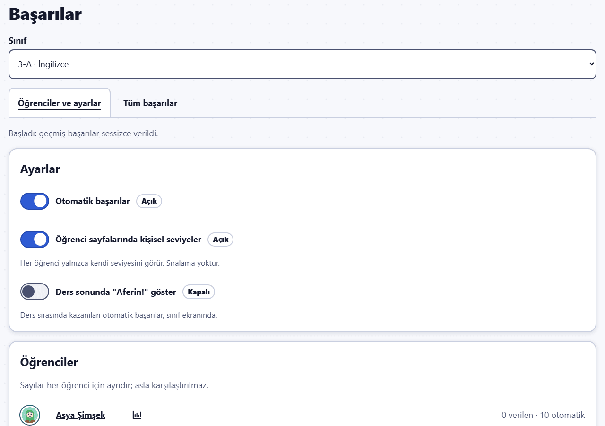

**Başarılar** sayfasında sınıfı ve dersi seçin.

**Öğrenciler ve ayarlar**

- İlk seferde Sınıf Pusulası **Başarılar nasıl başlasın?** diye sorar: **Geçmiş başarıları sessizce ver** (bugünden önce yapılan çalışmalar için başarılar, kutlama olmadan) ya da **Bugünden itibaren başla**. Seçim yapmadan önce de istediğiniz zaman elle başarı verebilirsiniz.
- **Otomatik başarılar**, **Öğrenci sayfalarında kişisel seviyeler** (her öğrenci yalnızca kendi seviyesini görür; hiçbir sıralama yoktur) ve **Ders sonunda "Aferin!" göster**.
- Bir öğrenciye başarı verin ya da yanlışlıkla verilmiş bir başarıyı bir nedenle **Kaldır**ın (geçmişte saklanır). Otomatik başarılar öğrencinin yaptıklarına göre gelir ve elle kaldırılamaz.

**Tüm başarılar**: bütün başarılar türlerine göre gruplanmış (hedefler, kanıtlar, ödev…; açmak için bir gruba dokunun), her birinin seviyesi (Bronz, Gümüş, Altın) adının yanında. **Kendi başarınızı oluşturun**: bir ad, ne için verildiği, bir resim, bir seviye ve **Nasıl verilir** (**Öğretmen verir** ya da "5 kez kanıt ekler" gibi bir kuralla **Otomatik**). **Sınıflarımda gizle** hazır bir başarıyı sizin sınıflarınızda gizler; **Yeniden göster** geri getirir.

Başarılar çabayı ödüllendirir: hiçbiri devama, hıza ya da öğrencileri karşılaştırmaya bağlı değildir ve öğrenci sayfası yalnızca öğrencinin kendi başarılarını ve seviyesini gösterir. Başarılar sınıf ekranında yalnızca siz birini kutladığınızda ya da sınıf **Aferin!** adımını gösterdiğinde görünür.

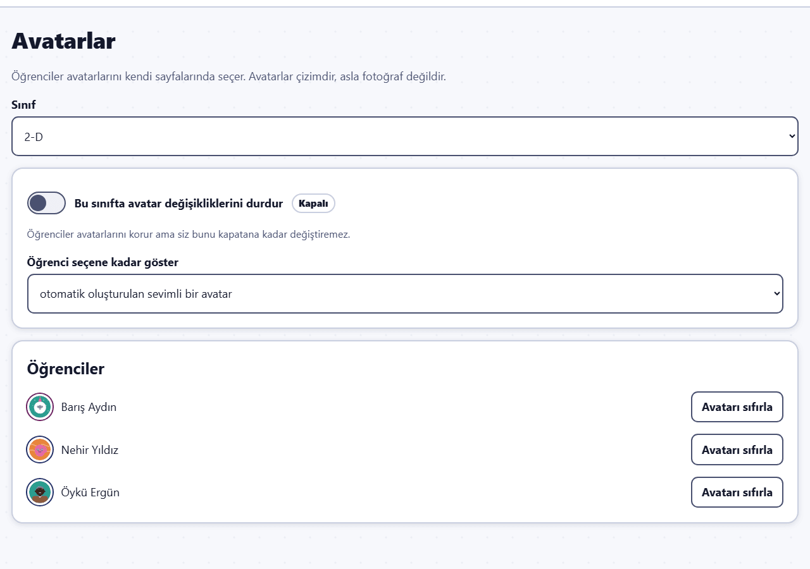

**Avatarlar**: öğrenciler avatarlarını kendi sayfalarında seçer; avatarlar çizimdir, hiçbir zaman fotoğraf değildir. **Avatarlar** sayfasında şunları yapabilirsiniz:

- **Bu sınıfta avatar değişikliklerini durdur** (öğrenciler avatarlarını korur ama değiştiremez);
- **Öğrenci seçene kadar göster**: **otomatik oluşturulan sevimli bir avatar** ya da **baş harfler**;
- bir öğrenci için **Avatarı sıfırla** (yazarak onaylarsınız; öğrenci yeniden seçene kadar otomatik avatarı görür);
- **Öğrenciler kendi resimlerini gönderebilir** seçeneğini açabilirsiniz (varsayılan olarak kapalı; yalnızca yönetici kendi resimlerini okul genelinde açtıysa). Avatar değişikliklerine ara verirseniz yeni resim de gönderilemez.

**Avatar resimleri** (öğretmen menüsünde, bakılacak sayısıyla): öğrencilerinizin avatar olarak gönderdiği resimler. Siz evet diyene kadar resmi başka kimse görmez.

- **Bakılacak**: en eskisi önce, silinmesine ne kadar kaldığıyla (kimsenin bakmadığı resim 14 gün sonra silinir). **Evet, kullansın**'dan önce **Öğrencinin ya da tanıdığı birinin fotoğrafı değil. Ünlüler, karakterler ve çizimler olur.** kutusunu işaretleyin. **Bu olmaz** nedenini sorar (**Tanıdığı gerçek biri**, **Kırıcı ya da uygun değil**, **Bir isim ya da yer gösteriyor**, **Net görünmüyor**): öğrenci nedeni görür, resim hemen silinir.
- **Kullanımda**: öğrencilerin şu an kullandığı resimler. **Kaldır** resmi hemen siler; öğrencinin avatarı geri gelir.

Onaylanan resimler diğer yüklemeler gibi okulun yedeklerinde tutulur; eski yedeklerdeki kopyalar o yedeklerin süresi dolunca gider. Bildirimleriniz bekleyen bir resmi haber verebilir (**Bakılacak kendi resimleri**, kapatılabilir).

### Nazik sözcük denetimi

**Nazik sözcük denetimi** sayfası öğrenci metinlerinin nasıl denetlendiğini açıklar. **Sınıflarımda engellediğim sözcükler** alanına sözcük ekleyebilirsiniz (satır başına bir). **Öğrenciler kaba sözcük denediğinde bana söyle** (varsayılan olarak kapalı) yalnızca her öğrencinin kaç kez denediğini gösterir; sözcüklerin kendisi hiçbir zaman saklanmaz.

## Sınıf ayarları

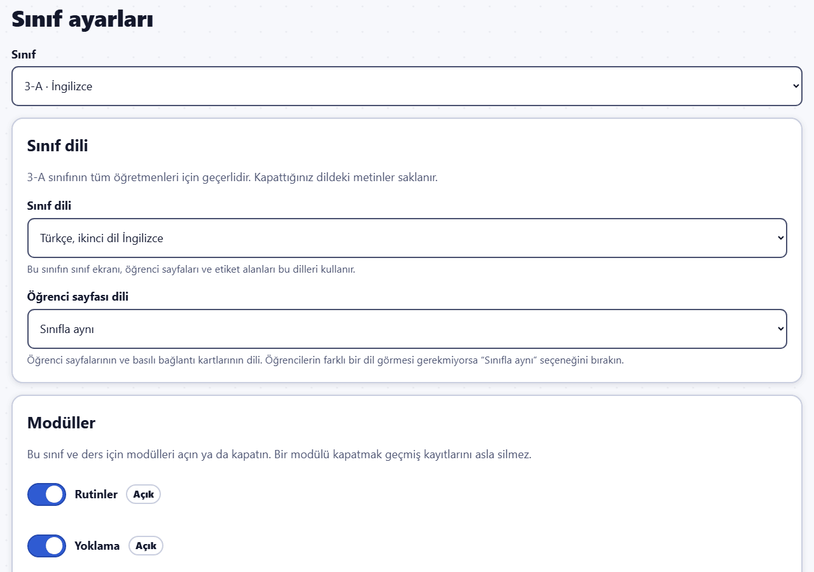

Üstten sınıfı ve dersi seçin.

- **Sınıf dili**: **Yalnızca İngilizce**, **Yalnızca Türkçe**, **İngilizce, ikinci dil Türkçe** ya da **Türkçe, ikinci dil İngilizce**. Bu sınıfın sınıf ekranı, öğrenci sayfaları ve ad alanları için, sınıfın bütün öğretmenlerinde geçerlidir. Kapattığınız dildeki metinler silinmez. Her ad alanı (rutinler ve aşamaları, sayaçlar, ödev durumları, hedefler, gruplar, yardımcı görevleri, ders konuları) sınıfın her dili için bir kutu gösterir, önce ana dil; **Çeviri gerekli**, diğer dilde metni olan ama kendisi hâlâ boş olan kutuyu işaretler (siz doldurana kadar sınıf diğer dili görür). **Hedefler** sayfasındaki **Kategoriler ve hazır hedefler** sekmesi (yeni kategoriler, hazır hedefler ve kendi cümle başlangıçlarınız) o dersteki bütün sınıflarınızın dillerini gösterir, çünkü oraya eklediğiniz her şey bu sınıfların hepsinde görünür. Yeni bir sınıfın hazır metinleri (yardımcı görevleri, İngilizce hatırlatma sayacı, grup adları) sınıfın dillerinde yazılır; ikinci bir dili açtığınızda hiç değiştirmediğiniz metinlere o dil de eklenir. **Öğrenci sayfası dili** sınıftan farklı olabilir (örneğin İngilizce bir sınıfta Türkçe öğrenci sayfaları); aksi hâlde **Sınıfla aynı** kalsın.
- **Modüller**: bu sınıf ve ders için modülleri açın ya da kapatın. "Yöneticiniz tarafından kapatıldı" yazan modülü açamazsınız. Bazı modüllerin ayarları anahtarın altında görünür (Sayaçlar: hatırlatma kutuları; Gruplama: grup ekranında büyük harf; Gizli Öğrenciler: kaç öğrenci seçileceği; Ödevler ve Hedefler ayarları). **Ders hedefleri** her sınıfta kapalı başlayan tek modüldür; her ders için bir hedef istediğiniz sınıflarda açın.
- **Sınıf ekranı**: tema, sesler ve ses düzeyi, animasyonlar, günün sözü ve süre bitince ne olacağı (bkz. [Sesler ve kutlamalar](#sesler-ve-kutlamalar)).

## Raporlar ve CSV

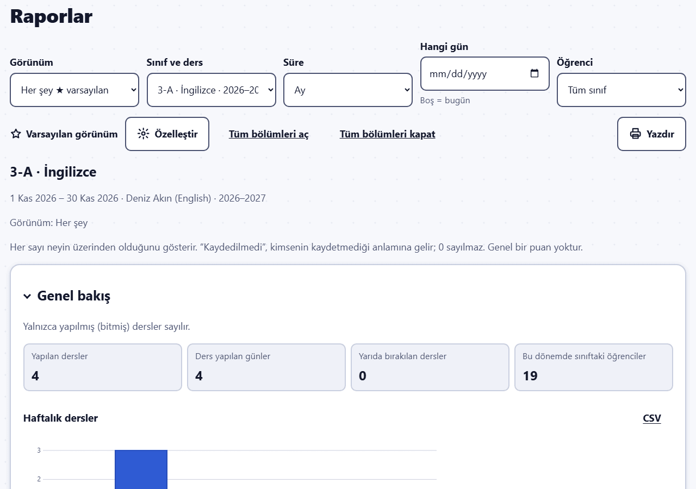

**Raporlar** sayfasında **Sınıf ve ders**'i, **Süre**'yi (**Gün**, **Hafta**, **Ay**, **Dönem**, **Öğretim yılı** ya da **Özel**) ve isterseniz tek bir **Öğrenci**'yi seçin (bu durumda onun **Zaman çizelgesi** de görünür). Bölümler modülleri izler: genel bakış, yoklama, sayaçlar, ödev, hedefler ve beceriler, değerlendirmeler, yardımcı, Gizli Öğrenciler, gruplama, başarılar, Süper Konuşmacılar, konular ve ders hedefleri. Her bölüm başlığından katlanabilir; **Tüm bölümleri aç** ve **Tüm bölümleri kapat** bunu bütün bölümler için yapar.

### Rapor görünümleri

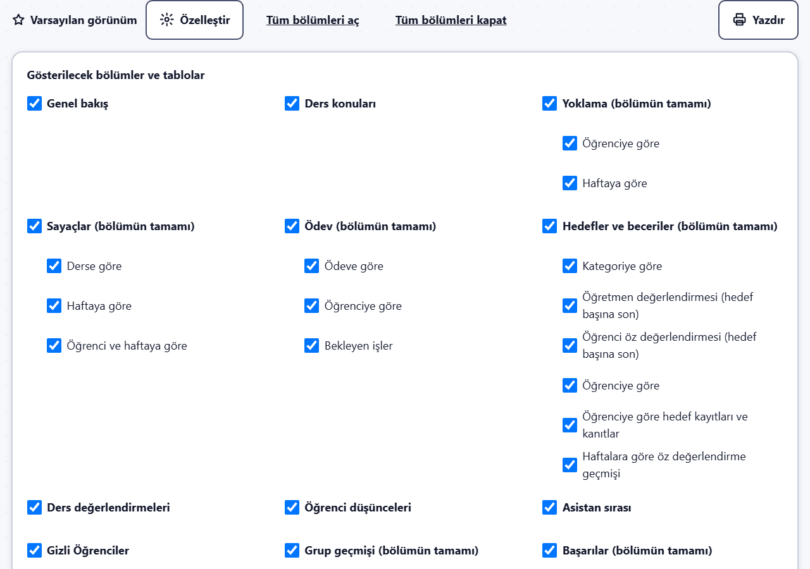

**Görünüm**, raporda hangi bölümlerin görüneceğini belirler; böylece rapor yalnızca gerekeni gösterir:

- Hazır görünümler: **Her şey**, **Yoklama ve ödevler**, **Hedefler ve düşünceler**, **Sınıf araçları**, **Başarılar ve Süper Konuşmacılar** ve **Öğrenci özeti** (her alanda öğrenci başına bir satır).
- **Özelleştir** bölümleri ve tablolarını listeler; göstermek istediklerinizi işaretleyin. Görünümün adının yanında "(değiştirildi, kaydedilmedi)" yazar. **Yeni görünüm olarak kaydet…** seçiminizi bir adla saklar (en çok 30 görünüm); **Değişiklikleri “…” görünümüne kaydet** kendi görünümünüzü günceller; **Değişiklikleri geri al** eski hâline döndürür; **Görünümü sil** yalnızca kaydedilmiş seçimi siler, rapor verisini asla. Görünüm yalnızca bölüm seçimini saklar; sınıfı, öğrenciyi ya da süreyi saklamaz.
- **Varsayılan yap**: ★ işaretli görünüm Raporlar sayfasında ilk açılan görünüm olur; giriş yaptığınız her cihazda.

Sayfanın adresi sınıfı, öğrenciyi, görünümü ve süreyi her zaman içerir. Bu yüzden bir yer imi ya da başka bir sayfadan gelen bağlantı (örneğin bir öğrencinin istatistiklerindeki **Raporun tamamını aç** ya da bir bildirimdeki **Aç**) aynı raporu yeniden açar.

- Her sayı neyin içinden olduğunu söyler. "Girilmedi", kimsenin kaydetmediği anlamına gelir ve hiçbir zaman 0 sayılmaz. Genel bir puan yoktur.
- Her tablonun altındaki **CSV** tabloyu elektronik tablo için indirir; **Yazdır** raporu A4'e basar.
- Yalnızca kendi sınıflarınızı ve derslerinizi görürsünüz, önceki yıllardakileri de; sona eren bir görevlendirme yalnızca o dersi verdiğiniz günleri kapsar.

## Öğrenci istatistikleri

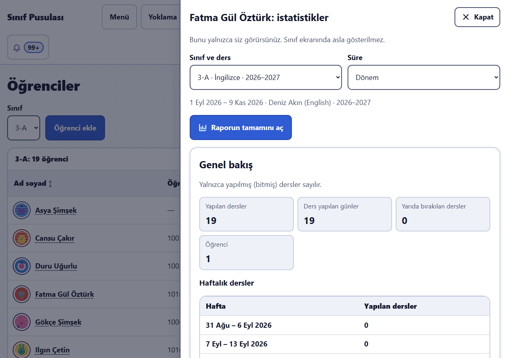

Öğretmen alanında bir öğrencinin **adı** hemen her yerde istatistiklerini açar: **Öğrenciler**, **Yoklama**, **Öğrenci bağlantıları**, **Avatarlar**, **Ödevler**, **Günün Yardımcısı**, **Gizli Öğrenciler**, **Nazik sözcük denetimi** sayfalarında ve her rapor tablosunda. Adın zaten başka bir işi olduğu yerlerde (**Hedefler** ve **Başarılar** sayfalarında öğrenciyi açar) yanındaki küçük **… için istatistikler** düğmesi istatistikleri açar.

İstatistik panelinde sınıf ve ders (öğrenci birden fazla sınıfınızdaysa başkasını seçebilirsiniz), bir süre, kısa bölümler hâlinde **Öğrenci özeti** raporu ve **Son olaylar** bulunur. **Raporun tamamını aç** o öğrenci için Raporlar sayfasını açar. Bu paneli yalnızca siz görürsünüz; sınıf ekranında asla gösterilmez. Orada bir ad yalnızca olumlu şeylerin yer aldığı küçük kartı açar (bkz. [Sınıf ekranında öğrenci kartı](#sınıf-ekranında-öğrenci-kartı)).

## Bildirimler

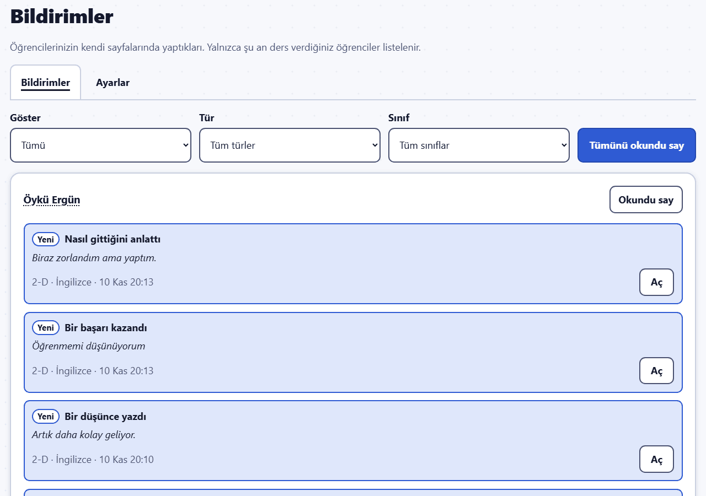

Öğretmen menüsündeki ve bağlantı satırındaki **zil**, öğrencilerinizin kendi sayfalarında yaptığı yeni şeylerin sayısını gösterir: yeni ya da değiştirilmiş hedefler, ulaşılan hedefler, düşünceler, notlar, öz değerlendirmeler, gösterdikleri çalışmalar (yazı, bağlantı, resim, belge, ses), kazanılan başarılar, değiştirilen avatarlar, bir öğrenci bağlantısının yeni bir cihazda açılması, nazik sözcük denetiminin durdurduğu metinler (yalnızca sayı) ve Süper Konuşmacılar puanları (günde bir satır). Yalnızca şu an ders verdiğiniz öğrenciler ve açık olan modüller yer alır.

**Bildirimler** sayfasında:

- Satırlar öğrenciye göre gruplanır. **Göster** (**Tümü** ya da **Yalnızca yeniler**), **Tür** ve **Sınıf** ile süzün. Varsa öğrencinin yazdığından kısa bir parça görünür; gizlenen, silinen ya da durdurulan metin asla görünmez.
- **Aç** sizi doğru sayfaya, sınıf ve öğrenci seçili olarak götürür (öğrencinin hedefleri, başarıları, rapor…). **Okundu say** bir öğrencinin satırlarını okundu sayar; **Tümünü okundu say** (süzgeç açıkken **Bunları okundu say**) kalanları.
- **Ayarlar** sekmesi: **Zilin altında neler görünsün** (istediğiniz türleri işaretleyin) ve **Günlük e-posta**: seçtiğiniz saatten sonra **Bana günlük e-posta gönder**. E-posta yalnızca kaç yeni şey beklediğini söyler; **E-postada öğrencilerin adlarını yaz** her öğrencinin adını sayısıyla birlikte ekler. Öğrencilerin yazdıkları e-postada asla yer almaz. Günlük e-posta için hesabınızda bir e-posta adresi olmalı ve okul e-posta gönderebilmelidir; biri eksikse sekme bunu söyler.

## Asistan

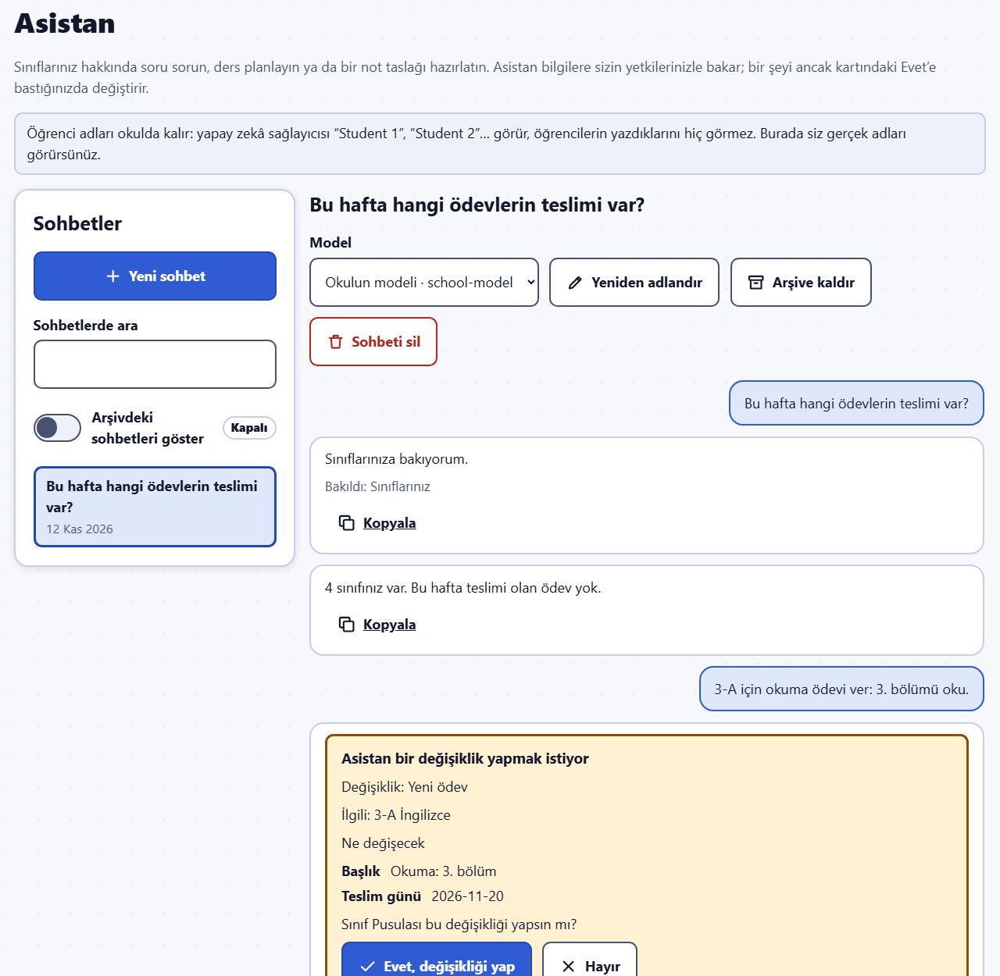

**Asistan** (öğretmen menüsü → Bugün), sınıflarınız hakkında bir yapay zekâ modeliyle sohbettir: hangi ödevlerin teslimi geldiğini sorun, bir raporu özetletin, ders konularını planlayın ya da veliler için bir not taslağı hazırlatın. Yalnızca bir yönetici açtıysa ve okulun yapay zekâ araçları açıksa çalışır; değilse sayfa nedenini söyler. Sınıf bilgisayarında önce PIN sorulur; asistan hiçbir zaman sınıf ekranında ya da bir öğrencinin sayfasında yer almaz.

- **Yeni sohbet** bir sohbet başlatır; soldaki listede (telefonda: **Tüm sohbetler**) **Sohbetlerde ara**, **Arşivdeki sohbetleri göster** ve kaldığınız yerden sürdürebileceğiniz eski sohbetler bulunur. Sohbetin içinde: **Yeniden adlandır**, **Arşive kaldır** (ya da arşivden çıkar) ve **Sohbeti sil**. **Model**, okulunuzun (izin varsa sizin) kurduğu bağlantılardan birini seçer.
- Yanıt yazılırken görünür; **Durdur** yanıtı keser (yazılan kısım kalır, durduruldu diye işaretlenir). "Bakıldı: Sınıf listesi (3-A İngilizce)" gibi satırlar asistanın sizin için neye baktığını söyler; asistan sizin yetkilerinizle okur, fazlasıyla değil.
- **Siz istemeden hiçbir şey değişmez.** Asistan bir şeyi değiştirmek istediğinde (ödev vermek, hedef yazmak, geri bildirim eklemek…) bir kart gösterir: ne değişecek, hangi sınıf ya da öğrenci için; altında **Evet, değişikliği yap** ve **Hayır**. Değişikliği yalnızca Evet yapar; kartta gösterildiği gibi ve bir kez. Kart bir metni tam kaydedileceği gibi ve bir listenin her öğesini (örneğin tüm ödev işaretlerini) gösterir; sizin sınıflarınızdan ya da öğrencilerinizden biri olmayan bir değişiklikte bunu söyler, değişiklik reddedilir. Kartı yanıtlamadan yeni bir mesaj yazarsanız kart yanıtsız kalır ve hiçbir şey değişmez. Değişiklikler denetim kaydında adınızla, "yapay zekâ aracı üzerinden" diye yer alır.
- Bir yanıtın altındaki **Kopyala** onu kopyalar. Sınıf Pusulası velilere ya da başka birine hiçbir şey göndermez: veli notu, kopyalayıp kendinizin gönderdiği bir taslaktır.
- **Yapay zekâ sağlayıcısı ne görür:** okulunuz öğrenci adlarını okulda tutarken sağlayıcı "Student 1", "Student 2"… görür, öğrencilerin yazdıklarını hiç görmez; siz sayfada gerçek adları görürsünüz. Sohbetin üstündeki satır hangisinin geçerli olduğunu söyler. Yanıtları öneri olarak görün ve denetleyin.
- Sohbetleriniz size özeldir: yöneticiler onları okuyamaz. Son mesajdan bir öğretim yılı sonra silinirler (yöneticiniz süreyi değiştirebilir). **Sohbetlerimi indir** hepsini gerçek adlarla bir dosya olarak kaydeder.

Okuldan neyin çıktığı hakkında daha fazlası: [Yapay zekâ araçları](ai-tools.md#asistan-sohbeti).

## Öğrenciler ve öğrenci listesi aktarma

**Öğrenciler** sayfasında sınıfınıza öğrenci ekleyebilir, fotoğraf ekleyebilir (yalnızca yönetici öğrenci fotoğraflarına izin verdiyse; izin alındığını siz onaylarsınız) ve **Bu sınıftan çıkar** diyebilirsiniz. Telefonda her öğrenci, düğmesi altta olan bir karttır. Öğrencileri pasifleştirmek ve silmek yöneticinin işidir.

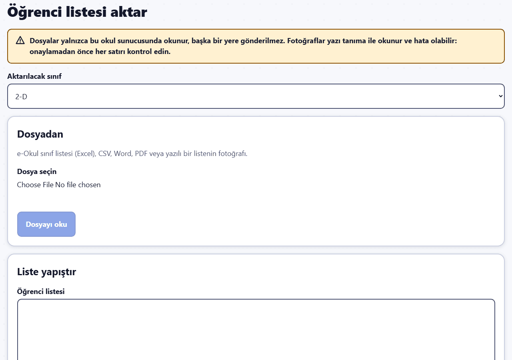

**Öğrenci listesi aktar** bütün sınıfı tek seferde ekler:

1. **Aktarılacak sınıf**'ı seçin.
2. **Dosyadan**: bir e-Okul sınıf listesi (Excel), CSV, Word, PDF ya da yazılı bir listenin fotoğrafı; ardından **Dosyayı oku**. Ya da **Liste yapıştır**: her satıra bir öğrenci, örneğin "1203 Ayşe Nur Kara"; Excel'den kopyalanan satırlar da olur.
3. Birden fazla sayfası olan bir çalışma kitabı **Hangi sayfalar okunsun?** diye sorar; en büyük sayfa sizin için işaretlenir. **Seçilen sayfaları oku**'ya basın.
4. **Listeyi kontrol edin**: **Sütunlar** altında hangi sütunun ad, numara ya da sınıf olduğunu kontrol edin. Dikkat isteyen satırlar işaretlenir (örneğin "Mevcut bir öğrenci olabilir"). Her biri için **Yeni öğrenci olarak ekle**, **Mevcut öğrenci** ya da **Atla**'yı seçin.
5. **Onayla: N ekle, M eşleştir**'e ya da **Sonra devam et**'e basın.

**Birden fazla sınıflı liste** (sınıf sütunu olan bir okul listesi): önce **Bu listede birden fazla sınıf var** seçeneğini açın. **Bu listedeki sınıflar** dosyadaki her sınıfı satır sayısıyla gösterir. Kendi sınıflarınız nasıl yazılmış olursa olsun tanınır (3/A, 3-A, 3 A, "3. Sınıf / A Şubesi"); diğer sınıflar **Sınıflarınızdan biri değil** diye işaretlenip atlanır, çünkü yalnızca derse girdiğiniz sınıflara aktarabilirsiniz. **N sınıfın önizlemesini hazırla**'ya basın, sonra her sınıfı **kontrol edip** yukarıdaki gibi onaylayın. Her sınıfın kendi raporu ve kendi **Aktarmayı geri al** düğmesi vardır. Dosyada iki sınıfınızın altında yer alan bir öğrenci **Bu listede başka bir sınıfta da var** diye işaretlenir: ilk kayıt için sizin seçiminiz gerekir, sonraki kayıtlar atlanır. Önce onayladığınız bir sınıf, aynı listedeki başka bir sınıfta bir adla eşleşirse o sınıfı onaylamaya çalıştığınızda satır işaretlenir ve kararı siz verirsiniz.

Aslında bir web sayfası olan .xls dosyası da (bazı okul sistemleri listeleri böyle kaydeder) okunur: yalnızca tablosundaki yazılar.

Dosyalar yalnızca okulun kendi sunucusunda okunur. Fotoğraflar metin tanıma ile okunur ve hata olabilir: her satırı kontrol edin. Adlar tam yazıldığı gibi saklanır. **Önceki aktarmalar** aktarmalarınızı listeler; **Aktarmayı geri al** (sınıfın adını yazarak) bir aktarmanın eklediği öğrencileri siler ya da o zamandan beri onlar için bir şey kaydedildiyse pasifleştirir.

## Öğretmen alanının diğer sayfaları

- **Yoklama** (Bugün): sınıflarınızın herhangi bir günü, notlar ve derse özel durumlarla; kimin neyi kaydettiği.
- **Ders konuları** (Sınıf kurulumu → Ders araçları): haftalık plan (günde en fazla 3 konu) ve simgeli kendi konularınız.
- **Rutinler** (Sınıf kurulumu → Ders araçları): rutinleriniz ve aşamaları ile her sınıfın rutini. Süren bir ders kendi rutiniyle devam eder.
- **Sayaçlar**, **Günün Yardımcısı**, **Gizli Öğrenciler**, **Gruplar** (Sınıf kurulumu → Ders araçları): bu modüllerin ayarları ve geçmişi.
- **Yapay zekâ araçları** (**Profil ve PIN** içinde; yalnızca yöneticiniz yapay zekâ araçlarını açtıysa): kişisel anahtarlar ve bağlı yapay zekâ uygulamaları. Bkz. [Yapay zekâ araçları kılavuzu](ai-tools.md).

## Yardım

Öğretmen menüsündeki **Yardım** bu kılavuzları arayüz dilinizde açar. Üstteki **English | Türkçe** kılavuzu ve kılavuz listesini diğer dile çevirir. Telefonda kılavuz listesi kılavuzun üstünde tek satıra katlanır (**Kılavuzlar: …**); başka bir kılavuz açmak için ona dokunun. Bir resmi tam boyutta açmak için resme dokunun. Yöneticinizin kendi [yönetici kılavuzu](admin.md) vardır; öğrenciler ve veliler için de ayrı bir [kılavuz](student.md) bulunur.
